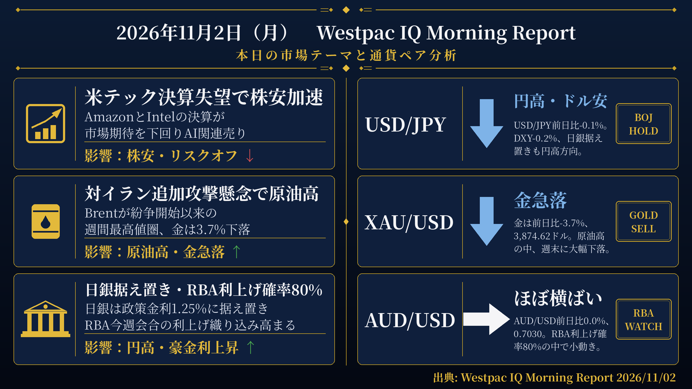
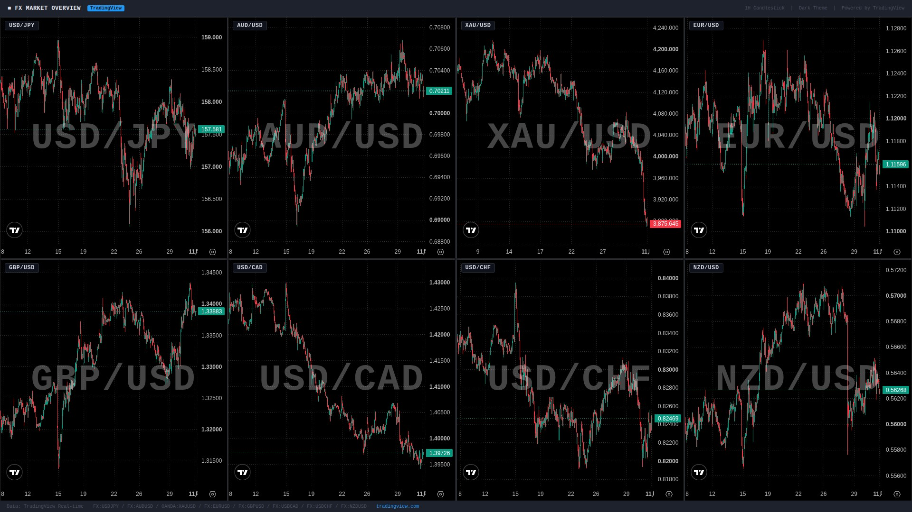

検証結果: **PASS** ／ モード: LIVE ／ 生成: 2026-11-02T08:02:48+09:00

## 本日の投稿素材
- 生成物フォルダ: https://github.com/MFlab-inc/westpac-morning-report/tree/main/outputs/2026-11-02
- レポート画像（投稿1に添付）: https://github.com/MFlab-inc/westpac-morning-report/raw/main/outputs/2026-11-02/report_image.png
- チャート画像（投稿2に添付）: https://github.com/MFlab-inc/westpac-morning-report/raw/main/outputs/2026-11-02/charts_1h.jpg

## 1. レポート画像（X投稿1に添付）


## 2. チャート画像（X投稿2に添付）


## 3. X投稿1（コピー用｜加重文字数 422）
```text
【11/2(月) 朝の為替市況】

■米テック株
→AmazonとIntelの決算が市場予想を下回りAI関連売りが加速
→S&P500は1.8%安、NASDAQは2.9%安、VIXは12.9%上昇

■原油・金
→Brentは2.4%高の118ドルと紛争開始以来の週間最高値圏
→WTIは2.1%高の104.12ドル
→金は3.7%安の3,874.62ドルと4,000ドルを大きく割り込む

■日銀・RBA
→日銀は政策金利1.25%に据え置き、インフレ上振れリスクを示唆
→スワップ市場は今週RBA会合の利上げ確率を80%と織り込む

#ドル円 #日銀
```

## 4. X投稿2（コピー用｜加重文字数 687）
```text
【通貨別分析 11/2】

#USDJPY 157.49 ↓ 円高・ドル安
根拠：前日比-0.1%。DXY-0.2%、米2年債・10年債利回りがともに1bp低下する中、日銀がインフレ上振れリスクを示唆。

#AUDUSD 0.7030 → ほぼ横ばい
根拠：前日比0.0%。RBA今週会合の利上げ確率80%が意識される中、DXY-0.2%、豪3年・10年債利回りは5bp低下。

#XAUUSD 3874.62 ↓ 金急落
根拠：前日比-3.7%。原油価格が上昇する中、金は4,000ドルを大きく割り込んで週を終えた。

#EURUSD 1.1158 ↓ ユーロ安
根拠：前日比-0.2%。ユーロ圏第3四半期GDP速報値は0.4%増と予想（0.2%増）を上回ったが、ユーロは小幅安。DXYも0.2%低下。

#GBPUSD ↑ ポンド高
根拠：ポンドは対ドルで0.1%上昇。DXY-0.2%、英FTSE100は0.1%の小幅高。

出典: Westpac IQ Morning Report 2026/11/02
#ドル円 #為替
```

## 5. レポート本文
<details><summary>クリックで全文を表示</summary>

# 2026年11月2日（月） Westpac IQ Morning Report

## 1. ファンダメンタルズ・マクロ経済分析

週末にかけてリスクオフムードが強まった。米国では、AmazonとIntelの決算が市場予想を下回り、AI関連銘柄を中心に売りが加速。S&P 500は1.8%下落し、週間では0.6%安となった。NASDAQは2.9%の下落となり、ダウ・ジョーンズも1.1%安。VIX指数は12.9%上昇し19.42となった。欧州ではユーロ・ストックス50が1.2%下落した一方、英FTSE100は0.1%の小幅高。アジアでは半導体需要見通しへの懸念からKOSPIが3.5%下落、日経平均も2.1%安となった。香港ハンセン指数は1.5%上昇し逆行高。豪ASX200は0.2%上昇し、週間では1.3%の上昇となった。

米国債はリスク回避の動きに支援される形で買われたが、原油価格の上昇がその勢いを抑えた。2年債・10年債利回りはともに1bp低下。12月FRB利上げの確率は73%、年末の政策金利の織り込みは4.06%となっている。日銀は政策金利を1.25%に据え置いたが、インフレの上振れリスクを示唆したことで10年JGB利回りは6bp低下した。豪州国債は前日の世界的な債券高に追随し、3年債・10年債利回りがともに5bp低下。スワップ市場は今週のRBA会合での利上げ確率を80%、12月の利上げをほぼ確実視しており、年末の政策金利の織り込みは4.85%となっている。

原油は米国によるイランへの追加攻撃の可能性を市場が織り込む形で上昇。Brentは2.4%高の118ドル（週間では紛争開始以来の最高値圏）、WTIは2.1%高の104.12ドルとなった。一方、金は3.7%下落し3,874.62ドルと4,000ドルを大きく割り込んで週を終えた。銅は1.4%、アルミニウムは0.3%それぞれ下落し、鉄鉱石も0.7%安となった。

国際経済指標では、米雇用コスト指数（ECI）が第3四半期に予想どおり0.8%増加（第2四半期は0.9%増）。内訳では賃金・給与が0.7%増、福利厚生費が0.9%増。民間部門では賃金・給与0.8%増・福利厚生費0.9%増と第2四半期とほぼ同水準。公共部門は第3四半期に賃金・給与0.6%増・福利厚生費0.7%増と、第1・第2四半期の好調から鈍化した。ユーロ圏の第3四半期GDP成長率（速報値）は0.4%増と予想（0.2%増）を上回り、前年比成長率は1.3%に上昇した。国別ではスペインが0.6%増と牽引し、ドイツは0.2%増、イタリアは横ばい、フランスは0.1%減。アイルランドは5.5%増と好調を維持した。ユーロ圏の失業率は8月分が6.5%に上方修正され、9月は6.5%で横ばいとなった。

FRBメンバーからは追加利上げを支持する発言が相次いだ。バーキン氏は「方向性は明確で、問題はペースだ。段階的なアプローチが望ましい」と述べた。ローガン氏は「現在の見通しを踏まえると、FOMCは少なくともあと2回の25bpの利上げを実施する必要がある」と発言。ミュサレム氏は「追加的な金融引き締めが必要であり、それは近い将来だ」と述べた。

豪州の国内データでは、9月の民間部門信用が前月比0.6%増加。住宅ローン（特に投資家向け）の伸びが鈍化した一方、事業向け信用は比較的底堅さを維持した。

## 2. テクニカル分析と本日の展望

### USD/JPY ― 下落（↓）

現値：157.49（前日比-0.1%）。DXYが0.2%低下する中、USD/JPYも小幅に下落した。日銀が政策金利を1.25%に据え置いたものの、インフレの上振れリスクを示唆したことで10年JGB利回りが6bp低下した。米2年債・10年債利回りもそれぞれ1bp低下しており、金利環境は円にとってやや支援的な状況となっている。本日はRBA会合を控え、豪州関連の動向も注目される。

### AUD/USD ― 横ばい（→）

現値：0.7030（前日比0.0%）。AUDはドルに対してほぼ変わらず推移した。スワップ市場が今週のRBA会合での利上げ確率を80%と織り込む中、豪州の金利見通しが意識されている。一方、米テック株の大幅下落に伴うリスクオフムードや、DXYの0.2%低下が交錯する形となった。豪州3年・10年国債利回りはともに5bp低下した。

### XAU/USD ― 下落（↓）

現値：3,874.62（前日比-3.7%）。金は大幅に下落し、4,000ドルを大きく割り込んで週を終えた。原油価格が上昇する中、金は週末にかけて3.7%の下落となった。銅も1.4%下落するなど、コモディティ市場全体でも弱い動きが見られた。変動性の高い展開が続いており、引き続き原油動向や地政学リスクの推移が注目される。

### EUR/USD ― 下落（↓）

現値：1.1158（前日比-0.2%）。ユーロは対ドルで0.2%下落した。ユーロ圏の第3四半期GDP成長率（速報値）は0.4%増と予想（0.2%増）を上回ったものの、ユーロは小幅安となった。ユーロ圏失業率は8月分が6.5%に上方修正、9月も6.5%で横ばい。DXYも0.2%低下する中、ユーロ自身の対ドル変化は-0.2%となった。

### GBP/USD ― 上昇（↑）

原文のFXレート表にGBP/USDの現値の記載なし。原文に「sterling gained 0.1%」と記載されており、ポンドは対ドルで0.1%上昇したと判断する。DXYが0.2%低下する中、ポンドは小幅に上昇した。英FTSE100は0.1%の小幅高となり、欧州株が総じて軟調だった中で相対的に底堅さを示した。

## 3. 本日の重要イベント

| 時刻(JST) | 国 | イベント | 予想 | 前回 |
|---|---|---|---|---|
| 9:00 | AU | MI インフレーション・ゲージ（10月） | - | 4.8% |
| 9:30 | AU | 住宅建設承認件数（9月） | 2.0% | -6.1% |
| 9:30 | JP | S&Pグローバル製造業PMI（10月確報値） | - | 53.3pts |
| 10:45 | CN | RatingDog製造業PMI（10月） | 52pts | 52.1pts |
| 18:00 | EZ | S&Pグローバル製造業PMI（10月確報値） | 52.4pts | 52.4pts |
| 18:30 | GB | S&P製造業PMI（10月確報値） | 52.8pts | 52.8pts |
| 23:45 | US | S&P製造業PMI（10月確報値） | 56pts | 56pts |
| 0:00(翌日) | US | ISM製造業景況指数（10月） | 54.5pts | 54.5pts |
| 0:00(翌日) | US | 建設支出（9月） | 0.4% | 0.9% |

出典: Westpac IQ Morning Report 2026/11/02

</details>

## 6. 機械検証ゲート
| ゲート | 判定 | 詳細 |
|---|---|---|
| G1 日付整合 | ✅ PASS | date_jst=2026-11-02 / 本文に「2026年11月2日」/ 投稿2と本文に「2026/11/02」を要求 |
| G2 暗号通貨語の混入ゼロ | ✅ PASS |  |
| G3 対象5ペア限定 | ✅ PASS |  |
| G4 プレースホルダ残存なし | ✅ PASS |  |
| G5 出典表記（本文・投稿2） | ✅ PASS |  |
| G6 規定ハッシュタグ | ✅ PASS |  |
| G7 投稿にURLなし（Intent URL禁止） | ✅ PASS |  |
| G8 数値のPDF原文照合 | ✅ PASS | 13個の数値を照合しすべて原文に存在 |
| G9 イベント時刻JST換算チェック | ✅ PASS | 時差2時間で換算した期待値['00:00', '09:00', '09:30', '10:45', '18:00', '18:30', '23:45']と本文イベント表['00:00', '09:00', '09:30', '10:45', '18:00', '18:30', '23:45']が一致 |
| G10 投稿2に「未確認」を含めない | ✅ PASS |  |
| I1 post1 加重文字数 | ℹ️ INFO | 422 |
| I2 post2 加重文字数 | ℹ️ INFO | 687 |
| I3 post1 →行の読点過多 | ℹ️ INFO | 5行目 読点2個 |

## 7. 投稿手順（方式A：手動投稿）
- [ ] 画像2枚と投稿文を確認した
- [ ] 投稿1をXへ投稿した（レポート画像を添付）
- [ ] 投稿2をXへ投稿した（チャート画像を添付）
- [ ] このIssueをCloseした（＝投稿完了の記録）

---
生成物: [`outputs/2026-11-02/`](https://github.com/MFlab-inc/westpac-morning-report/tree/main/outputs/2026-11-02) ／ 元PDF: https://library.westpaciq.com.au/content/dam/public/westpaciq/secure/economics/documents/aus/2026/11/WBC_MorningReport02Nov2026.pdf
修正したい場合はこのIssueにコメントを残し、翌日以降の改善に反映します（フェーズ2で再生成コマンドに対応予定）。