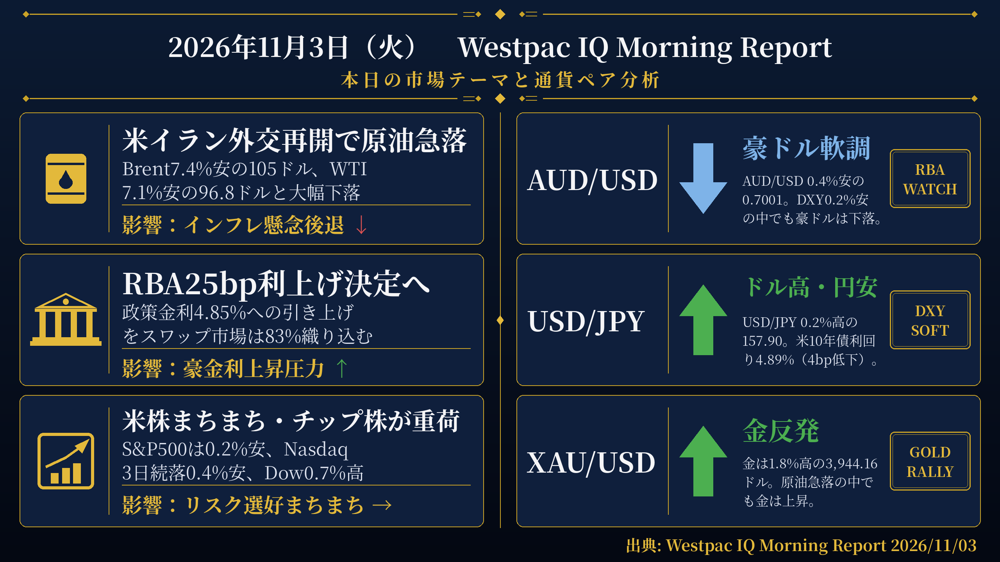
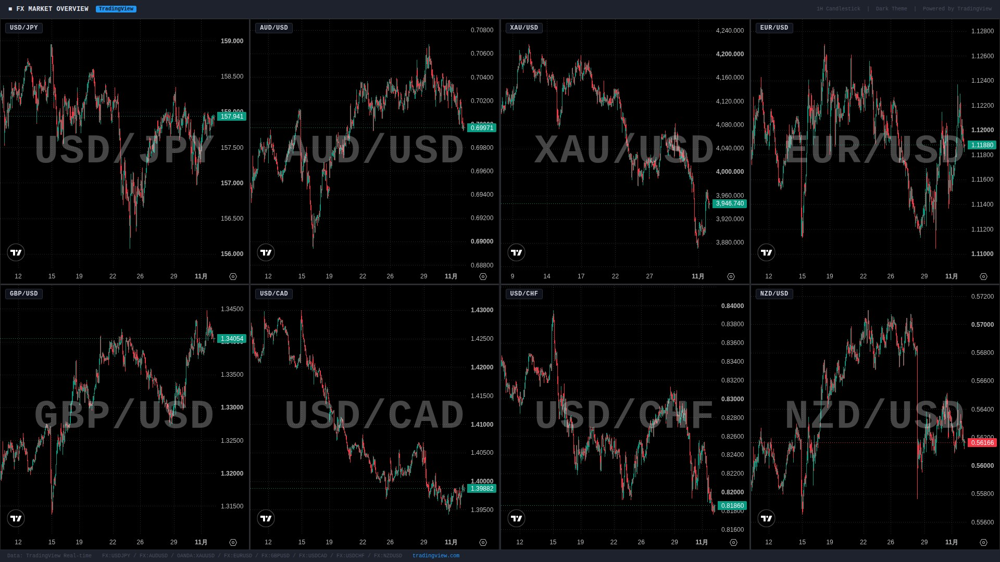

検証結果: **PASS** ／ モード: LIVE ／ 生成: 2026-11-03T08:02:54+09:00

## 本日の投稿素材
- 生成物フォルダ: https://github.com/MFlab-inc/westpac-morning-report/tree/main/outputs/2026-11-03
- レポート画像（投稿1に添付）: https://github.com/MFlab-inc/westpac-morning-report/raw/main/outputs/2026-11-03/report_image.png
- チャート画像（投稿2に添付）: https://github.com/MFlab-inc/westpac-morning-report/raw/main/outputs/2026-11-03/charts_1h.jpg

## 1. レポート画像（X投稿1に添付）


## 2. チャート画像（X投稿2に添付）


## 3. X投稿1（コピー用｜加重文字数 492）
```text
【11/3(火) 朝の為替市況】

■原油急落
→米イラン外交再開の期待でBrentが7.4%安の105ドル
→WTIも7.1%安の96.8ドルと大幅下落
→インフレ懸念が後退し米10年債利回りは4bp低下して4.89%

■RBA政策決定
→本日12:30に政策金利を4.60%から4.85%へ25bp引き上げ予想
→スワップ市場は83%の確率で利上げを織り込み
→更新された経済見通しも公表予定で政策見通しへの注目高い

■米国株
→S&P500は0.2%安、Nasdaqは3日続落で0.4%安
→半導体株の軟化が重荷となる一方、Dowは0.7%高
→欧州株はユーロ・ストックス50が0.7%高と堅調

#ドル円 #RBA
```

## 4. X投稿2（コピー用｜加重文字数 742）
```text
【通貨別分析 11/3】

#USDJPY 157.90 ↑ ドル高・円安
根拠：円は対ドルで0.2%下落。DXYは0.2%低下して101.72となる中、米10年債利回りは4bp低下して4.89%。

#AUDUSD 0.7001 ↓ 豪ドル軟調
根拠：豪ドルは対ドルで0.4%下落。DXYが0.2%低下する中でも豪ドルは軟化。本日RBAの政策決定（4.85%への利上げ予想）が予定されている。

#XAUUSD 3,944.16 ↑ 金反発
根拠：金は1.8%上昇。原油価格がBrent7.4%安・WTI7.1%安と大幅下落する中、金は上昇した。米10年債利回りは4bp低下して4.89%。

#EURUSD 1.1195 ↑ ユーロ高
根拠：ユーロは対ドルで0.3%上昇。DXYは0.2%低下して101.72。10年独国債利回りは3bp低下して3.29%。

#GBPUSD ↑ ポンド高
根拠：ポンドは対ドルで0.2%上昇。10年英国債利回りは9bp低下して5.19%。DXYは0.2%低下して101.72。

出典: Westpac IQ Morning Report 2026/11/03
#ドル円 #為替
```

## 5. レポート本文
<details><summary>クリックで全文を表示</summary>

# 2026年11月3日（火） Westpac IQ Morning Report

## 1. ファンダメンタルズ・マクロ経済分析

米国とイランが交渉への意欲を示したことで地政学的リスクプレミアムが一部巻き戻され、原油価格が大幅に下落した。イランの最高指導者が米国との協議を求める政府要請を承認したと伝えられ、外交的解決への期待が高まった。Brent先物は7.4%下落して105ドル/バレル、WTIは7.1%下落して96.8ドル/バレルとなった。金は1.8%上昇して3,944.16ドル/オンスとなり、鉄鉱石・アルミニウム・銅もそれぞれ0.5%・0.8%・1.3%上昇した。

原油価格の下落がインフレ懸念を和らげ、米国債利回りは低下した。2年債利回りは1bp低下し、10年債利回りは4bp低下して4.89%となった。欧州債利回りも低下し、10年独国債利回りは3bp低下、10年英国債利回りは9bp低下した。一方、オーストラリア国債利回りはRBAの2日間の政策会合開始を受けて小幅上昇し、3年債・10年債ともに2bp上昇した。

米国株式市場はまちまちの展開となった。原油安が当初は株式市場を押し上げたものの、半導体株の再度の軟化がS&P500とNasdaqの重荷となった。S&P500は0.2%安、Nasdaqは3日続落で0.4%安となった一方、ダウ・ジョーンズは0.7%高となった。欧州株はユーロ・ストックス50が0.7%高、FTSE100が0.3%高と堅調だった。アジア株はまちまちで、半導体株の反発でKospiが2.2%高となった一方、日経225は0.3%安、ASX200は0.6%安となった。中国CSI300は金融規制当局が資本市場支援策を検討しているとの週末報道を受けて0.8%上昇し、ハンセン指数は0.4%上昇した。

国際経済指標では、米ISM製造業指数が10月に54.5から55.5へ上昇した。新規受注は0.2ポイント上昇して55.5、雇用指数は0.3ポイント低下して52.4、仕入価格指数は2.7ポイント低下して75.2となった。S&Pグローバル製造業PMI（米国）の10月確報値は56.0から54.9へ下方修正されたが、ISM調査と概ね整合的な水準を維持した。米建設支出は9月に1.9%減少し、上方修正された8月の2.0%増を打ち消した。

国内では、オーストラリアの住宅建設承認件数が9月に前月比5.1%増加したが、年間ペースは−0.8%と縮小圏に転じた。増加は民間集合住宅承認の変動的な上昇が主因で、民間戸建て住宅の大幅な減少を相殺した。Cotality住宅価格指数は10月に前月比1.2%下落し、年間成長率は−2.8%となり、3月のピークから6.7%下落した。

本日の最大の注目点はRBAの政策決定で、政策金利を4.60%から4.85%へ25bp引き上げることが広く予想されている。スワップ市場は本日の利上げを83%の確率で織り込んでおり、年末までに1回の利上げが完全に織り込まれ、インプライドの政策金利は4.86%に達している。今回の決定には更新された経済見通しも伴う予定で、政策見通しに関するガイダンスとして注目される。また、米国では本日から中間選挙の投票が始まる。世論調査では民主党が下院を制する軌道にあるとされる一方、上院の支配権は依然として不透明な状況にある。

## 2. テクニカル分析と本日の展望

### USD/JPY ― 上昇（↑）

現値は157.90（前日比+0.2%）。円は対ドルで0.2%下落した。米ドル指数（DXY）は0.2%低下して101.72となった中でも、USD/JPYは上昇した。米10年債利回りは4bp低下して4.89%となり、日本の10年債利回りは2.78%で変化なし。本日はRBAの政策決定が主要イベントとなるが、米中間選挙の動向も引き続き注目される。

### AUD/USD ― 下落（↓）

現値は0.7001（前日比−0.4%）。豪ドルは対ドルで0.4%下落した。DXYが0.2%低下する中でも豪ドルは軟化し、0.7001の水準となった。本日のRBA政策決定（4.85%への25bp利上げが広く予想）および更新された経済見通しが豪ドルの方向性を左右する可能性がある。スワップ市場は本日の利上げを83%の確率で織り込んでいる。

### XAU/USD ― 上昇（↑）

現値は3,944.16ドル/オンス（前日比+1.8%）。金は1.8%上昇した。原油価格が大幅に下落する中、金は上昇した。鉄鉱石・アルミニウム・銅も上昇するなど、コモディティ市場は原油以外では総じて堅調だった。米国債利回りの低下も市場の背景として存在した。

### EUR/USD ― 上昇（↑）

現値は1.1195（前日比+0.3%）。ユーロは対ドルで0.3%上昇した。DXYが0.2%低下する中、欧州通貨は堅調に推移した。欧州株はユーロ・ストックス50が0.7%高と堅調で、10年独国債利回りは3bp低下して3.29%となった。

### GBP/USD ― 上昇（↑）

原文のFXレート表にGBP/USDの現値の記載なし。原文に「sterling up 0.2%」と直接記載されているため、これを根拠としてGBP/USDは上昇（↑）と判断する。ポンドは対ドルで0.2%上昇した。10年英国債利回りは9bp低下して5.19%となった。欧州通貨全般が堅調に推移する中、ポンドも上昇した。

## 3. 本日の重要イベント

| 時刻(JST) | 国 | イベント | 予想 | 前回 |
|---|---|---|---|---|
| 6:45 | NZ | 建設許可件数（9月） | - | 5.6% |
| 12:30 | AU | RBA政策金利決定 | 4.85% | 4.60% |
| 12:30 | AU | RBA金融政策声明 | - | - |
| 0:00（翌日） | US | JOLTS求人件数（9月） | 7,155千件 | 7,079千件 |
| 0:00（翌日） | US | 製造業受注（9月） | 1.2% | 0.1% |
| 0:00（翌日） | US | 耐久財受注（9月確報） | 1.8% | 1.8% |

出典: Westpac IQ Morning Report 2026/11/03

</details>

## 6. 機械検証ゲート
| ゲート | 判定 | 詳細 |
|---|---|---|
| G1 日付整合 | ✅ PASS | date_jst=2026-11-03 / 本文に「2026年11月3日」/ 投稿2と本文に「2026/11/03」を要求 |
| G2 暗号通貨語の混入ゼロ | ✅ PASS |  |
| G3 対象5ペア限定 | ✅ PASS |  |
| G4 プレースホルダ残存なし | ✅ PASS |  |
| G5 出典表記（本文・投稿2） | ✅ PASS |  |
| G6 規定ハッシュタグ | ✅ PASS |  |
| G7 投稿にURLなし（Intent URL禁止） | ✅ PASS |  |
| G8 数値のPDF原文照合 | ✅ PASS | 16個の数値を照合しすべて原文に存在 |
| G9 イベント時刻JST換算チェック | ✅ PASS | 時差2時間で換算した期待値['00:00', '06:45', '12:30']と本文イベント表['00:00', '06:45', '12:30']が一致 |
| G10 投稿2に「未確認」を含めない | ✅ PASS |  |
| I1 post1 加重文字数 | ℹ️ INFO | 492 |
| I2 post2 加重文字数 | ℹ️ INFO | 742 |
| I3 post1 →行の読点過多 | ℹ️ INFO | なし |

## 7. 投稿手順（方式A：手動投稿）
- [ ] 画像2枚と投稿文を確認した
- [ ] 投稿1をXへ投稿した（レポート画像を添付）
- [ ] 投稿2をXへ投稿した（チャート画像を添付）
- [ ] このIssueをCloseした（＝投稿完了の記録）

---
生成物: [`outputs/2026-11-03/`](https://github.com/MFlab-inc/westpac-morning-report/tree/main/outputs/2026-11-03) ／ 元PDF: https://library.westpaciq.com.au/content/dam/public/westpaciq/secure/economics/documents/aus/2026/11/WBC_MorningReport03Nov2026.pdf
修正したい場合はこのIssueにコメントを残し、翌日以降の改善に反映します（フェーズ2で再生成コマンドに対応予定）。