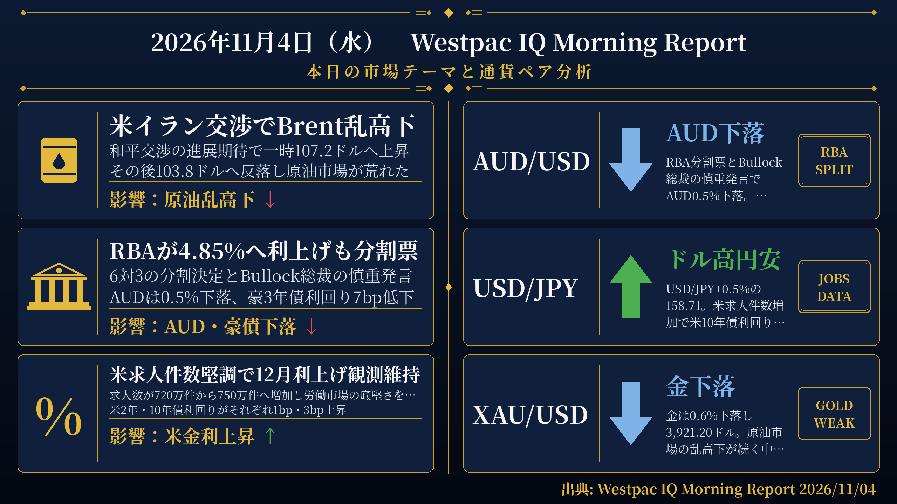
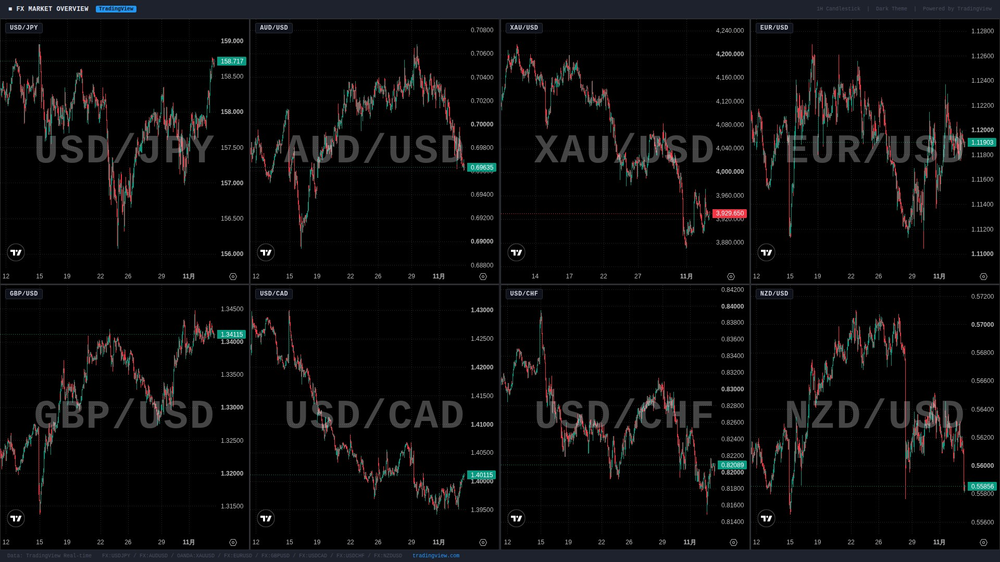

検証結果: **PASS** ／ モード: LIVE ／ 生成: 2026-11-04T08:23:12+09:00

## 本日の投稿素材
- 生成物フォルダ: https://github.com/MFlab-inc/westpac-morning-report/tree/main/outputs/2026-11-04
- レポート画像（投稿1に添付）: https://github.com/MFlab-inc/westpac-morning-report/raw/main/outputs/2026-11-04/report_image.png
- チャート画像（投稿2に添付）: https://github.com/MFlab-inc/westpac-morning-report/raw/main/outputs/2026-11-04/charts_1h.jpg

## 1. レポート画像（X投稿1に添付）


## 2. チャート画像（X投稿2に添付）


## 3. X投稿1（コピー用｜加重文字数 359）
```text
【11/4(水) 朝の為替市況】

■RBA利上げ
→政策金利を4.85%へ引き上げも6対3の分割決定
→Bullock総裁の慎重発言でAUDは0.5%下落
→豪3年債利回りは7bp低下

■米求人件数
→9月の求人件数が720万件から750万件へ増加
→米10年債利回りが3bp上昇し12月FRB利上げ確率80%を維持

■原油市場
→Brentは米イラン交渉報道で107.2ドルへ上昇後に103.8ドルへ反落
→WTIは0.2%安の96.28ドル

#ドル円 #RBA
```

## 4. X投稿2（コピー用｜加重文字数 781）
```text
【通貨別分析 11/4】

#USDJPY 158.71 ↑ ドル高・円安
根拠：USD/JPYは前日比0.5%上昇。米求人件数が720万件から750万件へ増加し、米10年債利回りが3bp上昇する中での動き。

#AUDUSD 0.6964 ↓ AUD下落
根拠：AUD/USDは前日比0.5%下落。RBAが6対3の分割票で4.85%へ利上げし、Bullock総裁が慎重な姿勢を示す中、豪3年債利回りも7bp低下した。

#XAUUSD 3921.20 ↓ 金下落
根拠：金は前日比0.6%下落。原油市場が米イラン交渉をめぐるヘッドラインで乱高下し、銅も2.2%下落する中での動き。

#EURUSD 1.1191 → 横ばい
根拠：EUR/USDは前日比0.0%とほぼ変わらず。ユーロ圏株式はユーロ・ストックス50が0.5%安となる一方、10年独国債利回りは4bp上昇した。

#GBPUSD ↑ ポンド小幅高
根拠：ポンドは対ドルで0.1%上昇。10年英国債利回りは明日のイングランド銀行決定を前に7bp上昇した。

出典: Westpac IQ Morning Report 2026/11/04
#ドル円 #為替
```

## 5. レポート本文
<details><summary>クリックで全文を表示</summary>

# 2026年11月4日（水） Westpac IQ Morning Report

## 1. ファンダメンタルズ・マクロ経済分析

本日の市場は、米国・イラン交渉をめぐる目まぐるしいヘッドラインに翻弄された原油相場の乱高下、RBAの分割利上げ決定、そして米国の堅調な労働市場データという3つのテーマが中心となった。

**原油・コモディティ：** Brentは米イラン和平交渉への懐疑論や米軍のイラン関連施設への攻撃報道を受けて一時107.2ドル/バレルへ上昇したが、その後両国が仲介案を検討しているとの報道やイラン最高指導者が「交渉不可能」としていた問題への追加権限付与を示したとの報道を受けて103.8ドル/バレルへ反落した。WTIは0.2%安の96.28ドル/バレルで引けた。金は0.6%下落し3,921.20ドル/オンス。銅はAIへの懸念から2.2%下落し7週間ぶりの安値を付けた。鉄鉱石はギニアのシマンドゥ鉱山からの供給増加と中国鉄鋼メーカーへの生産抑制要請が重なる中、0.6%下落した。原料炭は1.0%安の258.00ドル/トン、一般炭は2.5%安の147.50ドル/トン。

**米国データ：** 米国の求人件数は9月に720万件から750万件へ増加し、求人率は4.3%から4.5%へ上昇した。離職率も1.9%から2.1%へ小幅上昇した一方、解雇率は上方修正された前月の1.1%から1.0%へ小幅低下した。求人件数・離職率はともに過去6〜12か月でサイクル低水準から持ち直しているが、過去5年平均を依然大きく下回っている。解雇率は安定している。米耐久財受注は9月に最終推計で1.9%増となった。コア財の受注増加率は速報値からほぼ変わらず0.6%だった。工場受注は9月に総合で1.8%、輸送除きで1.3%と、それぞれ予想をやや上回った。

**米国債・株式：** 米国債は堅調な求人件数データを受けて下落（利回り上昇）し、2年債利回りが1bp上昇、10年債利回りが3bp上昇した（いずれも原油価格下落を受けた早期の低下分を打ち消した）。先物市場は次回会合での利上げ確率を80%と織り込んでいる。ナスダックは0.7%上昇、S&P 500は0.4%上昇し、テック株が3日続落から反発した。一方、ダウ・ジョーンズはAppleの下落を相殺する材料に乏しく0.5%下落した。欧州市場は米イラン交渉の悪化を受けてユーロ・ストックス50が0.5%安、FTSE 100が1.1%安と軟調だった。アジア株はまちまちで、コスピが2週間ぶりの大幅安となる3.6%下落、CSI 300が0.2%下落した一方、ハンセン指数は0.6%上昇した。ASX 200はRBAの慎重姿勢を受けて0.3%上昇した。

**RBA決定：** RBAは政策金利を4.85%へ引き上げたが、6対3の分割決定となった。反対票を投じたメンバーは下方リスクをより重視した。Bullock総裁は会見で、5回の利上げ後に「状況を見極める」時期に来ているとし、直近の利上げ効果がまだ浸透していないと指摘した。これを受けて市場は追加利上げ期待を後退させ、スワップ市場は12月の利上げ確率を6%、来年の利上げ確率を約30%と織り込んでいる。豪3年債利回りは7bp低下、10年債利回りは5bp低下した。

**豪州家計支出：** 第3四半期の消費者パネル調査によると、燃料費の再上昇にもかかわらず家計支出は底堅く、前期比1.5%増となった。裁量的支出が0.9ポイント、燃料が0.3ポイントそれぞれ寄与した。

**欧州金利：** 10年独国債利回りは4bp上昇、10年英国債利回りは明日のイングランド銀行決定を前に7bp上昇した。

## 2. テクニカル分析と本日の展望

### USD/JPY ― 上昇（↑）

現値：158.71（前日比+0.5%）。米ドル指数（DXY）が0.1%上昇する中、USD/JPYは0.5%上昇した。米国の堅調な求人件数データを受けて米10年債利回りが3bp上昇し、12月FRB利上げの可能性が維持されている。円は対ドルで0.5%下落した。本日は米ADPや米ISMサービス業PMIなど複数の米国指標が予定されており、引き続き米金利動向が焦点となる。

### AUD/USD ― 下落（↓）

現値：0.6964（前日比-0.5%）。RBAが6対3の分割票で4.85%への利上げを決定したが、Bullock総裁の慎重な発言と分割票がAUDの重荷となった。DXYは0.1%上昇した。スワップ市場は12月の追加利上げ確率をわずか6%と織り込んでおり、近い将来の追加引き締め期待が大幅に後退している。豪3年債利回りは7bp低下した。本日は豪家計支出指標（9月）の発表が予定されている。

### XAU/USD ― 下落（↓）

現値：3,921.20ドル/オンス（前日比-0.6%）。金は0.6%下落した。原油市場が米イラン交渉をめぐるヘッドラインで乱高下する中での動きとなった。銅も2.2%下落し7週間ぶりの安値を付けるなど、コモディティ全般に軟調な展開だった。DXYは0.1%上昇した。

### EUR/USD ― 横ばい（→）

現値：1.1191（前日比0.0%）。ユーロは対ドルでほぼ横ばいとなった。欧州株はユーロ・ストックス50が0.5%安と軟調だった一方、10年独国債利回りは4bp上昇した。本日はユーロ圏のHICP速報値（10月）やS&Pグローバル・サービス業PMI確報値の発表が予定されている。

### GBP/USD ― 上昇（↑）

原文のFXレート表にGBP/USDの現値の記載なし。方向感の導出：原文のFXレート表にAUD/GBP（-0.6%）とAUD/USD（-0.5%）の前日比が記載されている。AUD/GBPが-0.6%、AUD/USDが-0.5%であることから、GBP/USDはAUD/USD÷AUD/GBPの変化として概算すると、(-0.5%)-(-0.6%)≒+0.1%の上昇と推定される。原文本文にも「ポンドは0.1%上昇した」と記載されており、これと整合する。10年英国債利回りは明日のイングランド銀行決定を前に7bp上昇した。本日はS&Pグローバル・サービス業PMI確報値（英国）の発表が予定されている。

## 3. 本日の重要イベント

| 時刻(JST) | 国 | イベント | 予想 | 前回 |
|---|---|---|---|---|
| 6:45 | NZ | 雇用統計 Q3 | 0.4% | 0.5% |
| 6:45 | NZ | 失業率 Q3 | 5.5% | 5.6% |
| 6:45 | NZ | 労働コスト指数 Q3 | 0.5% | 0.7% |
| 9:00 | NZ | ANZ商品価格指数 10月 | - | 0.6% |
| 9:30 | AU | 家計支出指標 9月 | 0.2% | 0.0% |
| 10:45 | CN | RatingDog総合PMI 10月 | - | 52.4pts |
| 10:45 | CN | RatingDogサービス業PMI 10月 | 51.6pts | 51.6pts |
| 18:00 | EZ | S&Pグローバル・サービス業PMI 10月確報 | 51.7pts | 51.7pts |
| 18:30 | GB | S&Pサービス業PMI 10月確報 | 53.1pts | 53.1pts |
| 19:00 | EZ | HICP 10月速報 | 4.0% | 3.8% |
| 22:15 | US | ADP雇用者数変化 10月 | 67k | 90k |
| 22:30 | US | 貿易収支 9月 | -1,079億ドル | -1,056億ドル |
| 23:45 | US | S&Pサービス業PMI 10月確報 | 57.9pts | 57.9pts |
| 翌0:00 | US | ISMサービス業景況指数 10月 | 54.8pts | 54.9pts |

出典: Westpac IQ Morning Report 2026/11/04

</details>

## 6. 機械検証ゲート
| ゲート | 判定 | 詳細 |
|---|---|---|
| G1 日付整合 | ✅ PASS | date_jst=2026-11-04 / 本文に「2026年11月4日」/ 投稿2と本文に「2026/11/04」を要求 |
| G2 暗号通貨語の混入ゼロ | ✅ PASS |  |
| G3 対象5ペア限定 | ✅ PASS |  |
| G4 プレースホルダ残存なし | ✅ PASS |  |
| G5 出典表記（本文・投稿2） | ✅ PASS |  |
| G6 規定ハッシュタグ | ✅ PASS |  |
| G7 投稿にURLなし（Intent URL禁止） | ✅ PASS |  |
| G8 数値のPDF原文照合 | ✅ PASS | 14個の数値を照合しすべて原文に存在 |
| G9 イベント時刻JST換算チェック | ✅ PASS | 時差2時間で換算した期待値['00:00', '06:45', '09:00', '09:30', '10:45', '18:00', '18:30', '19:00', '22:15', '22:30', '23:45']と本文イベント表['00:00', '06:45', '09:00', '09:30', '10:45', '18:00', '18:30', '19:00', '22:15', '22:30', '23:45']が一致 |
| G10 投稿2に「未確認」を含めない | ✅ PASS |  |
| I1 post1 加重文字数 | ℹ️ INFO | 359 |
| I2 post2 加重文字数 | ℹ️ INFO | 781 |
| I3 post1 →行の読点過多 | ℹ️ INFO | なし |

## 7. 投稿手順（方式A：手動投稿）
- [ ] 画像2枚と投稿文を確認した
- [ ] 投稿1をXへ投稿した（レポート画像を添付）
- [ ] 投稿2をXへ投稿した（チャート画像を添付）
- [ ] このIssueをCloseした（＝投稿完了の記録）

---
生成物: [`outputs/2026-11-04/`](https://github.com/MFlab-inc/westpac-morning-report/tree/main/outputs/2026-11-04) ／ 元PDF: https://library.westpaciq.com.au/content/dam/public/westpaciq/secure/economics/documents/aus/2026/11/WBC_MorningReport04Nov2026.pdf
修正したい場合はこのIssueにコメントを残し、翌日以降の改善に反映します（フェーズ2で再生成コマンドに対応予定）。