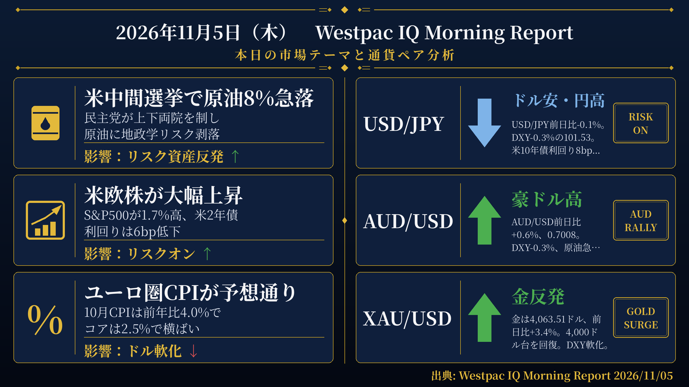
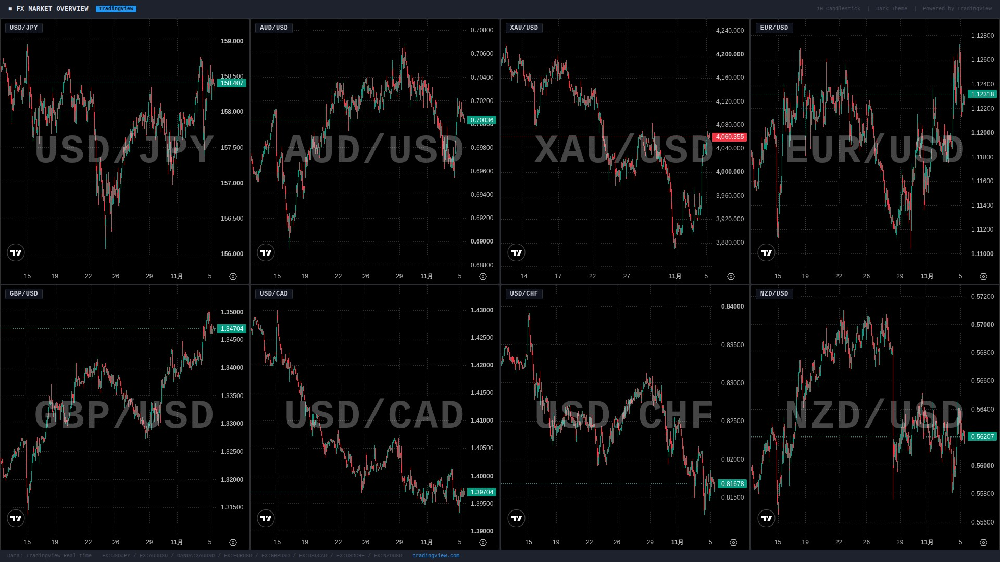

検証結果: **PASS** ／ モード: LIVE ／ 生成: 2026-11-05T08:02:53+09:00

## 本日の投稿素材
- 生成物フォルダ: https://github.com/MFlab-inc/westpac-morning-report/tree/main/outputs/2026-11-05
- レポート画像（投稿1に添付）: https://github.com/MFlab-inc/westpac-morning-report/raw/main/outputs/2026-11-05/report_image.png
- チャート画像（投稿2に添付）: https://github.com/MFlab-inc/westpac-morning-report/raw/main/outputs/2026-11-05/charts_1h.jpg

## 1. レポート画像（X投稿1に添付）


## 2. チャート画像（X投稿2に添付）


## 3. X投稿1（コピー用｜加重文字数 463）
```text
【11/5(木) 朝の為替市況】

■米中間選挙
→民主党が上下両院を制し、トランプ大統領はイラン再攻撃を計画せずと表明
→Brentが7.9%下落し95.4ドルと約2か月ぶりの安値
→WTI先物も7.6%下落し88.75ドル

■米欧株
→S&P500が1.7%高、ダウジョーンズが3.2%高、NASDAQが1.8%高
→ユーロ・ストックス50が2.0%高、英FTSE100が1.8%高
→VIX指数は19.2%低下し16.84

■米国債・金
→米2年債利回りが6bp低下し4.57%、米10年債利回りが8bp低下し4.89%
→金が3.4%上昇し4,063.51ドルと4,000ドル台を回復

#ドル円 #原油
```

## 4. X投稿2（コピー用｜加重文字数 728）
```text
【通貨別分析 11/5】

#USDJPY 158.48 ↓ ドル安・円高
根拠：前日比-0.1%。DXYが0.3%低下して101.53。米2年債利回りが6bp、10年債利回りが8bp低下。

#AUDUSD 0.7008 ↑ 豪ドル反発
根拠：前日比+0.6%で0.70ドルの節目を回復。DXYが0.3%低下し、S&P500が1.7%上昇する中、G10通貨の中でも強い上昇。

#XAUUSD 4,063.51ドル ↑ 金が大幅高
根拠：前日比+3.4%で4,000ドル台を回復。DXYが0.3%低下し、米実質利回りも低下する局面での上昇。

#EURUSD 1.1229 ↑ ユーロ高
根拠：前日比+0.3%。ユーロ圏10月CPIは前年比4.0%と予想通り。DXYが0.3%低下し主要G10通貨が対ドルで上昇。

#GBPUSD ↑ ポンド高
根拠：ポンドは対ドルで0.4%上昇。英10年債利回りが13bp低下し、FTSE100が1.8%上昇。本日イングランド銀行の政策決定を控える。

出典: Westpac IQ Morning Report 2026/11/05
#ドル円 #為替
```

## 5. レポート本文
<details><summary>クリックで全文を表示</summary>

# 2026年11月5日（木） Westpac IQ Morning Report

## 1. ファンダメンタルズ・マクロ経済分析

米中間選挙で民主党が上下両院を制した。副大統領はイランとの戦争が敗因と述べ、トランプ大統領はイランへの再攻撃を現時点では計画していないと表明した。これを受け、原油相場は選挙結果と大統領発言に反応し、Brentが7.9%下落してUS$95.4/bblと約2か月ぶりの安値を付けた。WTI先物も7.6%下落し88.75ドルとなった。原油の急落は地政学リスクプレミアムの巻き戻しとして市場に受け止められ、リスク資産全般が反発した。

米国株はS&P500が+1.7%、ダウジョーンズが+3.2%、NASDAQが+1.8%とそれぞれ上昇。欧州でもユーロ・ストックス50が+2.0%、英FTSE100が+1.8%と大幅高となった。アジア株は選挙結果が出る前の取引であったため、香港（+1.7%）・上海（+2.3%）・ソウル（+0.6%）が上昇した一方、東京は1.4%下落。ASX200も0.6%下落したが、夜間の動きを受けて先物は強い寄り付きを示唆している。

米国債は利回りが低下し、2年債が6bp低下して4.57%、10年債が8bp低下して4.89%となった。市場の利上げ織り込みは11月に約20bpが残り、2027年半ばまでにさらに1〜2回の利上げが見込まれており、今回の利回り低下はインフレリスクプレミアムの巻き戻しとして位置づけられる。独10年債利回りは6bp低下、英10年債利回りは13bp低下した一方、日本の10年国債利回りは4bp上昇した（夜間の価格変動に先行していたため）。豪州国債は現地取引中は横ばいだったが、夜間の先物取引で3年・10年ともに5bp低下した。RBAの今週の利上げが今サイクル最後になるとの見方が市場で50%超の織り込みとなっている。

DXYは0.3%低下して101.53となり、主要G10通貨は対ドルで上昇した。金はドル軟化と実質利回り低下を背景に3.4%上昇し、4,063.51ドルと4,000ドル台を回復した。LME銅は0.2%低下、アルミニウムは0.1%上昇と金属は概ね安定した動きだった。

**国際経済指標：** 米国の9月貿易収支は1,050億ドルの赤字と、小幅悪化の予想に対してやや良好な結果となった。輸出が1.9%増、輸入が1.2%増となった。米国のISMサービス業指数は10月に54.9から54.5へ小幅低下した。内訳では新規受注が59.8から55.9へ大幅に悪化した一方、雇用は50.1から51.4へ改善した。仕入れ価格は73.0と高水準で前月からほぼ変わらなかった。ユーロ圏の10月CPI（速報値）は前月比+0.4%・前年比+4.0%と予想通りの結果となり、9月の前年比3.8%から加速した。コアインフレは前年比2.5%で横ばいだった。

**国内経済指標：** 豪州の9月家計支出は名目ベースで前月比+0.6%となった。ただし価格上昇が寄与した面が大きく、実質ベースでは第3四半期に前期比+0.7%となった。ニュージーランドでは第3四半期の労働市場統計がWestpacおよびRBNZの予想を下回り、失業率が5.7%に上昇した。

## 2. テクニカル分析と本日の展望

### USD/JPY ― 下落（↓）

現値：158.48（前日比-0.1%）。DXYが0.3%低下して101.53となる中、円は対ドルで小幅に上昇した。米2年債利回りが6bp、10年債利回りが8bp低下しており、金利差縮小の動きが意識される局面となっている。原油急落を受けたリスクオンの流れの中でも、ドル安が円高方向に作用した。

### AUD/USD ― 上昇（↑）

現値：0.7008（前日比+0.6%）。豪ドルは0.70ドルの節目を回復した。DXYが0.3%低下し、株式市場がリスクオンの動きを見せる中、豪ドルはG10通貨の中でも強い上昇を示した。NZドルも0.6%上昇しており、オセアニア通貨全般に買いが入った。RBAの利上げが今サイクル最後との見方が市場で50%超の織り込みとなっており、今後の政策動向が引き続き注目される。

### XAU/USD ― 上昇（↑）

現値：4,063.51ドル（前日比+3.4%）。金は4,000ドルの節目を回復した。DXYの軟化と実質利回りの低下が重なる中、金は大幅に上昇した。原油急落後のリスクセンチメント改善の局面でも金は上昇しており、複数の要因が同時に動いている。

### EUR/USD ― 上昇（↑）

現値：1.1229（前日比+0.3%）。ユーロは対ドルで上昇した。ユーロ圏の10月CPIは前年比4.0%と予想通りの結果となり、コアは2.5%で横ばいだった。DXYが0.3%低下する中、ユーロを含む主要G10通貨が対ドルで上昇した。独10年債利回りは6bp低下した。

### GBP/USD ― 上昇（↑）

原文のFXレート表にGBP/USDの現値の記載はない。ただし原文に「Sterling (+0.4%)」と直接記載されており、ポンドは対ドルで0.4%上昇したと確認できる。英10年債利回りは13bp低下し、FTSE100は1.8%上昇した。本日はイングランド銀行の政策決定（予想4.00%、前回3.75%）が予定されており、ポンドの動向に注目が集まる。

## 3. 本日の重要イベント

| 時刻(JST) | 国 | イベント | 予想 | 前回 |
|---|---|---|---|---|
| 9:30 | AU | 貿易収支 9月 | 10億ドル | 4億9,500万ドル |
| 9:30 | JP | S&Pグローバル・サービス業PMI 10月確報値 | - | 52pt |
| 19:00 | EZ | 生産者物価指数 9月 | 2.6% | 1.9% |
| 21:00 | GB | イングランド銀行 政策金利決定 | 4.00% | 3.75% |
| 22:30 | US | 労働生産性 第3四半期速報値 | 2.6% | 1.4% |
| 22:30 | US | 新規失業保険申請件数 2026年10月31日週 | 196千件 | 194千件 |

出典: Westpac IQ Morning Report 2026/11/05

</details>

## 6. 機械検証ゲート
| ゲート | 判定 | 詳細 |
|---|---|---|
| G1 日付整合 | ✅ PASS | date_jst=2026-11-05 / 本文に「2026年11月5日」/ 投稿2と本文に「2026/11/05」を要求 |
| G2 暗号通貨語の混入ゼロ | ✅ PASS |  |
| G3 対象5ペア限定 | ✅ PASS |  |
| G4 プレースホルダ残存なし | ✅ PASS |  |
| G5 出典表記（本文・投稿2） | ✅ PASS |  |
| G6 規定ハッシュタグ | ✅ PASS |  |
| G7 投稿にURLなし（Intent URL禁止） | ✅ PASS |  |
| G8 数値のPDF原文照合 | ✅ PASS | 19個の数値を照合しすべて原文に存在 |
| G9 イベント時刻JST換算チェック | ✅ PASS | 時差2時間で換算した期待値['09:30', '19:00', '21:00', '22:30']と本文イベント表['09:30', '19:00', '21:00', '22:30']が一致 |
| G10 投稿2に「未確認」を含めない | ✅ PASS |  |
| I1 post1 加重文字数 | ℹ️ INFO | 463 |
| I2 post2 加重文字数 | ℹ️ INFO | 728 |
| I3 post1 →行の読点過多 | ℹ️ INFO | 9行目 読点2個 |

## 7. 投稿手順（方式A：手動投稿）
- [ ] 画像2枚と投稿文を確認した
- [ ] 投稿1をXへ投稿した（レポート画像を添付）
- [ ] 投稿2をXへ投稿した（チャート画像を添付）
- [ ] このIssueをCloseした（＝投稿完了の記録）

---
生成物: [`outputs/2026-11-05/`](https://github.com/MFlab-inc/westpac-morning-report/tree/main/outputs/2026-11-05) ／ 元PDF: https://library.westpaciq.com.au/content/dam/public/westpaciq/secure/economics/documents/aus/2026/11/WBC_MorningReport05Nov2026.pdf
修正したい場合はこのIssueにコメントを残し、翌日以降の改善に反映します（フェーズ2で再生成コマンドに対応予定）。