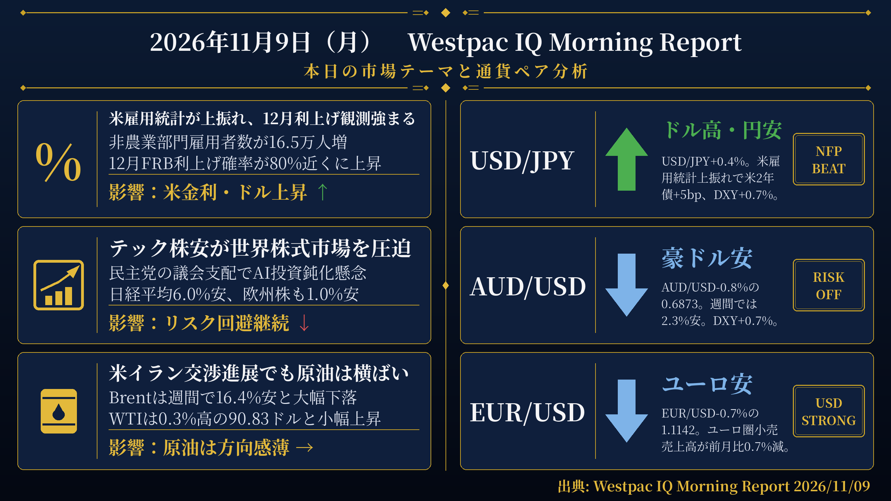
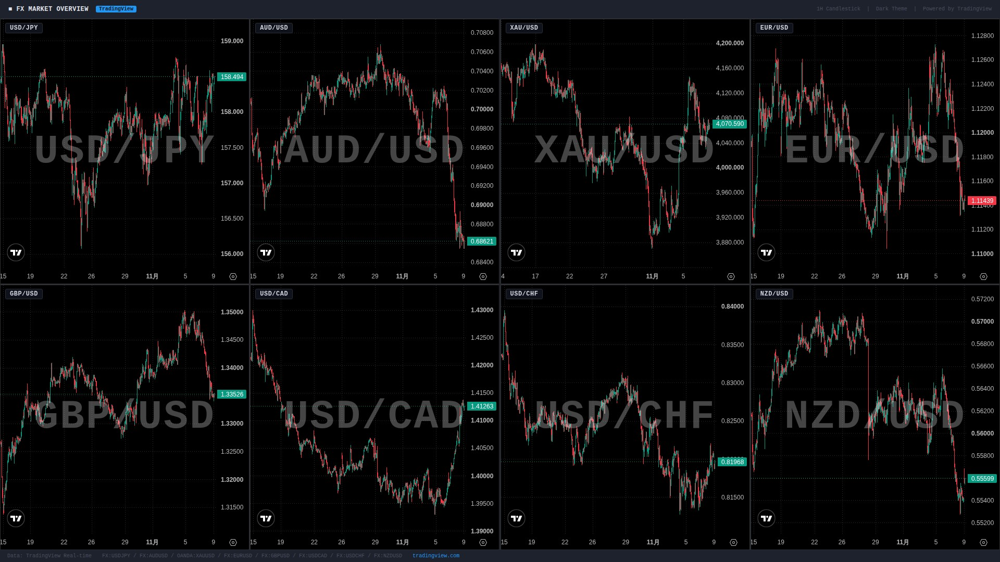

> [!CAUTION]
> 機械検証で不合格のゲートがあります。**このままXへ投稿しないでください。**
> 下の検証結果を確認し、修正が必要な場合はこのIssueにコメントで指示してください。

検証結果: **FAIL** ／ モード: LIVE ／ 生成: 2026-11-09T08:02:54+09:00

## 本日の投稿素材
- 生成物フォルダ: https://github.com/MFlab-inc/westpac-morning-report/tree/main/outputs/2026-11-09
- レポート画像（投稿1に添付）: https://github.com/MFlab-inc/westpac-morning-report/raw/main/outputs/2026-11-09/report_image.png
- チャート画像（投稿2に添付）: https://github.com/MFlab-inc/westpac-morning-report/raw/main/outputs/2026-11-09/charts_1h.jpg

## 1. レポート画像（X投稿1に添付）


## 2. チャート画像（X投稿2に添付）


## 3. X投稿1（コピー用｜加重文字数 422）
```text
【11/9(月) 朝の為替市況】

■米雇用統計
→10月非農業部門雇用者数が16.5万人増と予想を大幅に上回る
→12月FRB利上げ確率が80%近くに上昇
→米2年債利回り5bp上昇、DXYは0.7%高

■テック株安
→民主党の議会支配でAI投資鈍化懸念が広がる
→日経平均6.0%安、ハンセン指数1.3%安
→S&P500は0.3%高も週間では2.7%安

■原油・金
→WTIは0.3%高の90.83ドル、Brentは週間16.4%安
→金は0.4%安の4,070.80ドル、株式市場の変動継続が下値を支える

#ドル円 #米雇用統計
```

## 4. X投稿2（コピー用｜加重文字数 778）
```text
【通貨別分析 11/9】

#USDJPY 158.34 ↑ ドル高・円安
根拠：円は対ドルで0.4%下落。米雇用統計の上振れで米2年債+5bp、DXY+0.7%上昇。12月FRB利上げ確率が80%近くに上昇。

#AUDUSD 0.6873 ↓ 豪ドル安
根拠：豪ドルは対ドルで0.8%下落し週間では2.3%安。DXYが0.7%上昇する中、日経平均6.0%安など世界的なリスク回避の地合いが続いた。

#XAUUSD 4,070.80ドル ↓ 金価格下落
根拠：金は0.4%下落。DXYが0.7%上昇する中での下落となり、株式市場の変動継続に伴う安全資産需要が下値を支えた。

#EURUSD 1.1142 ↓ ユーロ安
根拠：ユーロは対ドルで0.7%下落。ユーロ圏9月小売売上高が前月比0.7%減と大幅に予想を下回り、DXYは0.7%上昇した。

#GBPUSD ↓ ポンド安
根拠：ポンドは対ドルで0.7%下落。DXYが0.7%上昇する中、英FTSE100は1.0%安、英10年債利回りは5.15%と小幅上昇した。

出典: Westpac IQ Morning Report 2026/11/09
#ドル円 #為替
```

## 5. レポート本文
<details><summary>クリックで全文を表示</summary>

# 2026年11月9日（月） Westpac IQ Morning Report

## 1. ファンダメンタルズ・マクロ経済分析

週末にかけて市場は総じて落ち着きを欠いた展開となった。木曜日の米国テック株主導の急落が世界各市場に波及する中、米国株は金曜日に部分的な反発を見せた。S&P500は0.3%上昇したものの週間では2.7%安、NASDAQはチップメーカーの反発で1.1%高、ダウ平均は0.5%安となった。欧州ではユーロ・ストックス50とFTSE100がともに1.0%下落。アジア市場では、民主党の議会支配がAI投資の鈍化につながるとの懸念から日経平均が6.0%安、韓国KOSPIも6.0%安、ハンセン指数は1.3%安と大幅に下落した。ASX200は週間1.3%高を維持しつつも0.5%安で引けた。VIX指数は25.64と9.0%低下した。

米国の10月非農業部門雇用者数は16.5万人増と予想を大幅に上回った。9月分の下振れ（2.9万人）は6.0万人へと大きく上方修正され、8月分も含めた2か月分の累計修正幅は8.4万人に達した。失業率は参加率が0.1ポイント上昇して61.9%となる中、0.1ポイント低下して4.1%となった。平均時給は前月比0.4%・前年比3.1%の堅調な伸びを維持した。この結果を受け、米国債利回りは上昇に転じ、2年債利回りが5bp上昇、10年債利回りが2bp上昇した。市場は12月のFRB利上げ確率を80%近くまで引き上げ、年末のフェデラルファンド金利の織り込みは4.07%となった。

ミシガン大学消費者態度指数（速報値）は11月に48.0から51.0へ上昇し、現況・期待ともに改善した。1年先インフレ期待は4.7%から4.3%へ低下、5年先は3.5%から3.4%へ小幅低下した。

ユーロ圏の9月小売売上高は前月比0.7%減と大幅に予想を下回った。8月分は0.3ポイント上方修正されて前月比+0.4%となり、年間成長率は0.4%となった。

オーストラリア国債利回りは米国債の動きに連動し、3年債利回りが4bp低下、10年債利回りが3bp低下した。スワップ市場は年末の政策金利を4.85%と織り込み、近い将来の利下げ・利上げの可能性をほぼ見込んでいない。

原油市場では、米国とイランが潜在的な合意に向けて交渉を進めているとの報道がある中、Brentはほぼ横ばいの98.3ドル/バレルで週を終えたが、週間では16.4%の大幅安となった。WTIは0.3%高の90.83ドル/バレル、Dated BrentはフロントマンスFutures比でディスカウントとなる96.8ドル/バレルで取引された。金は0.4%下落したが、株式市場の変動継続に伴う安全資産需要が下値を支えた。銅はAI関連の売りとともに0.5%下落し、議会支配の変化により米国の銅輸入関税リスクが低下したとの見方も加わった。アルミニウムは0.1%下落、鉄鉱石は横ばいだった。

ニュージーランドでは選挙結果がなお接戦で、選挙管理委員会は右派連合が131議席中67議席を獲得すると予測している。正式結果は11月27日に確定する予定。

## 2. テクニカル分析と本日の展望

### USD/JPY ― 上昇（↑）

現値：158.34（前日比+0.4%）。米10月非農業部門雇用者数が16.5万人増と予想を大幅に上回り、米国債利回りが上昇（2年債+5bp、10年債+2bp）する中、DXYは0.7%上昇した。円は対ドルで0.4%下落しており、USD/JPYは上昇。日本の10年債利回りは2.65%と0.13bp低下した。12月FRB利上げ確率が80%近くまで高まっており、ドル高圧力が続く環境にある。

### AUD/USD ― 下落（↓）

現値：0.6873（前日比-0.8%）。週間では2.3%の大幅安となった。DXYが0.7%上昇する中、豪ドルは主要通貨の中でも下落幅が大きかった。アジア株式市場の急落（日経平均-6.0%、ハンセン-1.3%）など、リスク回避的な地合いが続いた。ASX200は0.5%安で引けており、豪州の金融市場も世界的な売りの影響を受けた。

### XAU/USD ― 下落（↓）

現値：4,070.80ドル/オンス（前日比-0.4%）。金は0.4%下落した。原文によれば、株式市場の変動継続に伴う安全資産需要が下値を支えたとされている。DXYが0.7%上昇する中での下落となった。

### EUR/USD ― 下落（↓）

現値：1.1142（前日比-0.7%）。原文に「ユーロは対ドルで0.7%下落」と明記されている。ユーロ圏の9月小売売上高が前月比0.7%減と大幅に予想を下回ったことも重なった。ユーロ・ストックス50は1.0%下落しており、欧州全体として軟調な地合いが続いた。

### GBP/USD ― 下落（↓）

原文のFXレート表にGBP/USDの現値の記載なし。原文に「ポンドは対ドルで0.7%下落」と直接記載されているため、GBP/USDは下落と判断する。AUD/GBPは-0.1%、AUD/USDは-0.8%であり、クロス計算からもGBP/USDは約-0.7%の下落と整合する。英国FTSE100は1.0%下落、英国10年債利回りは5.15%と0.02bp上昇した。

## 3. 本日の重要イベント

| 時刻(JST) | 国 | イベント | 予想 | 前回 |
|---|---|---|---|---|
| 10:30 | CN | 中国PPI（10月） | 5.3% | 5.0% |
| 10:30 | CN | 中国CPI（10月） | 0.8% | 0.9% |
| 18:30 | EZ | ユーロ圏センティックス投資家信頼感（11月） | 2pts | 2.7pts |
| - | CN | 中国M2マネーサプライ（10月） | 7.2% | 7.2% |
| 23:00 | US | 米卸売在庫（9月確報値） | 0.6% | 0.6% |
| 翌0:00 | US | 米ニューヨーク連銀1年先インフレ期待（10月） | 3.8% | 3.9% |

出典: Westpac IQ Morning Report 2026/11/09

</details>

## 6. 機械検証ゲート
| ゲート | 判定 | 詳細 |
|---|---|---|
| G1 日付整合 | ✅ PASS | date_jst=2026-11-09 / 本文に「2026年11月9日」/ 投稿2と本文に「2026/11/09」を要求 |
| G2 暗号通貨語の混入ゼロ | ✅ PASS |  |
| G3 対象5ペア限定 | ✅ PASS |  |
| G4 プレースホルダ残存なし | ✅ PASS |  |
| G5 出典表記（本文・投稿2） | ✅ PASS |  |
| G6 規定ハッシュタグ | ✅ PASS |  |
| G7 投稿にURLなし（Intent URL禁止） | ✅ PASS |  |
| G8 数値のPDF原文照合 | ✅ PASS | 15個の数値を照合しすべて原文に存在 |
| G9 イベント時刻JST換算チェック | ❌ FAIL | 時差2時間で換算した期待値['00:00', '01:00', '10:30', '18:30']と本文イベント表['00:00', '10:30', '18:30', '23:00']が不一致（原文時刻['02:00', '03:00', '12:30', '20:30']。原文のAEST/AEDT表記は無視しzoneinfoベースの時差2時間を正としている） |
| G10 投稿2に「未確認」を含めない | ✅ PASS |  |
| I1 post1 加重文字数 | ℹ️ INFO | 422 |
| I2 post2 加重文字数 | ℹ️ INFO | 778 |
| I3 post1 →行の読点過多 | ℹ️ INFO | なし |

## 7. 投稿手順（方式A：手動投稿）
- [ ] 画像2枚と投稿文を確認した
- [ ] 投稿1をXへ投稿した（レポート画像を添付）
- [ ] 投稿2をXへ投稿した（チャート画像を添付）
- [ ] このIssueをCloseした（＝投稿完了の記録）

---
生成物: [`outputs/2026-11-09/`](https://github.com/MFlab-inc/westpac-morning-report/tree/main/outputs/2026-11-09) ／ 元PDF: https://library.westpaciq.com.au/content/dam/public/westpaciq/secure/economics/documents/aus/2026/11/WBC_MorningReport09Nov2026.pdf
修正したい場合はこのIssueにコメントを残し、翌日以降の改善に反映します（フェーズ2で再生成コマンドに対応予定）。