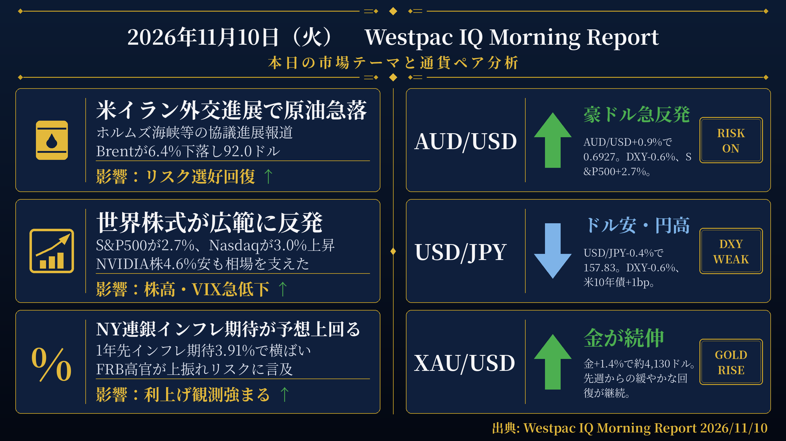
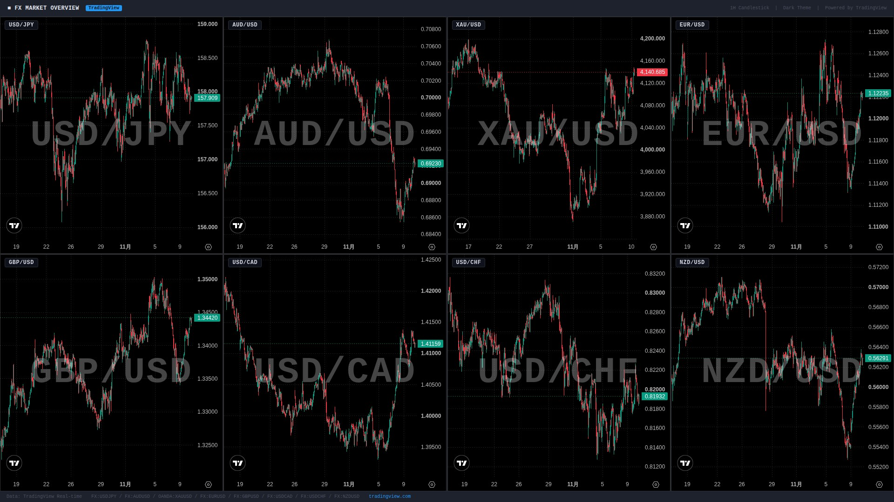

検証結果: **PASS** ／ モード: LIVE ／ 生成: 2026-11-10T08:02:49+09:00

## 本日の投稿素材
- 生成物フォルダ: https://github.com/MFlab-inc/westpac-morning-report/tree/main/outputs/2026-11-10
- レポート画像（投稿1に添付）: https://github.com/MFlab-inc/westpac-morning-report/raw/main/outputs/2026-11-10/report_image.png
- チャート画像（投稿2に添付）: https://github.com/MFlab-inc/westpac-morning-report/raw/main/outputs/2026-11-10/charts_1h.jpg

## 1. レポート画像（X投稿1に添付）


## 2. チャート画像（X投稿2に添付）


## 3. X投稿1（コピー用｜加重文字数 431）
```text
【11/10(火) 朝の為替市況】

■米イラン外交
→米国とイランの外交進展を示す報道が相次ぐ
→Brentが6.4%下落し92.0ドル
→WTI先物も5.1%下落し86.18ドル

■世界株式
→S&P500が2.7%上昇し7,575ポイント
→NasdaqはNVIDIA株4.6%安をこなし3.0%上昇
→VIX指数は23.2%低下し19.68

■NY連銀インフレ期待
→1年先インフレ期待が3.91%と実質横ばいで予想を上回る
→FRBのグールズビー氏がサービスインフレの懸念を強調
→12月利上げ織り込みが19bpから21bpに拡大

#ドル円 #米CPI
```

## 4. X投稿2（コピー用｜加重文字数 887）
```text
【通貨別分析 11/10】

#USDJPY 157.83 ↓ ドル安・円高
根拠：円は対ドルで0.4%上昇。DXYが0.6%下落し金曜日の上昇分を解消する中、米2年債利回りは4bp上昇して4.56%、10年債利回りは1bp上昇して4.87%となった。

#AUDUSD 0.6927 ↑ 豪ドル急反発
根拠：豪ドルは0.9%上昇し0.6930ドル近辺へ。先週の下落で3月以来の安値に沈んでいた水準から反発。DXYは0.6%下落し、S&P500は2.7%上昇した。

#XAUUSD 4,144.22ドル ↑ 金が続伸
根拠：金は1.8%上昇。先週からの緩やかな回復が継続する中、Brentが6.4%下落し原油市場が大きく動いた。

#EURUSD 1.1221 ↑ ユーロ高進行
根拠：ユーロは対ドルで0.7%上昇。DXYが0.6%下落しG10通貨全般が対ドルで上昇する中、ユーロ圏のSentix投資家信頼感指数は2.4と過去4年間で最も強い水準の一つを維持した。

#GBPUSD ↑ ポンド高進行
根拠：ポンドは対ドルで0.6%上昇。DXYが0.6%下落しG10通貨全般が対ドルで上昇する中、米2年債利回りは4bp上昇して4.56%となった。

出典: Westpac IQ Morning Report 2026/11/10
#ドル円 #為替
```

## 5. レポート本文
<details><summary>クリックで全文を表示</summary>

# 2026年11月10日（火） Westpac IQ Morning Report

## 1. ファンダメンタルズ・マクロ経済分析

週明けの市場は先週末の急落から広範に反発した。米国とイランの間で、ホルムズ海峡の管理・ウラン濃縮・凍結資金といった主要論点を巡る外交的進展を示す報道（多くは未確認）が相次ぎ、リスク選好が回復した。

株式市場では、S&P 500が2.7%上昇し7,575ポイント、ナスダックはNVIDIA株が4.6%下落したにもかかわらず3.0%上昇した。欧州ではユーロ・ストックス50が1.9%高、英FTSEが1.0%高。アジアでは日経平均が2.3%反発した一方、香港ハンセン指数は0.1%小幅安、上海は概ね横ばいだった。ASX 200は0.1%の小幅高にとどまったが、夜間の動きを受けて先物は堅調な寄り付きを示唆している。VIX指数は23.2%低下し19.68となった。

原油は外交進展報道を受けて大幅に下落し、Brentが6.4%安の92.0ドル/バレル、WTI先物が5.1%安の86.18ドルとなった。金は先週からの緩やかな回復を続け、1.4%上昇して約4,130ドル/オンスとなった（データスナップショット上の現値は4,144.22ドル）。LME銅は0.9%上昇し13,896ドル/トンとなった。原料炭は0.8%安の253.00ドル、一般炭は3.1%安の136.75ドル、鉄鉱石は0.3%安の92.85ドルとなった。

米国債市場では、リスク選好の回復と原油安を背景に需要が後退し、イールドカーブはベア・スティープ化した。2年債利回りは4bp上昇して4.56%、10年債利回りは1bp上昇して4.87%となった。FRBの12月会合での利上げ織り込みは21bp（前日比19bp）に拡大し、最初の完全な利上げ織り込みは3月から1月に前倒しされた。ドイツ10年債利回りは1bp上昇して3.26%、日本10年債利回りは1bp上昇して2.67%、英国10年債利回りは2bp低下して5.13%となった。豪州国債（ACGB）は国内取引時間中に売られたが、夜間の先物取引でその動きはほぼ解消された。

経済指標面では、米国のニューヨーク連銀1年先インフレ期待が10月に3.91%と実質的に横ばいとなり、若干の低下を見込んでいた市場予想を上回る結果となった。FOMCのグールズビー氏とバーキン氏が発言し、インフレの上振れリスクに焦点を当てた。グールズビー氏はサービスインフレへの懸念とAIインフラの急速な整備がもたらすインフレへの影響を特に強調した。ユーロ圏では11月のSentix投資家信頼感指数が2.7から2.4へ小幅低下したものの、過去4年間で最も強い水準の一つであり、歴史的平均を大きく上回っている。

## 2. テクニカル分析と本日の展望

### USD/JPY ― 下落（↓）

現値：157.83（前日比-0.4%）。DXYが0.6%下落して101.6近辺で推移する中、円は対ドルで0.4%上昇した。円は10月初旬以降、比較的狭いレンジでの取引が続いており、今回の動きもその範囲内にある。米2年債利回りが4bp上昇して4.56%、10年債利回りが1bp上昇して4.87%となる中、ドル安が主導する形でUSD/JPYは下落した。

### AUD/USD ― 上昇（↑）

現値：0.6927（前日比+0.9%）。豪ドルは先週末の売りを大きく取り戻し、先週の下落で3月以来の安値に沈んでいた水準から反発した。DXYが0.6%下落し、S&P 500が2.7%上昇する中、豪ドルは0.6930ドル近辺まで上昇した。G10通貨はすべて対ドルで上昇した。

### XAU/USD ― 上昇（↑）

現値：4,144.22ドル（前日比+1.8%）。金は先週からの緩やかな回復を継続した。本文中では1.4%上昇して約4,130ドル/オンスと記載されており、データスナップショットの現値4,144.22ドルとの差は取引時間の違いによるものと考えられる。原油が大幅下落する中、金は独自の動きで上昇した。

### EUR/USD ― 上昇（↑）

現値：1.1221（前日比+0.7%）。ユーロは対ドルで0.7%上昇した。DXYが金曜日の上昇分を全て解消する形で0.6%下落する中、G10通貨全般が対ドルで上昇した。ユーロ圏では11月のSentix投資家信頼感指数が2.4と過去4年間で最も強い水準の一つを維持している。

### GBP/USD ― 上昇（↑）

原文のFXレート表にGBP/USDの現値の記載なし。原文に「ポンドは0.6%上昇した（Sterling rose 0.6%）」と直接記載されているため、GBP/USDは上昇と判断する。DXYが0.6%下落し、G10通貨全般が対ドルで上昇する中、ポンドも0.6%の上昇となった。

## 3. 本日の重要イベント

| 時刻(JST) | 国 | イベント | 予想 | 前回 |
|---|---|---|---|---|
| 8:30 | AU | WBC-MI消費者信頼感指数（11月） | - | 80.4pts |
| 8:30 | JP | 家計支出（9月） | -3.0% | -3.1% |
| 8:50 | JP | 経常収支（9月） | ¥3300b | ¥4062b |
| 9:30 | AU | NAB企業業況指数（10月） | - | -1pts |
| - | CN | 貿易収支（10月） | 125.9b米ドル | 133.5b米ドル |
| 20:00 | US | NFIB中小企業楽観指数（10月） | 97.9pts | 97.9pts |
| 22:30 | US | 消費者物価指数（10月） | 0.3% | 0.6% |

出典: Westpac IQ Morning Report 2026/11/10

</details>

## 6. 機械検証ゲート
| ゲート | 判定 | 詳細 |
|---|---|---|
| G1 日付整合 | ✅ PASS | date_jst=2026-11-10 / 本文に「2026年11月10日」/ 投稿2と本文に「2026/11/10」を要求 |
| G2 暗号通貨語の混入ゼロ | ✅ PASS |  |
| G3 対象5ペア限定 | ✅ PASS |  |
| G4 プレースホルダ残存なし | ✅ PASS |  |
| G5 出典表記（本文・投稿2） | ✅ PASS |  |
| G6 規定ハッシュタグ | ✅ PASS |  |
| G7 投稿にURLなし（Intent URL禁止） | ✅ PASS |  |
| G8 数値のPDF原文照合 | ✅ PASS | 18個の数値を照合しすべて原文に存在 |
| G9 イベント時刻JST換算チェック | ✅ PASS | 時差2時間で換算した期待値['08:30', '08:50', '09:30', '20:00', '22:30']と本文イベント表['08:30', '08:50', '09:30', '20:00', '22:30']が一致 |
| G10 投稿2に「未確認」を含めない | ✅ PASS |  |
| I1 post1 加重文字数 | ℹ️ INFO | 431 |
| I2 post2 加重文字数 | ℹ️ INFO | 887 |
| I3 post1 →行の読点過多 | ℹ️ INFO | なし |

## 7. 投稿手順（方式A：手動投稿）
- [ ] 画像2枚と投稿文を確認した
- [ ] 投稿1をXへ投稿した（レポート画像を添付）
- [ ] 投稿2をXへ投稿した（チャート画像を添付）
- [ ] このIssueをCloseした（＝投稿完了の記録）

---
生成物: [`outputs/2026-11-10/`](https://github.com/MFlab-inc/westpac-morning-report/tree/main/outputs/2026-11-10) ／ 元PDF: https://library.westpaciq.com.au/content/dam/public/westpaciq/secure/economics/documents/aus/2026/11/WBC_MorningReport10Nov2026.pdf
修正したい場合はこのIssueにコメントを残し、翌日以降の改善に反映します（フェーズ2で再生成コマンドに対応予定）。