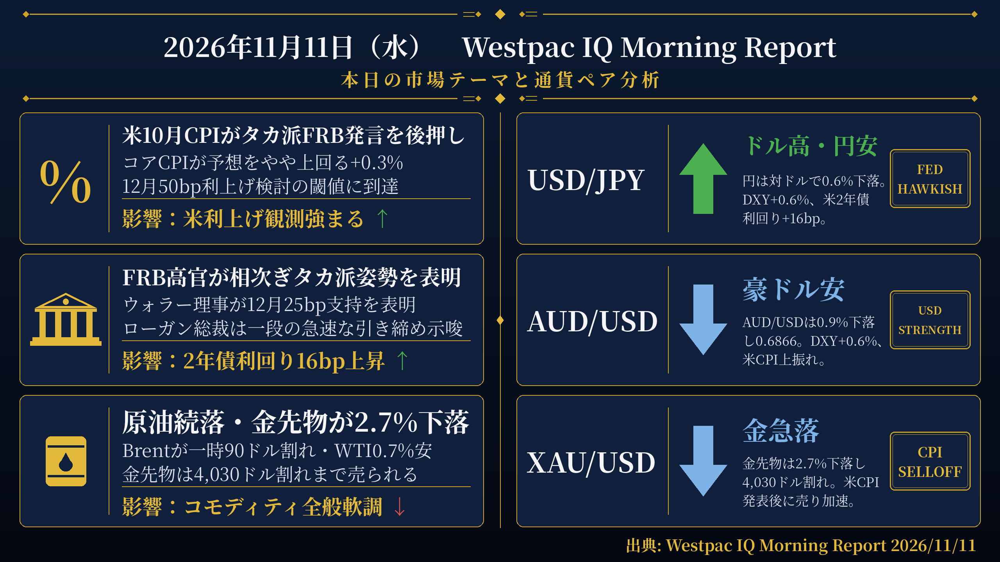
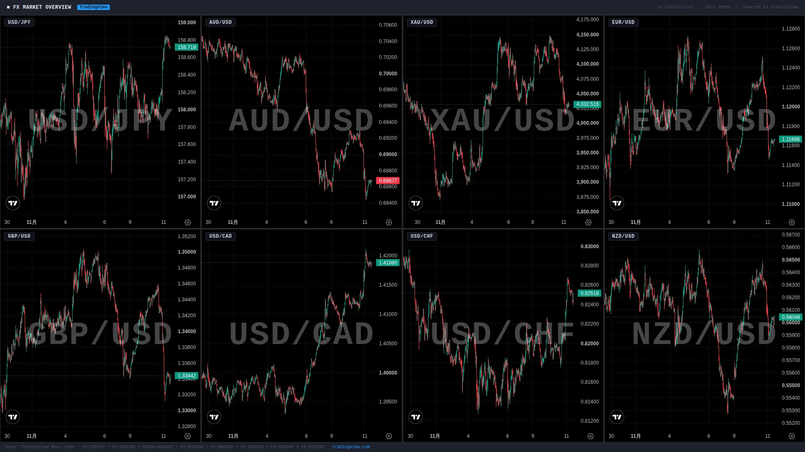

検証結果: **PASS** ／ モード: LIVE ／ 生成: 2026-11-11T08:03:09+09:00

## 本日の投稿素材
- 生成物フォルダ: https://github.com/MFlab-inc/westpac-morning-report/tree/main/outputs/2026-11-11
- レポート画像（投稿1に添付）: https://github.com/MFlab-inc/westpac-morning-report/raw/main/outputs/2026-11-11/report_image.png
- チャート画像（投稿2に添付）: https://github.com/MFlab-inc/westpac-morning-report/raw/main/outputs/2026-11-11/charts_1h.jpg

## 1. レポート画像（X投稿1に添付）


## 2. チャート画像（X投稿2に添付）


## 3. X投稿1（コピー用｜加重文字数 586）
```text
【11/11(水) 朝の為替市況】

■米10月CPI
→ヘッドラインCPIは前月比+0.4%でコンセンサスをわずかに上回る
→コアCPIも+0.3%と予想をやや上回り、12月50bp利上げ検討の閾値に到達

■FRB高官発言
→ウォラー理事が12月25bp利上げ支持を表明、コアCPI次第で50bpも検討と発言
→ダラス連銀のローガン総裁が少なくとも2回の追加利上げと一段の引き締め加速を示唆
→米2年債利回りが16bp上昇して4.73%、12月利上げ織り込みは28bpに拡大

■米国株・コモディティ
→S&P500は0.5%安、ナスダックは0.9%安と引けにかけて下落
→金先物はCPI発表後に2.7%下落し4,030ドル割れ
→WTIは0.7%安の86.21ドル、Brentは0.9%安の91.8ドルと続落

#ドル円 #米CPI
```

## 4. X投稿2（コピー用｜加重文字数 681）
```text
【通貨別分析 11/11】

#USDJPY 158.79 ↑ ドル高・円安
根拠：円は対ドルで0.6%下落。DXYは0.6%上昇して102.2、米2年債利回りは16bp上昇して4.73%。

#AUDUSD 0.6866 ↓ 豪ドル安
根拠：AUD/USDは0.9%下落し主要通貨中で最大の下落率。DXYは0.6%上昇、国内消費者信頼感指数は4年ぶり低水準の78.2。

#XAUUSD 4027.06 ↓ 金先物急落
根拠：金先物は2.7%下落し4,030ドル割れ。米2年債利回りが16bp上昇する中、銅も1.6%安と素材全般が軟調。

#EURUSD 1.1165 ↓ ユーロ安
根拠：ユーロは対ドルで0.5%下落。DXYは0.6%上昇、10年ドイツ国債利回りは5bp上昇して3.32%。

#GBPUSD ↓ ポンド安
根拠：ポンドは対ドルで0.7%下落。DXYは0.6%上昇、10年英国債利回りは9bp上昇して5.22%。

出典: Westpac IQ Morning Report 2026/11/11
#ドル円 #為替
```

## 5. レポート本文
<details><summary>クリックで全文を表示</summary>

# 2026年11月11日（水） Westpac IQ Morning Report

## 1. ファンダメンタルズ・マクロ経済分析

本日の市場を貫く最大のテーマは、予想をやや上回った米10月インフレ指標とFRB高官のタカ派発言が重なる中での政策見通しの急速な再評価であった。

**米10月CPI（国際データ）**
米10月ヘッドラインCPIは前月比+0.4%と、Westpacの予想に沿いつつもコンセンサス予想をわずかに上回った。エネルギーと食品がともに結果に寄与した。コアインフレも予想をやや上回り+0.3%となった。コア財インフレは過去4か月で加速しており、関税・テクノロジー・エネルギー投入コストの価格転嫁が続いている。価格は月次平均+0.2%の上昇が続いており、10月も同様であった。住居費は引き続き平均を上回るペースで+0.3%上昇した。住居費を除くコアインフレは6か月年率換算で2.4%と落ち着いており、FOMCが直接影響を及ぼせる物価圧力は抑制されていると指摘されている。なお、1年前の政府機関閉鎖によるCPI公表への影響から、今月は年率インフレ率が公表されなかった。

NFIB中小企業楽観指数は10月に97.8とほぼ横ばいで、歴史的平均並みの水準にとどまった。

**FRB高官発言**
FRBのウォラー理事は米国の労働市場と経済の基礎的成長力に自信を示す一方、インフレの強さと持続性に強い懸念を表明した。同理事は「10月のインフレが改善すれば12月会合で25bpの利上げを支持する方向に傾いている」としつつ、「コアCPIが0.3%前後またはそれ以上であれば、より大幅な措置として50bpの利上げを検討すべき」と述べた。この閾値は実際の10月CPI結果（+0.3%）によって到達された。ダラス連銀のローガン総裁もCPI発表後にタカ派姿勢を強め、少なくとも2回の追加25bp利上げを支持し、より速いペースでの引き締めの可能性を示唆した。

**金融市場の動向**
米国株式市場は原油安を受けて寄り付き高となったが、引けにかけて上昇分を全て失った。S&P500は0.5%安、ダウ・ジョーンズは0.4%安、ナスダックは0.9%安となった。欧州市場はまちまちで、ユーロ・ストックス50が0.6%上昇した一方、FTSE100は0.3%下落した。アジア株式市場は上昇し、韓国コスピが4.4%急騰、日経225は2.9%上昇と10月初旬以来最大の上昇となった。ハンセン指数は0.4%、CSI300は0.1%それぞれ上昇した。ASX200は1.1%上昇し、金利感応度の高いセクターが牽引した。

米国債利回りは短期ゾーンを中心に急上昇し、2年債利回りは16bp上昇して4.73%、10年債利回りは10bp上昇して4.98%となった。先物市場は12月の利上げ織り込みを28bp（前日21bp）に引き上げ、3月までに2回の利上げを完全に織り込んだ。10年ドイツ国債利回りは5bp上昇、10年英国債利回りは9bp上昇した。豪州国債利回りはほぼ横ばいで、3年債・10年債ともに1bp低下した。RBAの利上げサイクルは事実上終了したとの見方が市場では続いており、12月利上げの確率は4%、2月までの利上げ確率は20%にとどまっている。

原油価格は続落し、Brentは一時90ドルを割り込んだ後、0.9%安の91.8ドル/バレルで引けた。WTIは0.7%安の86.2ドル/バレルとなった。金先物はCPIデータ発表後に急落し、2.7%安で4,030ドル/オンスを下回った。銅は1.6%安、アルミニウムは1.8%安と、ベースメタルも全般的に軟調であった。

**豪州国内データ**
ウエストパック・メルボルン研究所（Westpac-MI）消費者信頼感指数は11月に2.7%低下し、4年ぶりの低水準となる78.2となった。近い将来の経済見通しの急激な悪化が主因であった。消費者は住宅価格についても悲観的になり、雇用の安定性への懸念も高まっており、70%超が今後1年間で住宅ローン金利が上昇すると予想している。NAB企業景況感調査では、信頼感が1ポイント低下してマイナス15となり、歴史的に下位5%に相当する深刻な悲観水準が続いている。先行受注は11ポイント急落してマイナス12となり、パンデミックの最盛期以来の最弱水準となった。設備投資意欲も低下した。

## 2. テクニカル分析と本日の展望

### USD/JPY ― 上昇（↑）
現値：158.79。円は対ドルで0.6%下落した。米ドル指数（DXY）は0.6%上昇して102.2となり、主要通貨が対ドルで軒並み下落する中、円も売られた。米2年債利回りが16bp上昇して4.73%に達するなど、米国の金利上昇が続く局面にある。引き続き米国の金融政策動向と米国債利回りの動向が注目される。

### AUD/USD ― 下落（↓）
現値：0.6866。AUD/USDは0.9%下落し、主要通貨の中で最大の下落率となった。DXYが0.6%上昇する中、豪ドルは特に大きく売られた。国内では消費者信頼感指数が4年ぶりの低水準に落ち込み、NAB企業景況感も深刻な悲観水準が続いている。RBAの追加利上げ観測が限定的な中、豪ドルの上値は重い状況が続いている。

### XAU/USD ― 下落（↓）
現値：4,027.06ドル（先物は4,030ドル割れ）。金先物はCPIデータ発表後に2.7%下落し、4,030ドル/オンスを下回った。銅が1.6%安、アルミニウムが1.8%安となるなど、ベースメタルも全般的に軟調であった。米国の金利上昇局面が続く中、金の動向には引き続き注意が必要である。

### EUR/USD ― 下落（↓）
現値：1.1165。ユーロは対ドルで0.5%下落した。DXYが0.6%上昇する中、ユーロも主要通貨の一角として対ドルで売られた。10年ドイツ国債利回りは5bp上昇して3.32%となった。欧州株式市場ではユーロ・ストックス50が0.6%上昇するなど、株式と通貨で異なる動きが見られた。

### GBP/USD ― 下落（↓）
原文のFXレート表にGBP/USDの現値の記載なし。原文に「ポンドは0.7%下落した（the pound declined 0.7%）」と直接記載されているため、GBP/USDは下落と判断する。10年英国債利回りは9bp上昇して5.22%となった。FTSE100は0.3%下落した。ポンドは主要通貨の中でも比較的大きな下落率を示した。

## 3. 本日の重要イベント

| 時刻(JST) | 国 | イベント | 予想 | 前回 |
|---|---|---|---|---|
| - | CN | M2マネーサプライ（10月、前年比） | 7.2% | 7.2% |
| 09:30 | AU | 住宅ローン承認件数（第3四半期） | -8.0% | -5.2% |

出典: Westpac IQ Morning Report 2026/11/11

</details>

## 6. 機械検証ゲート
| ゲート | 判定 | 詳細 |
|---|---|---|
| G1 日付整合 | ✅ PASS | date_jst=2026-11-11 / 本文に「2026年11月11日」/ 投稿2と本文に「2026/11/11」を要求 |
| G2 暗号通貨語の混入ゼロ | ✅ PASS |  |
| G3 対象5ペア限定 | ✅ PASS |  |
| G4 プレースホルダ残存なし | ✅ PASS |  |
| G5 出典表記（本文・投稿2） | ✅ PASS |  |
| G6 規定ハッシュタグ | ✅ PASS |  |
| G7 投稿にURLなし（Intent URL禁止） | ✅ PASS |  |
| G8 数値のPDF原文照合 | ✅ PASS | 19個の数値を照合しすべて原文に存在 |
| G9 イベント時刻JST換算チェック | ✅ PASS | 時差2時間で換算した期待値['09:30']と本文イベント表['09:30']が一致 |
| G10 投稿2に「未確認」を含めない | ✅ PASS |  |
| I1 post1 加重文字数 | ℹ️ INFO | 586 |
| I2 post2 加重文字数 | ℹ️ INFO | 681 |
| I3 post1 →行の読点過多 | ℹ️ INFO | なし |

## 7. 投稿手順（方式A：手動投稿）
- [ ] 画像2枚と投稿文を確認した
- [ ] 投稿1をXへ投稿した（レポート画像を添付）
- [ ] 投稿2をXへ投稿した（チャート画像を添付）
- [ ] このIssueをCloseした（＝投稿完了の記録）

---
生成物: [`outputs/2026-11-11/`](https://github.com/MFlab-inc/westpac-morning-report/tree/main/outputs/2026-11-11) ／ 元PDF: https://library.westpaciq.com.au/content/dam/public/westpaciq/secure/economics/documents/aus/2026/11/WBC_MorningReport11Nov2026.pdf
修正したい場合はこのIssueにコメントを残し、翌日以降の改善に反映します（フェーズ2で再生成コマンドに対応予定）。