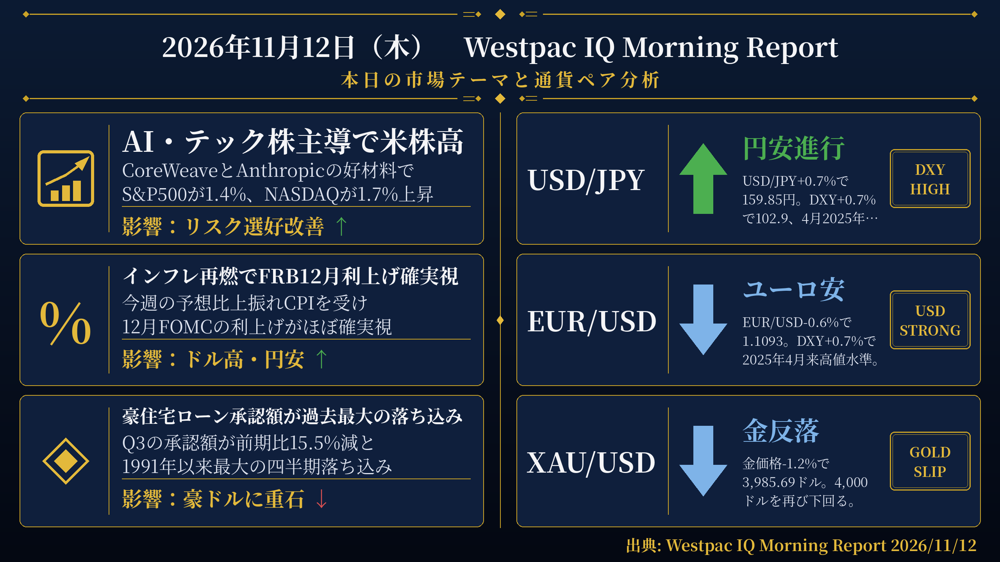
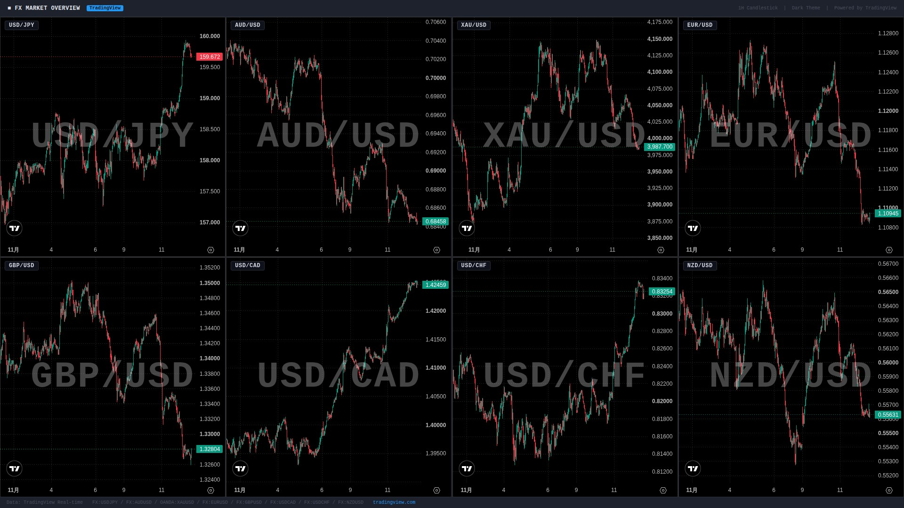

検証結果: **PASS** ／ モード: LIVE ／ 生成: 2026-11-12T08:03:41+09:00

## 本日の投稿素材
- 生成物フォルダ: https://github.com/MFlab-inc/westpac-morning-report/tree/main/outputs/2026-11-12
- レポート画像（投稿1に添付）: https://github.com/MFlab-inc/westpac-morning-report/raw/main/outputs/2026-11-12/report_image.png
- チャート画像（投稿2に添付）: https://github.com/MFlab-inc/westpac-morning-report/raw/main/outputs/2026-11-12/charts_1h.jpg

## 1. レポート画像（X投稿1に添付）


## 2. チャート画像（X投稿2に添付）


## 3. X投稿1（コピー用｜加重文字数 533）
```text
【11/12(木) 朝の為替市況】

■AI・テック株
→CoreWeaveの見通し引き上げとAnthropicのIPO好調でAI楽観が再燃
→S&P500が1.4%高、NASDAQが1.7%高と上昇
→DXYが0.7%高の102.9と2025年4月来高値

■FRB利上げ観測
→今週の予想比上振れインフレ指標で12月FOMCの利上げがほぼ確実視
→2027年中にさらに2回の利上げが市場に織り込まれる
→ドル円は0.7%円安の159.85円、ユーロは0.6%安の1.1093ドル

■豪住宅ローン
→Q3の承認額が前期比15.5%減と1991年以来最大の四半期落ち込み
→投資家向け融資額が約3分の1近く減少
→豪ドルは0.2%安の0.6850ドルと2026年安値圏に接近

#ドル円 #FOMC
```

## 4. X投稿2（コピー用｜加重文字数 916）
```text
【通貨別分析 11/12】

#USDJPY 159.85円 ↑ 円安進行
根拠：前日比+0.7%の円安。DXYが+0.7%の102.9と2025年4月来高値を付け、先物市場は今週の予想比上振れインフレ指標を受けた利回り上昇継続を示唆。

#AUDUSD 0.6850ドル ↓ 豪ドル軟調
根拠：前日比-0.2%の下落。最近の下落モメンタムが続き2026年安値圏に接近。Q3住宅ローン承認額が前期比15.5%減と過去最大の落ち込みを記録。DXYは2025年4月来高値水準。

#XAUUSD 3,985.69ドル ↓ 金反落
根拠：前日比-1.2%の下落で4,000ドルを再び下回る。今週の米CPI発表後に実質利回りが上昇した流れが続く中、DXYが+0.7%と堅調に推移。

#EURUSD 1.1093ドル ↓ ユーロ安
根拠：前日比-0.6%の下落で2025年5月来安値水準。DXYが2025年4月来高値を付ける中、1.10台に押し戻された。

#GBPUSD ↑ ポンド底堅い
根拠：AUD/GBPが+0.3%上昇（ポンド安）、AUD/USDが-0.2%下落の組み合わせから、ポンドは対ドルで上昇と推定。英FTSE100は+0.8%と堅調。本日は英GDP速報値（Q3）の発表を控える。

出典: Westpac IQ Morning Report 2026/11/12
#ドル円 #為替
```

## 5. レポート本文
<details><summary>クリックで全文を表示</summary>

# 2026年11月12日（木） Westpac IQ Morning Report

## 1. ファンダメンタルズ・マクロ経済分析

米国ではCoreWeaveの見通し引き上げ、AnthropicのIPO好調、Nvidiaの安定化を受けてAI・テック株への楽観が再燃し、S&P 500が1.4%高、NASDAQが1.7%高と上昇した。ダウ・ジョーンズの上昇幅は0.5%にとどまり、上昇の裾野は比較的限定的だった。欧州ではユーロ・ストックス50が1.0%高、英FTSE100が0.8%高と続伸。アジアでは日経平均が1.3%高、上海が0.4%高、ソウルが2.6%高となった一方、ハンセン指数は1.0%安と逆行した。ASX200は前日0.3%上昇したが、夜間の先物取引は軟調で本日の寄り付きは方向感が定まらない見通し。

米国の現金債券市場はベテランズデーで休場だったが、先物市場は今週発表された予想比上振れのインフレ指標を受けて国債利回りの上昇継続を示唆した。この結果、12月FOMCでの利上げはほぼ確実視され、2027年中にさらに2回の利上げが市場に織り込まれている。独10年債利回りと英10年債利回りは前日比横ばい（それぞれ3.32%・5.22%）。日本の10年国債利回りは11bp上昇して2.80%となり、先週末からの上昇分をほぼ取り戻した。豪州国債（ACGB）も軟調で、3年債利回りが7bp上昇して4.73%、10年債利回りが6bp上昇して5.04%となった。スワップ市場は現時点でRBAが2027年末まで利上げも利下げも行わないことを示唆している。

米ドルは堅調な買いが入り、DXYは0.7%高の102.9と2025年4月以来の高値を付けた。コモディティ面では、原油が米国とイランを巡る不確実性の中でやや持ち直し、Brentが1.0%高の92.4ドル/バレル、WTI先物が0.3%高の86.31ドルとなった。LME銅は1.0%高の13,817ドル/トン、LMEアルミニウムは1.9%高の3,068ドル/トン。金価格は1.2%下落して3,985.69ドル/オンスと4,000ドルを再び下回った。一般炭は3.3%高の143.40ドル、原料炭は0.2%安の253.50ドル、鉄鉱石は0.4%安の91.25ドル。

国内では、豪州の住宅ローン承認額がQ3に前期比15.5%減と1991年以来最大の四半期落ち込みを記録した。この減少は主に件数の減少によるもので、投資家向け融資額が約3分の1近く落ち込んだ。

国際データについては、昨日は主要な指標の発表はなかった。

## 2. テクニカル分析と本日の展望

### USD/JPY ― 上昇（↑）
現値：159.85円（前日比+0.7%）。DXYが0.7%高の102.9と2025年4月以来の高値を付ける中、円は対ドルで0.7%下落し、9月初旬の上昇前の水準まで戻った。米現金債券市場はベテランズデーで休場だったが、先物市場は今週の予想比上振れインフレ指標を受けた利回り上昇継続を示唆しており、12月FOMCの利上げがほぼ確実視されている。2027年中にさらに2回の利上げが織り込まれており、ドル高圧力が続く環境にある。

### AUD/USD ― 下落（↓）
現値：0.6850ドル（前日比-0.2%）。豪ドルの下落幅は他通貨と比べて小幅だったが、最近の下落モメンタムが続いており、2026年の安値圏に近い水準に位置している。国内では住宅ローン承認額がQ3に過去最大の落ち込みを記録したほか、スワップ市場はRBAが2027年末まで政策変更を行わないことを示唆している。DXYが2025年4月以来の高値を付けていることも豪ドルの重石となっている。

### XAU/USD ― 下落（↓）
現値：3,985.69ドル/オンス（前日比-1.2%）。金価格は4,000ドルを再び下回り、今週の米CPI発表後に実質利回りが上昇した流れを引き継いでいる。DXYが0.7%高と堅調に推移する中、金は下落した。LME銅が1.0%高、LMEアルミニウムが1.9%高と金属全般が堅調だった中で、金のみが逆行する動きとなった。

### EUR/USD ― 下落（↓）
現値：1.1093ドル（前日比-0.6%）。ユーロは2025年5月以来の安値水準まで下落した。DXYが0.7%高と2025年4月以来の高値を付ける中、ユーロは1.10台に押し戻された。欧州株（ユーロ・ストックス50+1.0%）は堅調だったが、為替市場ではドル高の影響が優勢だった。米国の12月利上げがほぼ確実視され、2027年中にさらに2回の利上げが織り込まれている状況がドル高を支える構図となっている。

### GBP/USD ― 上昇（↑）
原文のFXレート表にGBP/USDの現値の記載はない。方向感の導出について：原文のFXレート表にはAUD/GBP（前日比+0.3%）とAUD/USD（前日比-0.2%）の両方が記載されている。AUD/GBPが+0.3%上昇（ポンド安）、AUD/USDが-0.2%下落（ドル安）であることから、GBP/USDはAUD/USDの変化からAUD/GBPの変化を差し引いた方向、すなわちポンドが対ドルで約+0.5%程度上昇したと推定される。英FTSE100が0.8%高と堅調に推移する中、本日は英国のGDP速報値（Q3）や貿易収支の発表が予定されており、ポンドの動向に注目が集まる。

## 3. 本日の重要イベント

| 時刻(JST) | 国 | イベント | 予想 | 前回 |
|---|---|---|---|---|
| 6:45 | NZ | カード支出 10月 | - | -0.5% |
| 6:45 | NZ | 純移民者数 9月 | - | 1530k |
| 16:00 | GB | GDP Q3速報値 | 0.7% | 0.5% |
| 16:00 | GB | 貿易収支 9月 | -£2100b | -£920b |
| 22:30 | US | 新規失業保険申請件数 2026年11月7日週 | 195k | 189k |
| 翌0:00 | US | 中古住宅販売件数 10月 | -3.5% | 1.5% |

出典: Westpac IQ Morning Report 2026/11/12

</details>

## 6. 機械検証ゲート
| ゲート | 判定 | 詳細 |
|---|---|---|
| G1 日付整合 | ✅ PASS | date_jst=2026-11-12 / 本文に「2026年11月12日」/ 投稿2と本文に「2026/11/12」を要求 |
| G2 暗号通貨語の混入ゼロ | ✅ PASS |  |
| G3 対象5ペア限定 | ✅ PASS |  |
| G4 プレースホルダ残存なし | ✅ PASS |  |
| G5 出典表記（本文・投稿2） | ✅ PASS |  |
| G6 規定ハッシュタグ | ✅ PASS |  |
| G7 投稿にURLなし（Intent URL禁止） | ✅ PASS |  |
| G8 数値のPDF原文照合 | ✅ PASS | 17個の数値を照合しすべて原文に存在 |
| G9 イベント時刻JST換算チェック | ✅ PASS | 時差2時間で換算した期待値['00:00', '06:45', '16:00', '22:30']と本文イベント表['00:00', '06:45', '16:00', '22:30']が一致 |
| G10 投稿2に「未確認」を含めない | ✅ PASS |  |
| I1 post1 加重文字数 | ℹ️ INFO | 533 |
| I2 post2 加重文字数 | ℹ️ INFO | 916 |
| I3 post1 →行の読点過多 | ℹ️ INFO | なし |

## 7. 投稿手順（方式A：手動投稿）
- [ ] 画像2枚と投稿文を確認した
- [ ] 投稿1をXへ投稿した（レポート画像を添付）
- [ ] 投稿2をXへ投稿した（チャート画像を添付）
- [ ] このIssueをCloseした（＝投稿完了の記録）

---
生成物: [`outputs/2026-11-12/`](https://github.com/MFlab-inc/westpac-morning-report/tree/main/outputs/2026-11-12) ／ 元PDF: https://library.westpaciq.com.au/content/dam/public/westpaciq/secure/economics/documents/aus/2026/11/WBC_MorningReport12Nov2026.pdf
修正したい場合はこのIssueにコメントを残し、翌日以降の改善に反映します（フェーズ2で再生成コマンドに対応予定）。