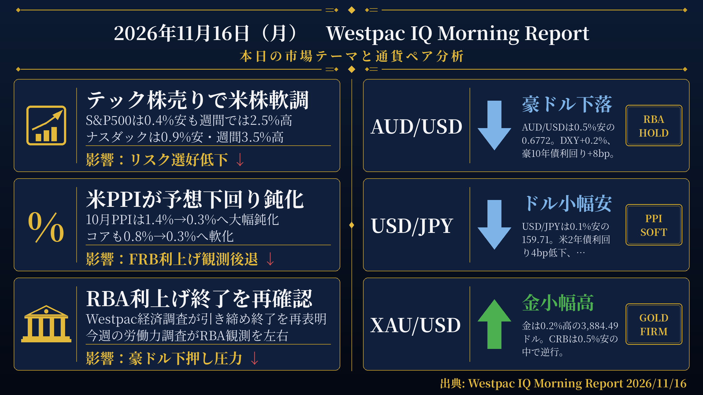
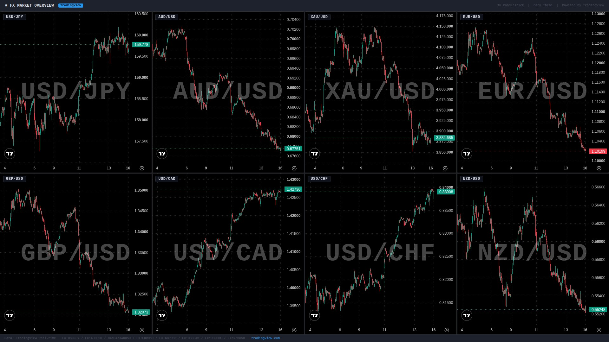

検証結果: **PASS** ／ モード: LIVE ／ 生成: 2026-11-16T08:02:53+09:00

## 本日の投稿素材
- 生成物フォルダ: https://github.com/MFlab-inc/westpac-morning-report/tree/main/outputs/2026-11-16
- レポート画像（投稿1に添付）: https://github.com/MFlab-inc/westpac-morning-report/raw/main/outputs/2026-11-16/report_image.png
- チャート画像（投稿2に添付）: https://github.com/MFlab-inc/westpac-morning-report/raw/main/outputs/2026-11-16/charts_1h.jpg

## 1. レポート画像（X投稿1に添付）


## 2. チャート画像（X投稿2に添付）


## 3. X投稿1（コピー用｜加重文字数 430）
```text
【11/16(月) 朝の為替市況】

■テック株売り
→S&P500は0.4%安の7,562も週間では2.5%高
→ナスダックは0.9%安も週間では3.5%高
→リスク選好が低下し豪ドルは0.5%安の0.6772ドル

■米PPI
→10月PPIは前年比1.4%から0.3%へ大幅鈍化
→コアPPIも0.8%から0.3%へ軟化
→米2年債利回りは4bp低下して4.84%

■RBA政策見通し
→Westpacが引き締めサイクル終了を再確認
→今週の労働力調査がRBA観測を左右する見通し
→豪3年・10年国債利回りはそれぞれ7bp・8bp上昇

#ドル円 #米PPI
```

## 4. X投稿2（コピー用｜加重文字数 915）
```text
【通貨別分析 11/16】

#USDJPY 159.71 ↓ ドル小幅安・円高
根拠：前日比0.1%下落。米PPIが予想を下回り米2年債利回りが4bp低下して4.84%となる中、USD/JPYは小幅に下落。DXYは0.2%上昇して103.41。

#AUDUSD 0.6772 ↓ 豪ドル下落
根拠：前日比0.5%下落。DXYが0.2%上昇する中、豪3年・10年国債利回りがそれぞれ7bp・8bp上昇。Westpacは今週の労働力調査がRBA観測に影響するとしている。

#XAUUSD 3884.49 ↑ 金小幅高
根拠：前日比0.2%上昇。CRBインデックスが0.5%安となる中で逆行。米2年債利回りは4bp低下して4.84%、米10年債利回りは1bp上昇して5.14%。

#EURUSD 1.1023 ↓ ユーロ下落
根拠：前日比0.3%下落。DXYが0.2%上昇する中、ユーロ圏Q3GDP第2次速報値は予想どおり前期比0.4%・前年比1.3%で修正なし。ドイツ10年Bund利回りは3bp上昇して3.38%。

#GBPUSD ↓ ポンド小幅安
根拠：AUD/USDが0.5%安、AUD/GBPが0.4%安となる中、GBP/USDは小幅下落と推定される。英10年ギルト利回りは4bp上昇して5.34%、FTSE100は0.4%高。

出典: Westpac IQ Morning Report 2026/11/16
#ドル円 #為替
```

## 5. レポート本文
<details><summary>クリックで全文を表示</summary>

# 2026年11月16日（月） Westpac IQ Morning Report

## 1. ファンダメンタルズ・マクロ経済分析

金曜日はテック株への売りが再燃し、リスク選好が低下した。S&P500は0.4%安の7,562で引けたが、週間では2.5%高。ナスダックは0.9%安も週間では3.5%高。ダウ平均は0.1%高で週間約2.0%高。欧州株は金曜日に小幅まちまちながら週間では堅調で、ユーロ・ストックス50は0.2%安も週間3.5%高、FTSE100は0.4%高で週間2.1%高。アジアでは日経平均が0.5%高、ハンセン指数が1.6%安。国内のS&P/ASX200は0.7%安の9,082。SPI200先物は9,114で変わらず。

米国の生産者物価指数（PPI）は10月に前年比1.4%から0.3%へ大幅に鈍化し、食品・エネルギーを除くコアも0.8%から0.3%へ軟化した。これを受けてFRBの積極的な利上げ観測が後退し、米2年債利回りは4bp低下して4.84%となった。一方、米10年債利回りは1bp上昇して5.14%。ニューヨーク連銀のウィリアムズ総裁とシカゴ連銀のグールズビー総裁はインフレ圧力と上振れリスクに引き続き注目し、追加引き締めが必要との見解を示した。市場は2026年末までに約25bpの利上げ、2027年末までに約60bpの利上げを織り込んでいる。

ユーロ圏では、ドイツ10年Bund利回りが3bp上昇して3.38%、英国10年ギルト利回りが4bp上昇して5.34%、日本10年国債利回りが6bp上昇して2.87%となるなど、欧州・日本の長期金利は概ね上昇した。豪州では3年国債利回りが7bp上昇して4.79%、10年国債利回りが8bp上昇して5.12%となった。OIS市場はRBAが2027年の大半にわたって政策金利を据え置くと予想しており、12月の利上げ確率はほぼゼロ、2027年2月会合での引き締め織り込みは約7bpにとどまる。その後は利下げの可能性へとシフトしている。今週の労働力調査が市場の織り込みに影響を与えると見られる。

ユーロ圏のQ3GDP第2次速報値は予想どおりで、速報値から修正なしの前期比0.4%・前年比1.3%となった。ユーロ圏の貿易収支は9月に赤字が拡大し、修正後の前月EUR78億から EUR87億へと小幅に拡大した。

Westpac経済調査チームは11月マーケット・アウトルックを公表し、RBAの引き締めサイクルが終了したとの見解を再確認した。

コモディティ市場は概ね軟調で、CRBインデックスは0.5%安の386.51。WTI原油は0.2%安の88.56ドル/バレル。原料炭は0.4%安の252.00ドル/トン、鉄鉱石は0.5%安の90.00ドル/トン、銅は1.4%安。一般炭は0.3%高の145.75ドル/トンと逆行。ACCUは4.3%安の36.13ドル。原油は週間でほぼ3.0%安となった。金は0.2%高の3,884.49ドル/オンスと小幅上昇した。

## 2. テクニカル分析と本日の展望

### USD/JPY ― 下落（↓）

現値：159.71（前日比−0.1%）。米PPIが予想を下回り、米2年債利回りが4bp低下して4.84%となる中、USD/JPYは小幅に下落した。一方でDXYは0.2%上昇して103.41となっており、ドル全体の動きとは一部乖離が見られる。日本10年国債利回りは6bp上昇して2.87%となった。本日は日本のQ3GDP速報値（予想前期比0.1%、前回0.4%）が注目される。

### AUD/USD ― 下落（↓）

現値：0.6772（前日比−0.5%）。豪ドルは対ドルで0.5%下落し、貿易加重指数も0.5%低下して63.3となった。豪州の3年・10年国債利回りがそれぞれ7bp・8bp上昇する中、豪ドルは軟調に推移した。DXYは0.2%上昇。Westpacは今週の労働力調査がRBA政策見通しに影響を与えるとしており、引き続き注目される。

### XAU/USD ― 上昇（↑）

現値：3,884.49（前日比+0.2%）。金は0.2%上昇し、CRBインデックスが0.5%安となる中で小幅に逆行した。米2年債利回りが4bp低下して4.84%となる一方、米10年債利回りは1bp上昇して5.14%となった。

### EUR/USD ― 下落（↓）

現値：1.1023（前日比−0.3%）。EUR/USDは0.3%下落した。DXYが0.2%上昇する中、ユーロ圏のQ3GDP第2次速報値は予想どおりで修正なし（前期比0.4%・前年比1.3%）、ユーロ圏の貿易赤字は9月に修正後EUR78億からEUR87億へ小幅拡大した。ドイツ10年Bund利回りは3bp上昇して3.38%。

### GBP/USD ― 下落（↓）

原文のFXレート表にGBP/USDの現値の記載なし。方向感の導出：原文にAUD/USD前日比−0.5%、AUD/GBP前日比−0.4%の記載がある。GBP/USDの変化率≒AUD/USDの変化率−AUD/GBPの変化率＝（−0.5%）−（−0.4%）＝約−0.1%となり、GBP/USDは小幅下落と推定される。英国10年ギルト利回りは4bp上昇して5.34%、FTSE100は0.4%高となった。

## 3. 本日の重要イベント

| 時刻(JST) | 国 | イベント | 予想 | 前回 |
|---|---|---|---|---|
| 6:30 | NZ | BusinessNZ PSI（10月） | - | 50.9pts |
| 8:50 | JP | GDP（Q3速報値） | 0.1% | 0.4% |
| 9:01 | GB | Rightmove住宅価格（11月） | - | 1.0% |
| 11:00 | CN | 小売売上高（前年比YTD、10月） | - | 1.1% |
| 11:00 | CN | 鉱工業生産（前年比YTD、10月） | - | 5.3% |
| 11:00 | CN | 固定資産投資（前年比YTD、10月） | 7.0% | 7.2% |
| 13:30 | JP | 鉱工業生産（9月確報値） | - | 2.2% |
| 19:00 | EZ | 鉱工業生産（9月） | - | -0.5% |

出典: Westpac IQ Morning Report 2026/11/16

</details>

## 6. 機械検証ゲート
| ゲート | 判定 | 詳細 |
|---|---|---|
| G1 日付整合 | ✅ PASS | date_jst=2026-11-16 / 本文に「2026年11月16日」/ 投稿2と本文に「2026/11/16」を要求 |
| G2 暗号通貨語の混入ゼロ | ✅ PASS |  |
| G3 対象5ペア限定 | ✅ PASS |  |
| G4 プレースホルダ残存なし | ✅ PASS |  |
| G5 出典表記（本文・投稿2） | ✅ PASS |  |
| G6 規定ハッシュタグ | ✅ PASS |  |
| G7 投稿にURLなし（Intent URL禁止） | ✅ PASS |  |
| G8 数値のPDF原文照合 | ✅ PASS | 18個の数値を照合しすべて原文に存在 |
| G9 イベント時刻JST換算チェック | ✅ PASS | 時差2時間で換算した期待値['06:30', '08:50', '09:01', '11:00', '13:30', '19:00']と本文イベント表['06:30', '08:50', '09:01', '11:00', '13:30', '19:00']が一致 |
| G10 投稿2に「未確認」を含めない | ✅ PASS |  |
| G11 通貨ペア方向感の照合 | ✅ PASS | 4ペアの向きが原文と一致（判定対象外: GBP/USD） |
| I1 post1 加重文字数 | ℹ️ INFO | 430 |
| I2 post2 加重文字数 | ℹ️ INFO | 915 |
| I3 post1 →行の読点過多 | ℹ️ INFO | なし |

## 7. 投稿手順（方式A：手動投稿）
- [ ] 画像2枚と投稿文を確認した
- [ ] 投稿1をXへ投稿した（レポート画像を添付）
- [ ] 投稿2をXへ投稿した（チャート画像を添付）
- [ ] このIssueをCloseした（＝投稿完了の記録）

---
生成物: [`outputs/2026-11-16/`](https://github.com/MFlab-inc/westpac-morning-report/tree/main/outputs/2026-11-16) ／ 元PDF: https://library.westpaciq.com.au/content/dam/public/westpaciq/secure/economics/documents/aus/2026/11/WBC_MorningReport16Nov2026.pdf
修正したい場合はこのIssueにコメントを残し、翌日以降の改善に反映します（フェーズ2で再生成コマンドに対応予定）。