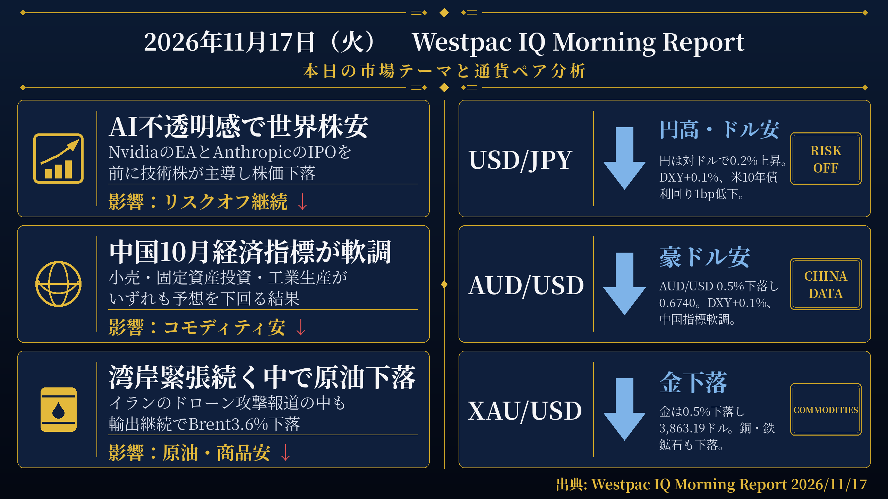
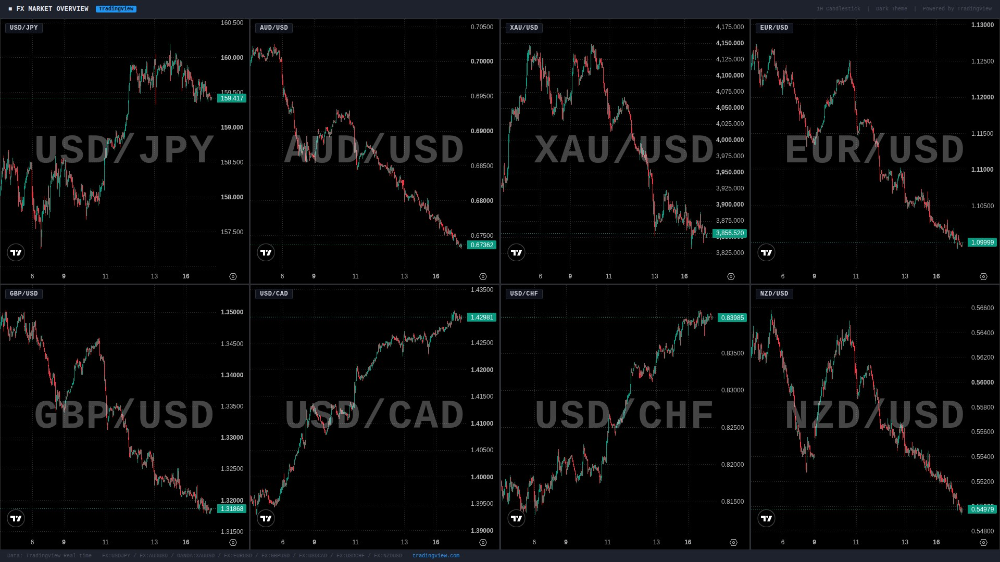

> [!CAUTION]
> 機械検証で不合格のゲートがあります。**このままXへ投稿しないでください。**
> 下の検証結果を確認し、修正が必要な場合はこのIssueにコメントで指示してください。

検証結果: **FAIL** ／ モード: LIVE ／ 生成: 2026-11-17T08:02:43+09:00

## 本日の投稿素材
- 生成物フォルダ: https://github.com/MFlab-inc/westpac-morning-report/tree/main/outputs/2026-11-17
- レポート画像（投稿1に添付）: https://github.com/MFlab-inc/westpac-morning-report/raw/main/outputs/2026-11-17/report_image.png
- チャート画像（投稿2に添付）: https://github.com/MFlab-inc/westpac-morning-report/raw/main/outputs/2026-11-17/charts_1h.jpg

## 1. レポート画像（X投稿1に添付）


## 2. チャート画像（X投稿2に添付）


## 3. X投稿1（コピー用｜加重文字数 468）
```text
【11/17(火) 朝の為替市況】

■世界株安
→NvidiaのEAとAnthropicのIPOを前にAI不透明感が高まる
→S&P500は2.1%安、NASDAQ2.3%安、日経225は2.4%安
→トランプ政権の先端チップ輸出規制も市場心理を悪化

■中国経済指標
→10月小売売上高の年間成長率が0.4%に鈍化
→固定資産投資は年初来8.1%低下と落ち込み拡大
→工業生産の年間成長率も5.5%から4.8%に鈍化

■原油・コモディティ
→Brentは3.6%安の92.4ドル、WTIは3.3%安の85.6ドル
→金は0.5%安の3,863.19ドル
→鉄鉱石は2.7%安の88.05ドル

#ドル円 #中国経済
```

## 4. X投稿2（コピー用｜加重文字数 610）
```text
【通貨別分析 11/17】

#USDJPY 159.47 ↓ 円高・ドル安
根拠：円は対ドルで0.2%上昇。DXYは0.1%高の103.51、米10年債利回りは1bp低下し5.12%。

#AUDUSD 0.6740 ↓ 豪ドル安
根拠：AUD/USDは0.5%下落。DXYが小幅上昇する中、中国10月経済指標が軟調で鉄鉱石は2.7%安。

#XAUUSD 3863.19 ↓ 金下落
根拠：金は0.5%下落。銅1.1%安・鉄鉱石2.7%安など商品全般が下落する中での動き。

#EURUSD 1.1003 ↓ ユーロ安
根拠：ユーロは対ドルで0.2%下落し一時1.10を割り込む場面も。DXYは0.1%上昇。

#GBPUSD ↓ ポンド安
根拠：ポンドは対ドルで0.2%下落。DXYは0.1%上昇し103.51、米10年債利回りは1bp低下。

出典: Westpac IQ Morning Report 2026/11/17
#ドル円 #為替
```

## 5. レポート本文
<details><summary>クリックで全文を表示</summary>

# 2026年11月17日（火） Westpac IQ Morning Report

## 1. ファンダメンタルズ・マクロ経済分析

世界株式市場はリスク回避の動きが強まる中、週明けから大幅に下落した。NvidiaのEA（決算発表）とAnthropicの新規株式公開（IPO）を今週に控え、AI関連銘柄への不透明感が技術株を中心に売りを誘った。加えて、トランプ政権が特定国のデータセンター事業者に対し、米国製先端チップの輸出に政府ライセンスを義務付ける新規制を発表したことも市場心理を悪化させた。S&P 500は2.1%下落、NASDAQは2.3%の下落、ダウ・ジョーンズは1.4%の下落となった。欧州ではユーロ・ストックス50が0.6%安、FTSE 100が0.2%安。アジアでもKOSPIが3.6%下落、日経225が2.4%下落した。香港ハンセン指数は0.5%上昇と地域の流れに逆行した。国内ASX 200は0.4%下落した。

米国債利回りは週初に小幅低下し、2年債利回りが2bp低下、10年債利回りが1bp低下した。先物市場は12月のFRBによる追加利上げをほぼ確実視しており、年末の実効フェデラルファンズ金利の織り込みは4.14%となっている。2027年3月・6月の追加利上げも完全に織り込まれている。豪州国債利回りは3年債・10年債ともに1bp上昇とほぼ横ばいで推移した。スワップ市場は近い将来の政策金利変更の可能性を低く見ており、年末の政策金利の織り込みは4.87%となっている。本日はRBAの11月理事会議事録が公表され、6対3の分割決定の背景に注目が集まる。

国際経済指標では、米国のニューヨーク連銀製造業景気指数が11月に25.5から7.8へ低下した。現水準は歴史的平均をやや上回る水準にある。FRB議長（Warsh）はサンフランシスコ連銀主催のAIシンポジウムで、FRBスタッフが検討を始めた3つの長期AIシナリオ（生産性向上・AI起因の失業・AI開発の失望）について初期的な見解を示したが、現在の金融政策については言及しなかった。ユーロ圏の鉱工業生産は9月に前月比0.2%上昇し、8月の0.5%低下から回復したが、前年比では1.5%の低下となっている。中国の10月経済指標は予想を下回る内容となった。小売売上高の年間成長率は0.4%に鈍化（年初来は1.0%でほぼ横ばい）、固定資産投資の年初来の落ち込みは拡大し経済全体で8.1%の低下、工業生産の年間成長率は5.5%から4.8%に鈍化（年初来は5.3%で横ばい）となった。不動産セクターは引き続き深刻な状況にあり、投資は年初来で21.6%減、不動産販売は年初来で14.1%減、新築・中古住宅価格はそれぞれ0.15%・0.24%の下落となっている。

原油はイランがバーレーンに向けてドローンを3日間で2度目に発射したと報じられ、米空母3隻目が地域に到着するなど緊張が続く中も輸出が継続し、価格は下落した。Brentは3.6%下落し92.4ドル/バレル、WTIは3.3%下落し85.6ドル/バレルとなった。金・銅・アルミニウム・鉄鉱石もそれぞれ0.5%・1.1%・0.2%・2.7%下落した。

## 2. テクニカル分析と本日の展望

### USD/JPY ― 下落（↓）

現値：159.47。原文に「円は対ドルで0.2%上昇」と直接記載されており、USD/JPYは下落（円高・ドル安）と判断する。DXYは0.1%上昇し103.51と小幅なドル高の中、円は主要通貨の中で逆行して上昇した。米10年債利回りは1bp低下し5.12%となっている。本日はRBA議事録のほか、米小売売上高（10月）の発表が予定されており、結果次第でドル・円双方に影響が及ぶ可能性がある。

### AUD/USD ― 下落（↓）

現値：0.6740。AUD/USDは0.5%下落した。DXYが0.1%上昇する中、中国の10月経済指標が軟調な内容となり、コモディティ価格も総じて下落した。鉄鉱石は2.7%下落し88.05ドル/トン、銅は1.1%下落した。豪州国債利回りはほぼ横ばいで、スワップ市場は近い将来の政策金利変更の可能性を低く見ている。本日のRBA議事録が豪ドルの方向性に影響を与える可能性がある。

### XAU/USD ― 下落（↓）

現値：3,863.19。金は0.5%下落した。銅（1.1%安）・アルミニウム（0.2%安）・鉄鉱石（2.7%安）など産業用金属・コモディティも広く下落する中、金も同様の動きとなった。原文は「recent themes persisted（最近のテーマが継続）」と記述している。VIX指数は26.0%上昇し24.31と、市場の不確実性が高まっている。

### EUR/USD ― 下落（↓）

現値：1.1003。ユーロは対ドルで0.2%下落し、一時1.10を割り込む場面もあった。DXYは0.1%上昇。ユーロ圏の鉱工業生産は9月に前月比0.2%上昇したものの、前年比では1.5%の低下となっている。本日はユーロ圏ZEW景況感調査（11月）の発表が予定されている。

### GBP/USD ― 下落（↓）

原文のFXレート表にGBP/USDの現値の記載なし。原文に「sterling declined 0.2%」と直接記載されており、GBP/USDは下落と判断する。AUD/GBPは0.2%下落、AUD/USDは0.5%下落しており、クロス計算（GBP/USD変化率≒AUD/USD変化率−AUD/GBP変化率＝−0.5%−(−0.2%)＝−0.3%）でも下落方向と整合する。本日は英国のILO失業率（9月）の発表が予定されており、予想は4.7%（前回4.7%）となっている。

## 3. 本日の重要イベント

| 時刻(JST) | 国 | イベント | 予想 | 前回 |
|---|---|---|---|---|
| 6:45 | NZ | 食品価格指数（10月） | - | 0.0% |
| 9:30 | AU | RBA議事録（11月） | - | - |
| 11:00 | NZ | RBNZ インフレ期待（Q4） | - | 2.3% |
| 16:00 | GB | ILO失業率（9月） | 4.7% | 4.7% |
| 19:00 | EZ | ZEW景況感調査（11月） | - | 18.5pts |
| 23:30 | US | 小売売上高（10月） | 0.2% | 0.8% |
| 23:30 | US | 輸入物価指数（10月） | 0.7% | 1.1% |
| 1:00(翌日) | US | 企業在庫（9月） | 0.5% | 0.4% |
| 1:00(翌日) | US | NAHB住宅市場指数（11月） | 29pts | 29pts |

出典: Westpac IQ Morning Report 2026/11/17

</details>

## 6. 機械検証ゲート
| ゲート | 判定 | 詳細 |
|---|---|---|
| G1 日付整合 | ✅ PASS | date_jst=2026-11-17 / 本文に「2026年11月17日」/ 投稿2と本文に「2026/11/17」を要求 |
| G2 暗号通貨語の混入ゼロ | ✅ PASS |  |
| G3 対象5ペア限定 | ✅ PASS |  |
| G4 プレースホルダ残存なし | ✅ PASS |  |
| G5 出典表記（本文・投稿2） | ✅ PASS |  |
| G6 規定ハッシュタグ | ✅ PASS |  |
| G7 投稿にURLなし（Intent URL禁止） | ✅ PASS |  |
| G8 数値のPDF原文照合 | ✅ PASS | 14個の数値を照合しすべて原文に存在 |
| G9 イベント時刻JST換算チェック | ❌ FAIL | 時差2時間で換算した期待値['00:00', '06:45', '09:30', '11:00', '16:00', '19:00', '22:30']と本文イベント表['01:00', '06:45', '09:30', '11:00', '16:00', '19:00', '23:30']が不一致（原文時刻['00:30', '02:00', '08:45', '11:30', '13:00', '18:00', '21:00']。原文のAEST/AEDT表記は無視しzoneinfoベースの時差2時間を正としている） |
| G10 投稿2に「未確認」を含めない | ✅ PASS |  |
| G11 通貨ペア方向感の照合 | ✅ PASS | 5ペアの向きが原文と一致（判定対象外: なし） |
| I1 post1 加重文字数 | ℹ️ INFO | 468 |
| I2 post2 加重文字数 | ℹ️ INFO | 610 |
| I3 post1 →行の読点過多 | ℹ️ INFO | 5行目 読点2個 |

## 7. 投稿手順（方式A：手動投稿）
- [ ] 画像2枚と投稿文を確認した
- [ ] 投稿1をXへ投稿した（レポート画像を添付）
- [ ] 投稿2をXへ投稿した（チャート画像を添付）
- [ ] このIssueをCloseした（＝投稿完了の記録）

---
生成物: [`outputs/2026-11-17/`](https://github.com/MFlab-inc/westpac-morning-report/tree/main/outputs/2026-11-17) ／ 元PDF: https://library.westpaciq.com.au/content/dam/public/westpaciq/secure/economics/documents/aus/2026/11/WBC_MorningReport17Nov2026.pdf
修正したい場合はこのIssueにコメントを残し、翌日以降の改善に反映します（フェーズ2で再生成コマンドに対応予定）。