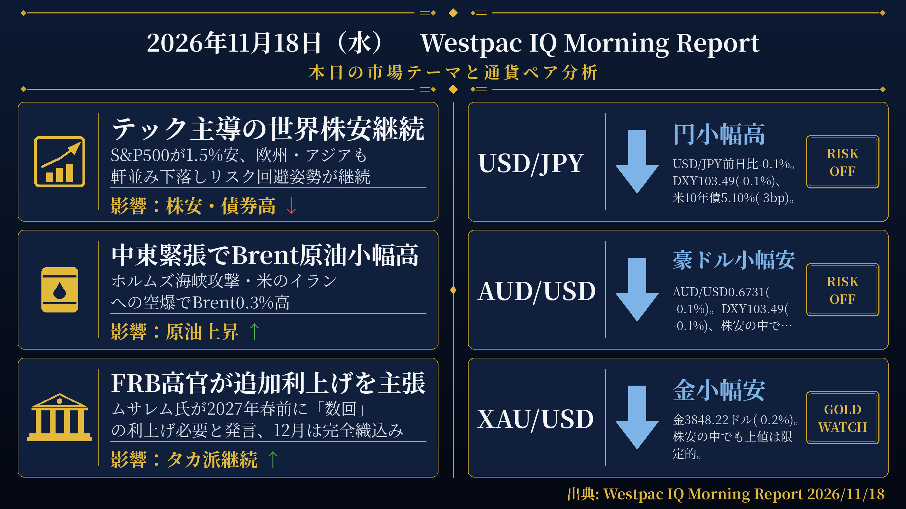
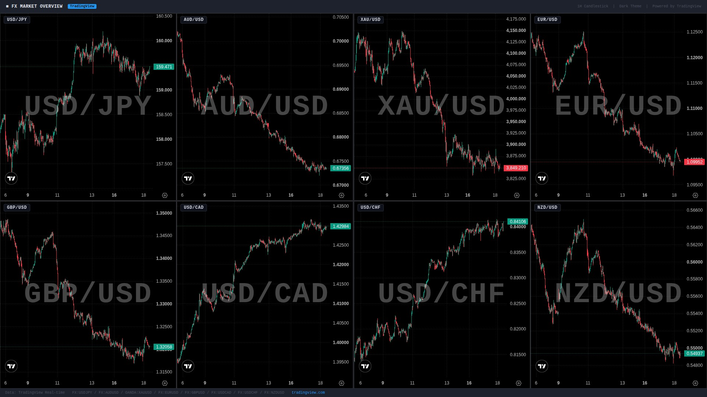

検証結果: **PASS** ／ モード: LIVE ／ 生成: 2026-11-18T08:02:57+09:00

## 本日の投稿素材
- 生成物フォルダ: https://github.com/MFlab-inc/westpac-morning-report/tree/main/outputs/2026-11-18
- レポート画像（投稿1に添付）: https://github.com/MFlab-inc/westpac-morning-report/raw/main/outputs/2026-11-18/report_image.png
- チャート画像（投稿2に添付）: https://github.com/MFlab-inc/westpac-morning-report/raw/main/outputs/2026-11-18/charts_1h.jpg

## 1. レポート画像（X投稿1に添付）


## 2. チャート画像（X投稿2に添付）


## 3. X投稿1（コピー用｜加重文字数 524）
```text
【11/18(水) 朝の為替市況】

■世界株安
→S&P500が1.5%安、ダウが1.9%安、NASDAQが1.3%安
→ユーロ・ストックス50が2.1%安、英FTSEが1.8%安と2日続落
→ASX200も1.8%安と広範な下落、VIXは18.4%上昇し27.12

■FRB高官発言
→ムサレム氏が2027年春前に「数回」の利上げ必要と発言
→12月利上げは完全織込み、1月追加利上げも過半数が見込む

■米経済指標
→10月小売売上高ヘッドラインが予想を0.1ポイント上回る前月比0.2%増
→コントロールグループは予想を0.3ポイント上回る0.6%増
→11月NAHB住宅市場指数が29から25へ低下し2011年以来の最低水準

#ドル円 #米小売売上高
```

## 4. X投稿2（コピー用｜加重文字数 965）
```text
【通貨別分析 11/18】

#USDJPY 159.34 ↓ 円小幅高
根拠：USD/JPYは前日比-0.1%。DXYは103.49(-0.1%)とサイクル高値103.8近辺から押し返され、米2年債利回りは5bp低下し4.78%、10年債は3bp低下し5.10%となった。

#AUDUSD 0.6731 ↓ 豪ドル小幅安
根拠：AUD/USDは前日比-0.1%。11月初旬からの下落トレンドの後、小幅な安定化の兆しも見られる。DXYは103.49と高水準にあり、世界的な株安が続く中での推移となった。

#XAUUSD 3848.22ドル ↓ 金小幅安
根拠：金は前日比-0.2%。原文では「ほぼ横ばい」と記載されており変動は小幅。DXYが103.49と高水準を維持する中、中東情勢の緊迫化が続いている。

#EURUSD 1.1005 ↑ ユーロ小幅高
根拠：EUR/USDは前日比+0.1%。DXYが103.8近辺のサイクル高値から103.49へ小幅に押し返される中、ユーロ圏の11月ZEW投資家期待指数は18.5から26.5へ上昇した。

#GBPUSD ↑ ポンド小幅高
根拠：ポンドは対ドルで0.2%上昇。英国9月ILO失業率は4.7%から4.6%へ低下し、3か月間の雇用者数は155,000人増加した。本日は英国10月CPIの発表が予定されている。

出典: Westpac IQ Morning Report 2026/11/18
#ドル円 #為替
```

## 5. レポート本文
<details><summary>クリックで全文を表示</summary>

# 2026年11月18日（水） Westpac IQ Morning Report

## 1. ファンダメンタルズ・マクロ経済分析

世界の株式市場はリスク回避姿勢が続き、テクノロジー株主導の売りが拡大した。米国ではS&P500が1.5%安、ダウ工業株30種が1.9%安、NASDAQが1.3%安となった。欧州でもユーロ・ストックス50が2.1%安、英FTSEが1.8%安と2日続落。アジアでは日経平均が1.3%安、ハンセン指数が1.0%安、CSI300が0.1%安、ASX200が1.8%安と広範な下落となった。VIX指数は18.4%上昇し27.12に達した。

米国債はリスク回避の動きを受けてブル・スティープニングとなった。2年債利回りは5bp低下し4.78%、10年債は3bp低下し5.10%、30年債は1bp低下し5.58%となった。ドイツ10年債・日本10年債はともに1bp低下、英10年債は横ばいだった。豪州国債は国内取引中は動かなかったが、夜間の先物取引で3年債・10年債ともに2bp低下した。

FRBのムサレム氏は2027年春前に「数回」の利上げが必要と発言し、インフレリスクの持続に懸念を示した。金融環境は景気を支援する水準にあり、労働市場はほぼ完全雇用に近いと評価した。12月のFOMC利上げは完全に織り込まれており、1月の追加利上げも市場の過半数が見込んでいる。

RBA議事録では、11月の利上げに反対した委員が「経済が著しく急激な景気後退に近づいている可能性」と「雇用への相当なコスト」を懸念していたことが明らかになった。市場は2027年末まで利上げも利下げも完全には織り込んでいない状況が続いている。

中東情勢ではホルムズ海峡での船舶攻撃、バーレーンの米軍装備への攻撃、米国によるイランのケシュム島への「自衛」空爆が報告された。Brent原油は0.3%高の92.7ドル/バレルとなった。WTI先物は0.4%安の85.40ドル。LME銅は0.2%安の13,226ドル/トン、LMEアルミニウムは2.3%安の2,934ドル/トンとなった。金価格はほぼ横ばいだった。

米国の経済指標では、10月小売売上高がヘッドラインで市場予想を0.1ポイント上回る前月比0.2%増、コントロールグループは予想を0.3ポイント上回る0.6%増となった。10月鉱工業生産は前月比0.4%低下した。9月企業在庫は前月比0.5%増加し、8月の0.4%増に続く伸びとなった。10月輸入物価指数は前月比1.1%上昇（石油除くベースでは0.8%上昇）となった。11月NAHB住宅市場指数は29から25へ低下し、2011年以来の最低水準となった。

ユーロ圏では11月ZEW投資家期待指数が18.5から26.5へ上昇し、調査の全期間の平均を上回る水準となった。英国では9月ILO失業率が4.7%から4.6%へ低下し、9月までの3か月間の雇用者数は155,000人増加した。平均週次賃金の伸びは3.8%から3.6%（前年比）へ小幅鈍化した。

ニュージーランドでは10月の物価動向が概ね予想に沿った内容で、食品価格の軟調さと旅行関連の変動カテゴリーの上昇が相殺し合った。

豪州では11月ウエストパック住宅センチメント指数が2.2%低下し83.2となり、深刻な悲観的水準と整合的な結果となった。

## 2. テクニカル分析と本日の展望

### USD/JPY ― 下落（↓）

現値：159.34（前日比-0.1%）。DXYは103.49（-0.1%）と小幅低下し、サイクル高値の103.8近辺から押し返された。米2年債利回りが5bp低下し4.78%、10年債が3bp低下し5.10%となる中、円は対ドルで0.1%上昇した。FRBのタカ派姿勢は継続しているものの、リスク回避の動きが米国債に資金を向け、利回り低下が円を下支えした格好となっている。本日は豪州賃金指数（Q3）や英国CPI（10月）、米国住宅着工件数・建設許可件数（10月）などが予定されており、引き続きリスク動向とFRB関連の発言に注目が集まる。

### AUD/USD ― 下落（↓）

現値：0.6731（前日比-0.1%）。11月初旬からの一貫した下落トレンドの後、小幅な安定化の兆しも見られる。DXYが103.49と依然として高水準にある中、世界的な株安が続いており、豪ドルは上値の重い展開が続いている。本日は豪州賃金指数（Q3）の発表が予定されており、前回値0.8%（前期比）・前回値3.2%（前年比）に対して予想はそれぞれ1.0%・3.4%と加速が見込まれており、結果次第でRBAの政策見通しへの影響が注目される。

### XAU/USD ― 下落（↓）

現値：3,848.22ドル（前日比-0.2%）。原文では「金価格はほぼ横ばい（broadly steady）」と記載されており、変動は小幅にとどまっている。世界的な株安が続く中でも金の上値は限られており、DXYが103.49と高水準を維持している。中東情勢の緊迫化が続く一方、FRBのタカ派姿勢も意識される状況となっている。

### EUR/USD ― 上昇（↑）

現値：1.1005（前日比+0.1%）。ユーロは対ドルで0.1%上昇した。DXYはサイクル高値の103.8近辺から103.49へ押し返された。ユーロ圏では11月ZEW投資家期待指数が18.5から26.5へ上昇し、平均を上回る水準となった。DXYの小幅な反落の中でユーロは小幅に値を戻している。

### GBP/USD ― 上昇（↑）

原文のFXレート表にGBP/USDの現値の記載なし。原文に「ポンドは対ドルで0.2%上昇（Sterling gained 0.2%）」と直接記載されているため、これを根拠として上昇と判断する。英国では9月ILO失業率が4.7%から4.6%へ低下し、雇用者数も3か月で155,000人増加した。平均週次賃金の伸びは3.8%から3.6%へ小幅鈍化した。本日は英国10月CPIの発表（予想0.5%、前回0.4%）が予定されており、結果が注目される。

## 3. 本日の重要イベント

| 時刻(JST) | 国 | イベント | 予想 | 前回 |
|---|---|---|---|---|
| 6:45 | NZ | NZ PPI Q3 | - | 1.6% |
| 8:30 | AU | ウエストパック・メルボルン研究所景気先行指数 10月 | - | -0.1% |
| 9:30 | AU | 賃金指数 Q3（前期比） | 1.0% | 0.8% |
| 9:30 | AU | 賃金指数 Q3（前年比） | 3.4% | 3.2% |
| 16:00 | GB | CPI 10月 | 0.5% | 0.4% |
| 22:30 | US | 住宅着工件数 10月 | 2.4% | -5.2% |
| 22:30 | US | 建設許可件数 10月（速報値） | -1.6% | -0.4% |
| 0:00(翌日) | US | 中古住宅販売仮契約 10月 | -1.9% | -7.3% |

出典: Westpac IQ Morning Report 2026/11/18

</details>

## 6. 機械検証ゲート
| ゲート | 判定 | 詳細 |
|---|---|---|
| G1 日付整合 | ✅ PASS | date_jst=2026-11-18 / 本文に「2026年11月18日」/ 投稿2と本文に「2026/11/18」を要求 |
| G2 暗号通貨語の混入ゼロ | ✅ PASS |  |
| G3 対象5ペア限定 | ✅ PASS |  |
| G4 プレースホルダ残存なし | ✅ PASS |  |
| G5 出典表記（本文・投稿2） | ✅ PASS |  |
| G6 規定ハッシュタグ | ✅ PASS |  |
| G7 投稿にURLなし（Intent URL禁止） | ✅ PASS |  |
| G8 数値のPDF原文照合 | ✅ PASS | 18個の数値を照合しすべて原文に存在 |
| G9 イベント時刻JST換算チェック | ✅ PASS | 時差2時間で換算した期待値['00:00', '06:45', '08:30', '09:30', '16:00', '22:30']と本文イベント表['00:00', '06:45', '08:30', '09:30', '16:00', '22:30']が一致 |
| G10 投稿2に「未確認」を含めない | ✅ PASS |  |
| G11 通貨ペア方向感の照合 | ✅ PASS | 5ペアの向きが原文と一致（判定対象外: なし） |
| I1 post1 加重文字数 | ℹ️ INFO | 524 |
| I2 post2 加重文字数 | ℹ️ INFO | 965 |
| I3 post1 →行の読点過多 | ℹ️ INFO | 4行目 読点2個 |

## 7. 投稿手順（方式A：手動投稿）
- [ ] 画像2枚と投稿文を確認した
- [ ] 投稿1をXへ投稿した（レポート画像を添付）
- [ ] 投稿2をXへ投稿した（チャート画像を添付）
- [ ] このIssueをCloseした（＝投稿完了の記録）

---
生成物: [`outputs/2026-11-18/`](https://github.com/MFlab-inc/westpac-morning-report/tree/main/outputs/2026-11-18) ／ 元PDF: https://library.westpaciq.com.au/content/dam/public/westpaciq/secure/economics/documents/aus/2026/11/WBC_MorningReport18Nov2026.pdf
修正したい場合はこのIssueにコメントを残し、翌日以降の改善に反映します（フェーズ2で再生成コマンドに対応予定）。