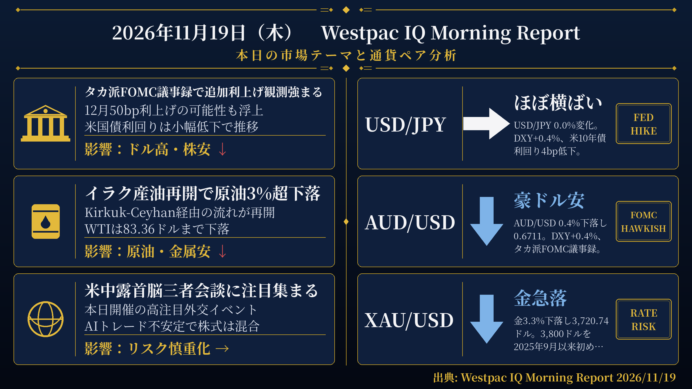
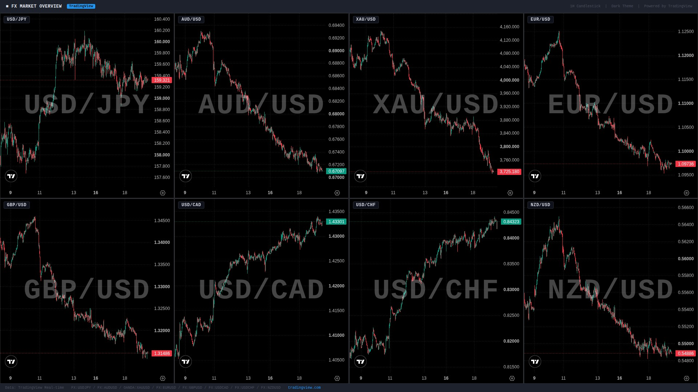

検証結果: **PASS** ／ モード: LIVE ／ 生成: 2026-11-19T08:03:08+09:00

## 本日の投稿素材
- 生成物フォルダ: https://github.com/MFlab-inc/westpac-morning-report/tree/main/outputs/2026-11-19
- レポート画像（投稿1に添付）: https://github.com/MFlab-inc/westpac-morning-report/raw/main/outputs/2026-11-19/report_image.png
- チャート画像（投稿2に添付）: https://github.com/MFlab-inc/westpac-morning-report/raw/main/outputs/2026-11-19/charts_1h.jpg

## 1. レポート画像（X投稿1に添付）


## 2. チャート画像（X投稿2に添付）


## 3. X投稿1（コピー用｜加重文字数 402）
```text
【11/19(木) 朝の為替市況】

■FOMC議事録
→タカ派的な内容で追加利上げ観測が強化
→ウォラー理事が12月50bp利上げの可能性を示唆

■原油・金属
→イラクのKirkuk-Ceyhan経由原油輸送再開でWTIが3.1%下落し83.36ドル
→金が3.3%下落し3,720.74ドルと3,800ドルを割込む
→銅がAIトレード懸念で5.7%下落し13,000ドルを割込む

■米中露首脳会談
→本日開催の三者会談に市場の注目が集まる
→S&P500は0.3%下落、ダウは1.2%下落

#ドル円 #FOMC
```

## 4. X投稿2（コピー用｜加重文字数 658）
```text
【通貨別分析 11/19】

#USDJPY 159.35 → ほぼ横ばい
根拠：前日比0.0%で変化なし。DXYは0.4%上昇、米10年債利回りは4bp低下して5.06%。

#AUDUSD 0.6711 ↓ 豪ドル安
根拠：前日比0.4%下落。DXYが0.4%上昇する中、ユーロが0.3%下落するなど主要通貨全般が対ドルで軟調となった。

#XAUUSD 3,720.74 ↓ 金急落
根拠：前日比3.3%下落し、2025年9月以来初めて3,800ドルを割り込んだ。FRBの追加引き締め観測が高まる中での下落。

#EURUSD 1.0965 ↓ ユーロ安
根拠：前日比0.3%下落。DXYが0.4%上昇し、ユーロ・ストックス50は0.9%下落。

#GBPUSD ↓ ポンド安
根拠：ポンドは対ドルで0.5%下落。英10年債利回りは8bp低下して5.29%、英FTSE100は1.3%下落。

出典: Westpac IQ Morning Report 2026/11/19
#ドル円 #為替
```

## 5. レポート本文
<details><summary>クリックで全文を表示</summary>

# 2026年11月19日（木） Westpac IQ Morning Report

## 1. ファンダメンタルズ・マクロ経済分析

水曜日のグローバル市場はリスク資産全般が軟調となった。タカ派的なFOMC議事録が今後数カ月の追加利上げ観測を強化し、FRBのウォラー理事が別途CNBCのインタビューで12月の50bp利上げの可能性を改めて示唆した。ウォラー理事はインフレが「誤った方向」に向かい、CPIバスケット全体に「広がっている」と述べ、FOMCは「もう少し積極的」になる必要があると主張した。

10月のFOMC議事録では、インフレが関税・エネルギー価格・AIインフラ投資によって押し上げられており、「市場ベースのコア非住宅サービス」カテゴリーでのインフレ高止まりが指摘された。参加者の大多数は、ベースラインの見通しのもとで追加利上げが適切と判断した。先物市場は12月の利上げをほぼ確実視し、2027年3月・6月の追加利上げも完全に織り込んでいる。

株式市場では、AIトレードの不安定さが続く中、S&P 500が0.3%下落、ダウ・ジョーンズは1.2%の大幅安となった。一方NASDAQは0.3%上昇。アジアでは、Nvidiaの好調な売上予想がAIトレードを一部支援し、日経225が0.3%上昇、KOSPIが2.0%上昇した一方、ハンセン指数は0.9%下落。ASX 200は0.7%下落した。

米国債利回りはタカ派議事録にもかかわらず小幅低下し、2年債が1bp低下、10年債は4bp低下した。市場は今後の利上げの多くをすでに織り込み済みとみているもようだ。豪州国債利回りも低下し、3年債が6bp、10年債が5bp低下した。

コモディティ面では、イラクがKirkuk-Ceyhan経由の原油輸送を12年ぶりに再開したと伝わり、Brentが1.3%下落して91.9ドル、WTIが3.1%下落して83.36ドルとなった。金はFRBの追加引き締め観測を背景に3.3%下落し、3,720.74ドルと2025年9月以来初めて3,800ドルを割り込んだ。銅はAIトレードへの懸念と中国経済指標の軟調さを背景に5.7%下落し、13,000ドルを割り込んだ。アルミニウムも3.8%の大幅下落となった一方、鉄鉱石は0.7%上昇した。

英国のCPIは10月に0.5%上昇（前年比3.6%）と予想通りの結果となった。コアインフレも前月から変わらず前年比2.8%、サービスインフレも9月と同水準の前年比3.7%だった。

米国では、住宅着工件数が10月に9.9%増加し、9月の7.0%減少を打ち消した。建築許可件数は9月の0.4%減少に続き、10月は7.4%減少した。米国の中古住宅販売仮契約は10月に4.7%減少し、9月の7.2%減少に続く落ち込みとなった。前年比では17.1%低い水準にある。

本日は米中露首脳による三者会談が注目される。

## 2. テクニカル分析と本日の展望

### USD/JPY ― ほぼ横ばい（→）

現値：159.35（前日比0.0%）。円は対ドルでほぼ変わらずの水準を維持した。DXYが0.4%上昇する中、円は主要通貨の中で相対的に底堅い動きを示した。米10年債利回りは4bp低下して5.06%となっており、日本の10年債利回りは2.88%で変化なし。タカ派的なFOMC議事録が発表されたが、USD/JPYへの影響は限定的だった。

### AUD/USD ― 下落（↓）

現値：0.6711（前日比−0.4%）。豪ドルは対ドルで0.4%下落した。DXYが0.4%上昇する中、主要通貨全般が対ドルで軟調となった。豪州3年債利回りは6bp低下、10年債利回りは5bp低下した。スワップ市場は年内の政策金利変更をほぼ見込んでおらず、年末の予想レートは4.86%となっている。本日は豪州10月雇用統計（予想：+2.5万人、前回：−3.93万人）と失業率（予想：4.7%、前回：4.7%）の発表が予定されており、注目される。

### XAU/USD ― 下落（↓）

現値：3,720.74ドル（前日比−3.3%）。金はFRBの追加引き締め観測を背景に3.3%下落し、2025年9月以来初めて3,800ドルを割り込んだ。原文はこの下落をFRBの追加引き締め観測と明示的に結びつけている。銅も5.7%下落するなどコモディティ全般が軟調な地合いとなった。

### EUR/USD ― 下落（↓）

現値：1.0965（前日比−0.3%）。ユーロは対ドルで0.3%下落した。DXYが0.4%上昇する中、ユーロも軟調となった。欧州株式市場ではユーロ・ストックス50が0.9%下落、英FTSE100が1.3%下落するなど欧州全般が弱い動きとなった。ドイツ10年債利回りは1bp低下して3.37%となった。

### GBP/USD ― 下落（↓）

原文のFXレート表にGBP/USDの現値の記載なし。原文には「sterling lost 0.5%」と直接記載されているため、これを根拠としてポンドは対ドルで0.5%下落と判断する。英国の10月CPIは前月比0.5%上昇（前年比3.6%）と予想通りの結果となった。コアインフレは前年比2.8%で前月から変わらず、サービスインフレも前年比3.7%と9月と同水準だった。英FTSE100は1.3%下落し、英10年債利回りは8bp低下して5.29%となった。

## 3. 本日の重要イベント

| 時刻(JST) | 国 | イベント | 予想 | 前回 |
|---|---|---|---|---|
| 6:45 | NZ | 貿易収支 10月 | - | -NZ1971m |
| 8:50 | JP | 機械受注 9月 | 1.5% | 5.2% |
| 9:30 | AU | 雇用者数変化 10月 | 25k | -39.3k |
| 9:30 | AU | 失業率 10月 | 4.7% | 4.7% |
| 22:30 | US | フィラデルフィア連銀製造業景気指数 11月 | 20.6pts | 20.9pts |
| 22:30 | US | 新規失業保険申請件数 2026/11/14週 | 198k | 200k |
| 0:00(翌日) | US | 景気先行指数 10月 | 0pts | 0pts |
| 1:00(翌日) | US | カンザスシティ連銀製造業景気指数 11月 | 11pts | 11pts |

出典: Westpac IQ Morning Report 2026/11/19

</details>

## 6. 機械検証ゲート
| ゲート | 判定 | 詳細 |
|---|---|---|
| G1 日付整合 | ✅ PASS | date_jst=2026-11-19 / 本文に「2026年11月19日」/ 投稿2と本文に「2026/11/19」を要求 |
| G2 暗号通貨語の混入ゼロ | ✅ PASS |  |
| G3 対象5ペア限定 | ✅ PASS |  |
| G4 プレースホルダ残存なし | ✅ PASS |  |
| G5 出典表記（本文・投稿2） | ✅ PASS |  |
| G6 規定ハッシュタグ | ✅ PASS |  |
| G7 投稿にURLなし（Intent URL禁止） | ✅ PASS |  |
| G8 数値のPDF原文照合 | ✅ PASS | 19個の数値を照合しすべて原文に存在 |
| G9 イベント時刻JST換算チェック | ✅ PASS | 時差2時間で換算した期待値['00:00', '01:00', '06:45', '08:50', '09:30', '22:30']と本文イベント表['00:00', '01:00', '06:45', '08:50', '09:30', '22:30']が一致 |
| G10 投稿2に「未確認」を含めない | ✅ PASS |  |
| G11 通貨ペア方向感の照合 | ✅ PASS | 5ペアの向きが原文と一致（判定対象外: なし） |
| I1 post1 加重文字数 | ℹ️ INFO | 402 |
| I2 post2 加重文字数 | ℹ️ INFO | 658 |
| I3 post1 →行の読点過多 | ℹ️ INFO | なし |

## 7. 投稿手順（方式A：手動投稿）
- [ ] 画像2枚と投稿文を確認した
- [ ] 投稿1をXへ投稿した（レポート画像を添付）
- [ ] 投稿2をXへ投稿した（チャート画像を添付）
- [ ] このIssueをCloseした（＝投稿完了の記録）

---
生成物: [`outputs/2026-11-19/`](https://github.com/MFlab-inc/westpac-morning-report/tree/main/outputs/2026-11-19) ／ 元PDF: https://library.westpaciq.com.au/content/dam/public/westpaciq/secure/economics/documents/aus/2026/11/WBC_MorningReport19Nov2026.pdf
修正したい場合はこのIssueにコメントを残し、翌日以降の改善に反映します（フェーズ2で再生成コマンドに対応予定）。