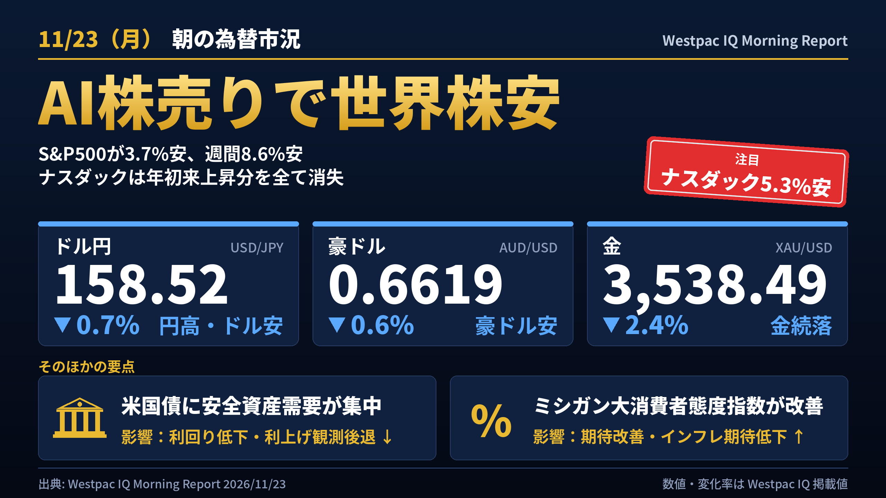
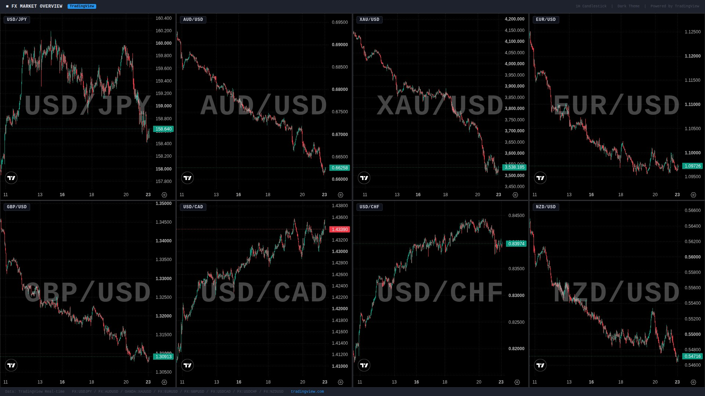

検証結果: **PASS** ／ モード: LIVE ／ 生成: 2026-11-23T08:02:53+09:00

## 本日の投稿素材
- 生成物フォルダ: https://github.com/MFlab-inc/westpac-morning-report/tree/main/outputs/2026-11-23
- レポート画像（投稿1に添付）: https://github.com/MFlab-inc/westpac-morning-report/raw/main/outputs/2026-11-23/report_image.png
- チャート画像（投稿2に添付）: https://github.com/MFlab-inc/westpac-morning-report/raw/main/outputs/2026-11-23/charts_1h.jpg

## 1. レポート画像（X投稿1に添付）


## 2. チャート画像（X投稿2に添付）


## 3. X投稿1（コピー用｜加重文字数 394）
```text
【11/23(月) 朝の為替市況】

■AnthropicIPO
→S&P500が3.7%安、週間8.6%安と大幅下落
→ナスダックは5.3%安で年初来上昇分を全て消失
→日経225も5.1%安、ASX200は4年超ぶりの週間大幅安

■米国債
→安全資産需要で2年債利回りが11bp低下
→12月FRB利上げの織り込みが後退、年末FF金利は4.11%へ

■ミシガン大消費者態度指数
→11月最終値は51.0から51.5へ改善
→1年先インフレ期待は4.3%から3.7%へ低下

#ドル円 #米消費者態度指数
```

## 4. X投稿2（コピー用｜加重文字数 696）
```text
【通貨別分析 11/23】

#USDJPY 158.52 ↓ 円高・ドル安
根拠：円が0.7%上昇。DXYは0.1%低下し103.81、米2年債利回りは11bp低下、10年債は10bp低下した。

#AUDUSD 0.6619 ↓ 豪ドル安
根拠：AUD/USDは0.6%下落。週間では対ドルで2.1%の下落となった。ASX200は1.6%安、TWIも0.2%低下した。

#XAUUSD 3538.49 ↓ 金続落
根拠：金は2.4%下落し3,500ドル強。週間では5.2%安。銅も2.9%下落し、CRBインデックスも0.5%低下した。

#EURUSD 1.0969 → ほぼ横ばい
根拠：ユーロは前日比0.0%と横ばい。ユーロ圏消費者信頼感指数は-17.9から-16.9へ改善した。

#GBPUSD → ほぼ横ばい
根拠：ポンドはほぼ横ばい。英国小売売上高は10月に前月比0.7%増と予想を上回ったが、9月分は-0.6%へ下方修正された。

出典: Westpac IQ Morning Report 2026/11/23
#ドル円 #為替
```

## 5. レポート本文
<details><summary>クリックで全文を表示</summary>

# 2026年11月23日（月） Westpac IQ Morning Report

## 1. ファンダメンタルズ・マクロ経済分析

AnthropicのIPO後にAI関連株の売りが加速し、世界的な株安が続いた。S&P500は3.7%下落し週間では8.6%の損失を記録。ナスダックは5.3%安と年初来の上昇分を全て消失し、ダウ平均も1.9%下落した。欧州ではユーロ・ストックス50が2.8%安、FTSE100が1.0%安。アジアでもKOSPIが5.2%安、日経225が5.1%安、ハンセン指数が1.9%安と広範な下落となった。国内ではASX200が1.6%下落し、4年超ぶりの大幅な週間下落（5.4%安）を記録した。マイニング株はAI関連コモディティトレードの巻き戻しで重荷となった。

米国債は株式市場の混乱の中で安全資産需要を集め、大幅に上昇した。2年債利回りは11bp低下、10年債利回りは10bp低下した。先物市場は12月の利上げ織り込みを後退させ、年末のフェデラルファンズ金利の織り込みは4.11%となった。一方、2027年1月・3月の利上げは引き続き完全に織り込まれている。豪州国債利回りは週末にかけてほぼ横ばいで、3年債が1bp低下、10年債が2bp低下した。スワップ市場は予想を下回った雇用統計を受けてRBAの利上げサイクルが終了したとみており、2027年8月までの利下げを完全に織り込んでいる。

国際データでは、米ミシガン大学消費者態度指数（11月最終値）が51.0から51.5へ改善した。現況指数は悪化したが、期待指数が2pt改善し52.9となり全体を押し上げた。1年先インフレ期待は初回推計の4.3%から3.7%へ改善し、5年先も3.4%から3.3%へ小幅低下した。ユーロ圏消費者信頼感指数（11月速報）は-17.9から-16.9へ上昇した。現水準は過去5年平均（-15.5）とほぼ並ぶが、全期間平均（-9.6）は下回る。英国GfK消費者信頼感指数は11月に-24から-22へ改善し、過去5年平均並みだが全期間水準（-11）は下回る。英国小売売上高は10月に予想を上回る前月比0.7%増となった。ただし9月分は-0.4%から-0.6%へ下方修正された。自動車燃料を除くコア小売売上高は10月に0.9%増となり、前年比では2.5%増となった。

コモディティでは、原油が小幅上昇した一方、週間では下落した。金は2.4%下落し3,500ドル強で推移し、週間では5.2%の下落となった。銅も2.9%下落し12,000ドル強の水準にとどまった。アルミニウムは1.6%下落し、鉄鉱石は0.1%の小幅上昇にとどまった。

## 2. テクニカル分析と本日の展望

### USD/JPY ― 下落（↓）

現値：158.52（前日比-0.7%）。原文に「円が安全資産需要で0.7%上昇した」と明記されており、USD/JPYは下落（円高・ドル安）と判断する。DXYは0.1%低下し103.81、米2年債利回りは11bp低下、10年債利回りは10bp低下した。株式市場の混乱の中、安全資産としての円需要が高まる地合いが続いている。本日は米国・欧州・英国のPMI速報値が発表予定であり、結果次第でドルの方向感に影響を与える可能性がある。

### AUD/USD ― 下落（↓）

現値：0.6619（前日比-0.6%）。週間では対ドルで2.1%の下落となった。原文は「リスクオフ地合いの中でAUDが下落した」と記載している。TWIも0.2%低下し62.1となった。ASX200が1.6%下落し、マイニング株が重荷となる中、豪ドルへの売り圧力が続いた。本日はNZ実質小売売上高（Q3）の発表があり、NZDの動向がAUDにも影響しうる。

### XAU/USD ― 下落（↓）

現値：3,538.49ドル（前日比-2.4%）。週間では5.2%の下落となっており、下落基調が続いている。銅も2.9%下落し、アルミニウムも1.6%下落するなど、コモディティ全般に売りが広がる中での動きとなっている。CRBインデックスも0.5%低下した。

### EUR/USD ― 横ばい（→）

現値：1.0969（前日比0.0%）。原文は「ユーロはほぼ横ばい」と記載している。ユーロ圏消費者信頼感指数（11月速報）は-17.9から-16.9へ改善したが、為替への影響は限定的だった。本日はユーロ圏のS&PグローバルPMI速報値（製造業・サービス業）が発表予定であり、注目される。

### GBP/USD ― 横ばい（→）

原文のFXレート表にGBP/USDの現値の記載なし。方向感の導出について：原文は「ポンドはほぼ横ばい（sterling were broadly unchanged）」と直接記載しているため、これを最優先の根拠とし、GBP/USDは横ばいと判断する。なお参考として、AUD/USD前日比-0.6%、AUD/GBP前日比-0.6%からクロス計算すると、GBP/USDの変化率≒-0.6%-(-0.6%)=0.0%となり、原文の「ほぼ横ばい」と整合する。英国小売売上高は10月に前月比0.7%増と予想を上回ったが、9月分は下方修正された。本日は英国のS&PグローバルPMI速報値が発表予定。

## 3. 本日の重要イベント

| 時刻(JST) | 国 | イベント | 予想 | 前回 |
|---|---|---|---|---|
| 6:45 | NZ | 実質小売売上高 Q3 | 0.5% | -0.5% |
| 18:00 | EZ | S&Pグローバル製造業PMI 11月速報 | 52.7pts | 52.7pts |
| 18:00 | EZ | S&Pグローバルサービス業PMI 11月速報 | 51.8pts | 51.4pts |
| 18:30 | GB | S&Pグローバル製造業PMI 11月速報 | 53pts | 52.8pts |
| 18:30 | GB | S&Pグローバルサービス業PMI 11月速報 | 53pts | 52.8pts |
| 22:30 | US | シカゴ連銀全米活動指数 10月 | 0.2pts | 0.1pts |
| 23:45 | US | S&Pグローバル製造業PMI 11月速報 | 54.4pts | 54.9pts |
| 23:45 | US | S&Pグローバルサービス業PMI 11月速報 | 55.5pts | 56.1pts |

出典: Westpac IQ Morning Report 2026/11/23

</details>

## 6. 機械検証ゲート
| ゲート | 判定 | 詳細 |
|---|---|---|
| G1 日付整合 | ✅ PASS | date_jst=2026-11-23 / 本文に「2026年11月23日」/ 投稿2と本文に「2026/11/23」を要求 |
| G2 暗号通貨語の混入ゼロ | ✅ PASS |  |
| G3 対象5ペア限定 | ✅ PASS |  |
| G4 プレースホルダ残存なし | ✅ PASS |  |
| G5 出典表記（本文・投稿2） | ✅ PASS |  |
| G6 規定ハッシュタグ | ✅ PASS |  |
| G7 投稿にURLなし（Intent URL禁止） | ✅ PASS |  |
| G8 数値のPDF原文照合 | ✅ PASS | 23個の数値を照合しすべて原文に存在 |
| G9 イベント時刻JST換算チェック | ✅ PASS | 時差2時間で換算した期待値['06:45', '18:00', '18:30', '22:30', '23:45']と本文イベント表['06:45', '18:00', '18:30', '22:30', '23:45']が一致 |
| G10 投稿2に「未確認」を含めない | ✅ PASS |  |
| G11 通貨ペア方向感の照合 | ✅ PASS | 4ペアの向きが原文と一致（判定対象外: GBP/USD） |
| G12 画像の見出し・注目バッジ | ✅ PASS | 見出し10文字・バッジ10文字（数値は原文と照合済み） |
| I1 post1 加重文字数 | ℹ️ INFO | 394 |
| I2 post2 加重文字数 | ℹ️ INFO | 696 |
| I3 post1 →行の読点過多 | ℹ️ INFO | なし |

## 7. 投稿手順（方式A：手動投稿）
- [ ] 画像2枚と投稿文を確認した
- [ ] 投稿1をXへ投稿した（レポート画像を添付）
- [ ] 投稿2をXへ投稿した（チャート画像を添付）
- [ ] このIssueをCloseした（＝投稿完了の記録）

---
生成物: [`outputs/2026-11-23/`](https://github.com/MFlab-inc/westpac-morning-report/tree/main/outputs/2026-11-23) ／ 元PDF: https://library.westpaciq.com.au/content/dam/public/westpaciq/secure/economics/documents/aus/2026/11/WBC_MorningReport23Nov2026.pdf
修正したい場合はこのIssueにコメントを残し、翌日以降の改善に反映します（フェーズ2で再生成コマンドに対応予定）。