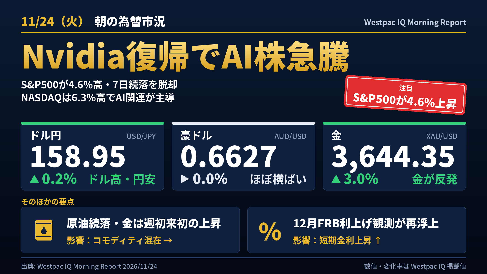
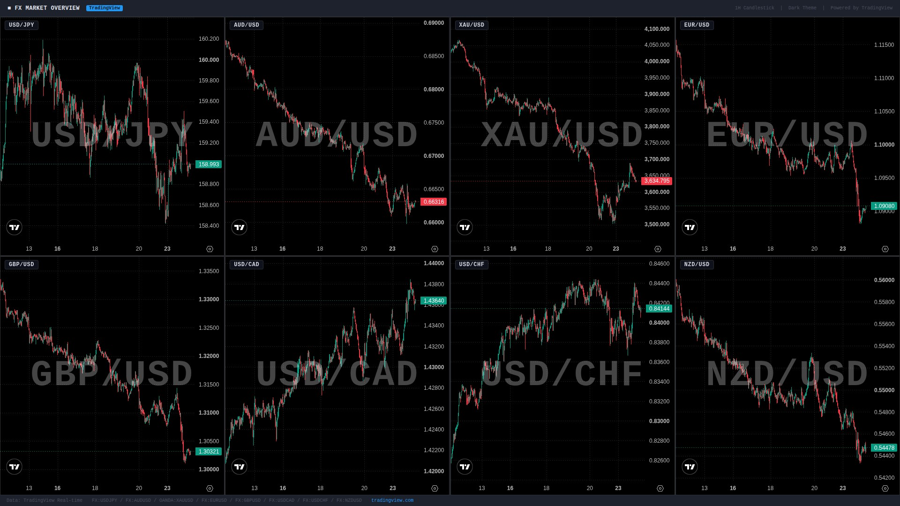

検証結果: **PASS** ／ モード: LIVE ／ 生成: 2026-11-24T08:04:54+09:00

## 本日の投稿素材
- 生成物フォルダ: https://github.com/MFlab-inc/westpac-morning-report/tree/main/outputs/2026-11-24
- レポート画像（投稿1に添付）: https://github.com/MFlab-inc/westpac-morning-report/raw/main/outputs/2026-11-24/report_image.png
- チャート画像（投稿2に添付）: https://github.com/MFlab-inc/westpac-morning-report/raw/main/outputs/2026-11-24/charts_1h.jpg

## 1. レポート画像（X投稿1に添付）


## 2. チャート画像（X投稿2に添付）


## 3. X投稿1（コピー用｜加重文字数 392）
```text
【11/24(火) 朝の為替市況】

■Nvidia復帰
→ジェンセン・ファン氏のCEO復帰でAI株が急反発
→S&P500が4.6%高と7日続落を脱却
→NASDAQは6.3%高、ダウ平均は3.0%高

■原油・金
→Brentが3.7%安の89.2ドルと90ドルを下回る
→WTIは4.1%安の80.0ドル
→金は3.0%高の3,644.35ドルと1週間超ぶりに反発

■FRB利上げ観測
→12月利上げ観測が再浮上、年末FF金利想定4.14%へ
→2年債利回りは1bp上昇、10年債利回りは3bp低下

#ドル円 #FOMC
```

## 4. X投稿2（コピー用｜加重文字数 728）
```text
【通貨別分析 11/24】

#USDJPY 158.95 ↑ ドル高・円安
根拠：円は対ドルで0.2%下落。DXYは0.5%高の104.36、12月FRB利上げ観測が再浮上し年末FF金利想定は4.14%に上昇。

#AUDUSD 0.6627 → ほぼ横ばい
根拠：AUD/USDは前日比0.0%。DXYが0.5%上昇する中、豪ドルは主要通貨の中で相対的に底堅く推移した。

#XAUUSD 3,644.35ドル ↑ 金が反発
根拠：金は3.0%高と1週間超ぶりに上昇。VIX指数は23.4%低下して27.48となった。

#EURUSD 1.0903 ↓ ユーロ安・ドル高
根拠：ユーロは対ドルで0.6%下落。ユーロ圏サービスPMI11月速報は51.4から51.2へ低下し、DXY+0.5%の流れが続いた。

#GBPUSD ↓ ポンド安・ドル高
根拠：ポンドは対ドルで0.4%下落。英サービスPMI11月速報は52.8から52.0へ低下し、DXY+0.5%の中でポンドも軟化した。

出典: Westpac IQ Morning Report 2026/11/24
#ドル円 #為替
```

## 5. レポート本文
<details><summary>クリックで全文を表示</summary>

# 2026年11月24日（火） Westpac IQ Morning Report

## 1. ファンダメンタルズ・マクロ経済分析

Nvidiaのジェンセン・ファン氏がCEOに復帰したとの報道を受け、米国・欧州株式市場はAI関連銘柄を中心に大幅上昇した。S&P500は4.6%高と7日続落から脱却し、NASDAQは6.3%上昇、ダウ平均は3.0%高となった。欧州ではユーロ・ストックス50が2.2%高、英FTSE100が1.3%高となった。一方、アジア株式市場は前週末の米国株急落を受けて大幅安となり、KOSPIは3.3%下落（韓国当局の市場安定化措置発表後に下げ幅を縮小）、ハンセン指数は0.1%安にとどまった。日本市場は休場。豪ASX200は0.3%安と8日続落し、金融・不動産セクターが重しとなった。

米国債市場では、リスク資産への需要回復を背景に短期債利回りが小幅上昇し、2年債利回りは1bp上昇して4.66%となった。一方、原油価格の一段の軟化を背景に長期債は続伸し、10年債利回りは3bp低下して4.92%となった。先物市場では12月のFRB利上げ観測が再び高まり、年末のFF金利の想定水準は4.14%に上昇、2027年3月の追加利上げも織り込まれた。豪州国債利回りは3年・10年ともに4bp低下した。スワップ市場はRBAの利上げサイクル終了を引き続き見込んでおり、2027年8月までの利下げを完全に織り込んでいる。

原油価格は続落し、Brentは3.7%安の89.2ドル/バレルと90ドルを下回り、WTIは4.1%安の80.0ドル/バレルとなった。金は3.0%高の3,644.35ドル/オンスと1週間超ぶりに上昇した。銅は2.7%高、アルミニウムは1.1%高、鉄鉱石は0.3%高となった一方、原料炭は0.8%安、ACCUは4.3%安となった。一般炭は1.2%高となった。

経済指標面では、米国のS&Pグローバル製造業PMIが11月速報値で54.9から54.5へ小幅低下し予想どおりとなった一方、サービスPMIは56.1から54.7へ低下し予想を下回った。いずれも堅調な経済成長と整合的な水準にある。シカゴ連銀全米活動指数は10月に+0.05から-0.06へ低下し、GDPがトレンド成長付近にあることと整合的な結果となった。ユーロ圏のS&Pグローバル製造業PMIは11月速報値で52.7から52.9へ小幅上昇した一方、サービスPMIは51.4から51.2へ低下した。英国のS&Pグローバル製造業PMIは11月速報値で52.7とほぼ横ばいとなった一方、サービスPMIは52.8から52.0へ低下した。ニュージーランドでは第3四半期の小売売上高が前期比2.2%増と予想を上回る結果となった。

## 2. テクニカル分析と本日の展望

### USD/JPY ― 上昇（↑）

現値は158.95（前日比+0.2%）。米ドルはAI株の急反発とともに幅広い通貨に対して強含み、DXYは0.5%上昇して104.36となった。先物市場での12月FRB利上げ観測の再浮上も背景にある中、円は対ドルで0.2%下落した。米2年債利回りは1bp上昇した一方、10年債利回りは3bp低下しており、米国債市場では短期・長期で方向が分かれた。日本の10年債利回りは2.80%で変わらずとなった。

### AUD/USD ― 横ばい（→）

現値は0.6627（前日比0.0%）。DXYが0.5%上昇する中、豪ドルは主要通貨の中で相対的に底堅く、対ドルでほぼ横ばいを維持した。リスクセンチメントの回復が豪ドルを支える中、ASX200は0.3%安と8日続落した。豪州3年・10年国債利回りはともに4bp低下した。本日は豪州国内の主要指標発表は予定されていない。

### XAU/USD ― 上昇（↑）

現値は3,644.35ドル/オンス（前日比+3.0%）。金は1週間超ぶりに上昇し、3.0%高となった。原油価格が続落する中、銅（+2.7%）やアルミニウム（+1.1%）など工業用金属も総じて上昇した。VIX指数は23.4%低下して27.48となり、リスク回避の後退が見られた。

### EUR/USD ― 下落（↓）

現値は1.0903（前日比-0.6%）。ユーロは対ドルで0.6%下落した。原文に「sterling fell 0.4% and the euro lost 0.6%」と直接記載されている。ユーロ圏のS&PグローバルサービスPMIは11月速報値で51.4から51.2へ低下した。ユーロ・ストックス50は2.2%高となったが、為替はドル高の流れに押された。ドイツ10年債利回りは2bp低下して3.29%となった。

### GBP/USD ― 下落（↓）

原文のFXレート表にGBP/USDの現値の記載なし。原文に「sterling fell 0.4%」と直接記載されており、ポンドは対ドルで0.4%下落した。英国のS&PグローバルサービスPMIは11月速報値で52.8から52.0へ低下した。英FTSE100は1.3%高となった一方、英10年債利回りは3bp低下して5.21%となった。

## 3. 本日の重要イベント

| 時刻(JST) | 国 | イベント | 予想 | 前回 |
|---|---|---|---|---|
| 9:30 | JP | S&Pグローバル製造業PMI 11月速報 | - | 53.3pts |
| 9:30 | JP | S&Pグローバルサービス業PMI 11月速報 | - | 51.7pts |
| 23:00 | US | FHFA住宅価格指数 9月 | 0.2% | 0.3% |
| 23:00 | US | S&P/ケース・シラー住宅価格指数 9月 | 0.2% | 0.3% |
| 翌0:00 | US | リッチモンド連銀製造業景気指数 11月 | -2pts | -2pts |
| 翌0:00 | US | 消費者信頼感指数 11月 | 92.2pts | 91.7pts |

出典: Westpac IQ Morning Report 2026/11/24

</details>

## 6. 機械検証ゲート
| ゲート | 判定 | 詳細 |
|---|---|---|
| G1 日付整合 | ✅ PASS | date_jst=2026-11-24 / 本文に「2026年11月24日」/ 投稿2と本文に「2026/11/24」を要求 |
| G2 暗号通貨語の混入ゼロ | ✅ PASS |  |
| G3 対象5ペア限定 | ✅ PASS |  |
| G4 プレースホルダ残存なし | ✅ PASS |  |
| G5 出典表記（本文・投稿2） | ✅ PASS |  |
| G6 規定ハッシュタグ | ✅ PASS |  |
| G7 投稿にURLなし（Intent URL禁止） | ✅ PASS |  |
| G8 数値のPDF原文照合 | ✅ PASS | 21個の数値を照合しすべて原文に存在 |
| G9 イベント時刻JST換算チェック | ✅ PASS | 時差2時間で換算した期待値['00:00', '09:30', '23:00']と本文イベント表['00:00', '09:30', '23:00']が一致 |
| G10 投稿2に「未確認」を含めない | ✅ PASS |  |
| G11 通貨ペア方向感の照合 | ✅ PASS | 5ペアの向きが原文と一致（判定対象外: なし） |
| G12 画像の見出し・注目バッジ | ✅ PASS | 見出し14文字・バッジ13文字（数値は原文と照合済み） |
| I1 post1 加重文字数 | ℹ️ INFO | 392 |
| I2 post2 加重文字数 | ℹ️ INFO | 728 |
| I3 post1 →行の読点過多 | ℹ️ INFO | なし |

## 7. 投稿手順（方式A：手動投稿）
- [ ] 画像2枚と投稿文を確認した
- [ ] 投稿1をXへ投稿した（レポート画像を添付）
- [ ] 投稿2をXへ投稿した（チャート画像を添付）
- [ ] このIssueをCloseした（＝投稿完了の記録）

---
生成物: [`outputs/2026-11-24/`](https://github.com/MFlab-inc/westpac-morning-report/tree/main/outputs/2026-11-24) ／ 元PDF: https://library.westpaciq.com.au/content/dam/public/westpaciq/secure/economics/documents/aus/2026/11/WBC_MorningReport24Nov2026.pdf
修正したい場合はこのIssueにコメントを残し、翌日以降の改善に反映します（フェーズ2で再生成コマンドに対応予定）。