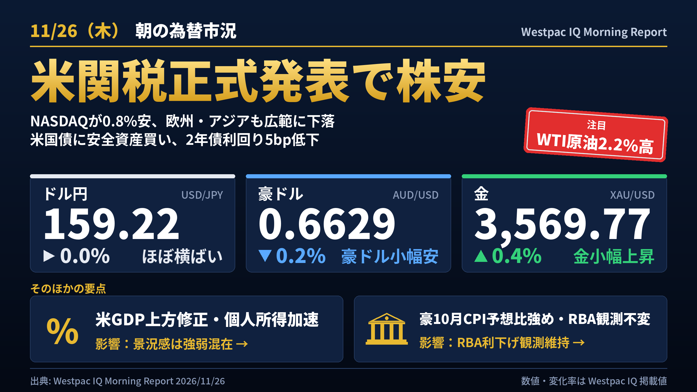
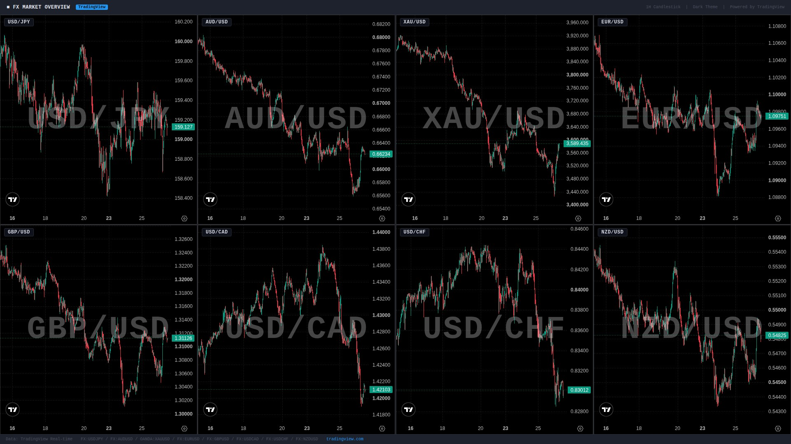

> [!CAUTION]
> 機械検証で不合格のゲートがあります。**このままXへ投稿しないでください。**
> 下の検証結果を確認し、修正が必要な場合はこのIssueにコメントで指示してください。

検証結果: **FAIL** ／ モード: LIVE ／ 生成: 2026-11-26T07:43:12+09:00

## 本日の投稿素材
- 生成物フォルダ: https://github.com/MFlab-inc/westpac-morning-report/tree/main/outputs/2026-11-26
- レポート画像（投稿1に添付）: https://github.com/MFlab-inc/westpac-morning-report/raw/main/outputs/2026-11-26/report_image.png
- チャート画像（投稿2に添付）: https://github.com/MFlab-inc/westpac-morning-report/raw/main/outputs/2026-11-26/charts_1h.jpg

## 1. レポート画像（X投稿1に添付）


## 2. チャート画像（X投稿2に添付）


## 3. X投稿1（コピー用｜加重文字数 467）
```text
【11/26(木) 朝の為替市況】

■米新関税
→新関税が正式発表され、NASDAQは0.8%安
→欧州・アジアも広範に下落（日経平均2.8%安、ソウル6.2%安）
→米国債に安全資産買い、2年債利回り5bp低下・10年債8bp低下

■米経済指標
→Q3GDP年率4.3%に上方修正（速報値3.4%）
→個人所得10月0.7%増、予想0.4%を上回る
→ベージュブックは消費・住宅・雇用に慎重な見方

■豪CPI
→10月ヘッドラインCPI前年比4.9%、予想をやや上回る
→トリム平均も前年比3.8%と小幅上振れ
→WestpacのRBA見通しへの影響なし

#ドル円 #豪CPI
```

## 4. X投稿2（コピー用｜加重文字数 811）
```text
【通貨別分析 11/26】

#USDJPY 159.22 → ほぼ横ばい
根拠：前日比0.0%。米2年債利回り5bp低下・10年債8bp低下の中、DXYは0.1%安の103.68にとどまり、USD/JPYはほぼ変化なし。

#AUDUSD 0.6629 ↓ 豪ドル小幅安
根拠：前日比0.2%安。豪10月CPIが予想をやや上回ったが、豪ドルはDXYの軟化とは逆行して下落。リスクオフの中で広範な株安が続く。

#XAUUSD 3569.77 ↑ 金小幅上昇
根拠：前日比0.4%上昇。米国債利回りが大幅低下する中、金はおおむね横ばい圏で底堅く推移。銅は1.5%下落しサイクル安値を更新。

#EURUSD 1.0979 ↑ ユーロ小幅高
根拠：前日比0.1%上昇。DXYが0.1%安の103.68と軟化する中、ユーロはドル安の恩恵を受けた。ドイツ10年債利回りは4bp低下して3.23%。

#GBPUSD ↑ ポンド小幅高
根拠：ポンドは対ドルで0.1%上昇。DXYが0.1%安となる中、英10年債利回りは5bp低下して5.13%。FTSE 100は0.4%安。

出典: Westpac IQ Morning Report 2026/11/26
#ドル円 #為替
```

## 5. レポート本文
<details><summary>クリックで全文を表示</summary>

# 2026年11月26日（木） Westpac IQ Morning Report

## 1. ファンダメンタルズ・マクロ経済分析

米国の新たな関税が正式に発表される中、株式市場はテック株からの資金流出も重なり広範に下落した。NASDAQは0.8%安、S&P 500は0.3%安となった一方、ダウ・ジョーンズは0.4%上昇した。欧州ではユーロ・ストックス50が1.8%安、FTSE 100が0.4%安。アジアでは東京（日経平均2.8%安）、香港（ハンセン1.1%安）、上海（1.7%安）、ソウル（6.2%安）と軒並み下落した。ASX 200も0.4%安となったが、先物は朝方のより強い寄り付きを示唆している。

米国債は安全資産としての買いが続き、ブル・スティープニングとなった。2年債利回りは5bp低下して4.64%、10年債利回りは8bp低下して4.85%となった。ドイツ10年債（4bp低下）、日本10年国債（10bp低下）、英国10年債（5bp低下）など主要市場でも利回りが低下した。豪州では予想比強めのインフレ指標発表後もACGB利回りが低下し、3年・10年先物利回りはそれぞれ3bp低下して4.43%・4.80%となった。スワップ市場はRBAの最初の利下げを8月までに織り込んでいるが、年末までの利下げ幅については不確実性が残る。

米国の経済指標では、個人所得が10月に0.7%増と9月の0.3%から加速し、予想の0.4%を上回った。個人消費支出は10月に0.3%増と予想をやや下回ったが、9月分が0.6%へ上方修正されたことで一部相殺された。ただし9月・10月の消費増加は価格上昇によるもので、実質消費は9月が0.1%増、10月は横ばいにとどまった。ヘッドライン・コアPCEインフレはともに月次0.3%と予想どおりで、年率はそれぞれ3.8%・3.3%へ上昇した。米Q3GDP成長率（年率換算）は第2次推計で3.4%から4.3%へ上方修正された。個人消費が3.8%から4.2%へ引き上げられたほか、設備投資（データセンター関連の非住宅建設・知的財産）も広範に上振れた。耐久財受注は10月に0.2%増と9月の2.0%増から鈍化し予想を下回ったが、コア受注（航空・国防除く）は1.2%増と安定した伸びを維持した。新築住宅販売は10月に14.2%増と9月の9.7%減から反発した。新規失業保険申請件数は前週の202千件から189千件へ低下した。

FRBのベージュブックは直近の堅調な経済指標より慎重な内容で、12地区のうち8地区が「わずかから緩やかな成長」を報告し、4地区は変化なしとした。消費支出はほぼ横ばいで、家計は価格に敏感で裁量的支出を選別する傾向が強まっているとされた。住宅市場は購入能力の問題から需要が抑制され、商業用不動産は区々の状況となった。雇用は全体としてわずかに増加し、多くの企業が採用を離職補充に限定していると報告した。物価は前回報告期間と同様に全体として緩やかに上昇し、投入コストの上昇が販売価格の上昇を上回る状況が続いているとされた。

豪州では、10月のCPIがヘッドラインベース（前月比0.5%・前年比4.9%）・トリム平均ベース（前月比0.5%・前年比3.8%）ともに予想をやや上回ったが、これがインフレのピークとなる可能性が高い。この結果はWestpacのRBA見通しに影響を与えない。また、Q3の建設活動は0.9%増と予想を上回り、住宅建設および非住宅建設が牽引した。

コモディティ市場では、中東の緊張が続く中、原油価格が上昇した。Brentは3.3%高の94.4米ドル/バレル。LME銅は脆弱なリスク心理の中で1.5%下落し、サイクル安値を更新した。金価格はおおむね横ばいで3,550米ドル/オンス近辺で推移した。

## 2. テクニカル分析と本日の展望

### USD/JPY ― ほぼ横ばい（→）

現値は159.22（前日比0.0%）。米国債利回りが2年債5bp低下・10年債8bp低下と大幅に低下する中、USD/JPYはほぼ変化なしで推移した。DXYは0.1%安の103.68と小幅に軟化した。日本10年国債利回りも10bp低下して2.64%となっており、内外金利差の縮小が限定的な動きにとどまった背景にある。本日は米国が感謝祭の祝日で市場参加者が少なく、流動性の低下に注意が必要。

### AUD/USD ― 下落（↓）

現値は0.6629（前日比0.2%安）。豪州の10月CPI（ヘッドライン4.9%・トリム平均3.8%）が予想をやや上回ったにもかかわらず、豪ドルはDXYの小幅軟化とは逆行して下落した。広範なリスクオフの流れの中でAUD/JPYも0.2%安の105.54、AUD/GBPも0.2%安の0.5051となっており、豪ドルは主要通貨に対して軟調だった。本日は豪州の民間設備投資（Q3）が発表される。

### XAU/USD ― 上昇（↑）

現値は3,569.77米ドル/オンス（前日比0.4%上昇）。金価格はおおむね横ばいで3,550米ドル/オンス近辺と報告されており、データスナップショット上は3,569.77と小幅上昇を示している。米国債利回りの低下やリスクオフの環境の中、金は底堅い動きとなった。銅が1.5%下落してサイクル安値を更新するなどコモディティ全般が軟調な中、金は相対的に堅調を維持した。

### EUR/USD ― 上昇（↑）

現値は1.0979（前日比0.1%上昇）。DXYが0.1%安の103.68と軟化する中、ユーロは対ドルで小幅上昇した。原文には「ユーロ（+0.1%）とスターリング（+0.1%）がドル安の恩恵を最も受けた」と記載されている。ユーロ圏ではユーロ・ストックス50が1.8%安と大幅下落し、ドイツ10年債利回りも4bp低下して3.23%となった。本日はユーロ圏のM3マネーサプライ（10月）が発表される。

### GBP/USD ― 上昇（↑）

原文のFXレート表にGBP/USDの現値の記載なし。原文には「スターリング（+0.1%）がドル安の恩恵を受けた」と直接記載されているため、GBP/USDは前日比0.1%上昇と判断する。英国10年債利回りは5bp低下して5.13%となった。FTSE 100は0.4%安と下落したが、ポンドは対ドルで小幅上昇した。

## 3. 本日の重要イベント

| 時刻(JST) | 国 | イベント | 予想 | 前回 |
|---|---|---|---|---|
| 10:30 | AU | 民間設備投資 Q3 | 4.2% | -3.6% |
| 18:00 | EZ | M3マネーサプライ 10月 | 3.5% | 3.5% |
| - | US | 感謝祭祝日（市場休場） | - | - |
| - | SK | 韓国銀行政策金利決定 | 3.25% | 3.00% |

出典: Westpac IQ Morning Report 2026/11/26

</details>

## 6. 機械検証ゲート
| ゲート | 判定 | 詳細 |
|---|---|---|
| G1 日付整合 | ✅ PASS | date_jst=2026-11-26 / 本文に「2026年11月26日」/ 投稿2と本文に「2026/11/26」を要求 |
| G2 暗号通貨語の混入ゼロ | ✅ PASS |  |
| G3 対象5ペア限定 | ✅ PASS |  |
| G4 プレースホルダ残存なし | ✅ PASS |  |
| G5 出典表記（本文・投稿2） | ✅ PASS |  |
| G6 規定ハッシュタグ | ✅ PASS |  |
| G7 投稿にURLなし（Intent URL禁止） | ✅ PASS |  |
| G8 数値のPDF原文照合 | ✅ PASS | 15個の数値を照合しすべて原文に存在 |
| G9 イベント時刻JST換算チェック | ❌ FAIL | 時差2時間で換算した期待値['09:30', '18:00']と本文イベント表['10:30', '18:00']が不一致（原文時刻['11:30', '20:00']。原文のAEST/AEDT表記は無視しzoneinfoベースの時差2時間を正としている） |
| G10 投稿2に「未確認」を含めない | ✅ PASS |  |
| G11 通貨ペア方向感の照合 | ✅ PASS | 4ペアの向きが原文と一致（判定対象外: GBP/USD） |
| G12 画像の見出し・注目バッジ | ✅ PASS | 見出し10文字・バッジ10文字（数値は原文と照合済み） |
| I1 post1 加重文字数 | ℹ️ INFO | 467 |
| I2 post2 加重文字数 | ℹ️ INFO | 811 |
| I3 post1 →行の読点過多 | ℹ️ INFO | なし |

## 7. 投稿手順（方式A：手動投稿）
- [ ] 画像2枚と投稿文を確認した
- [ ] 投稿1をXへ投稿した（レポート画像を添付）
- [ ] 投稿2をXへ投稿した（チャート画像を添付）
- [ ] このIssueをCloseした（＝投稿完了の記録）

---
生成物: [`outputs/2026-11-26/`](https://github.com/MFlab-inc/westpac-morning-report/tree/main/outputs/2026-11-26) ／ 元PDF: https://library.westpaciq.com.au/content/dam/public/westpaciq/secure/economics/documents/aus/2026/11/WBC_MorningReport26Nov2026.pdf
修正したい場合はこのIssueにコメントを残し、翌日以降の改善に反映します（フェーズ2で再生成コマンドに対応予定）。