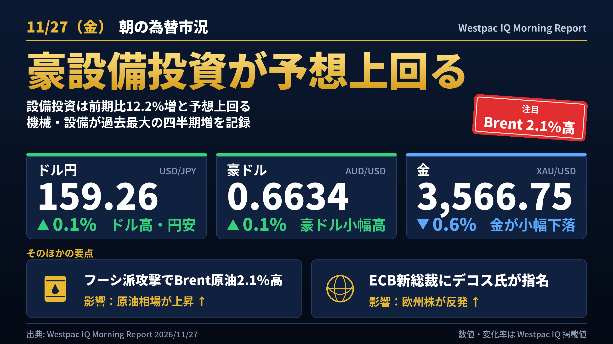
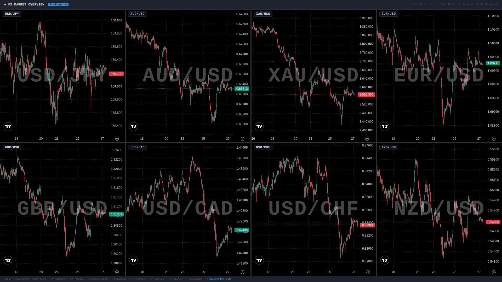

検証結果: **PASS** ／ モード: LIVE ／ 生成: 2026-11-27T07:42:56+09:00

## 本日の投稿素材
- 生成物フォルダ: https://github.com/MFlab-inc/westpac-morning-report/tree/main/outputs/2026-11-27
- レポート画像（投稿1に添付）: https://github.com/MFlab-inc/westpac-morning-report/raw/main/outputs/2026-11-27/report_image.png
- チャート画像（投稿2に添付）: https://github.com/MFlab-inc/westpac-morning-report/raw/main/outputs/2026-11-27/charts_1h.jpg

## 1. レポート画像（X投稿1に添付）


## 2. チャート画像（X投稿2に添付）


## 3. X投稿1（コピー用｜加重文字数 509）
```text
【11/27(金) 朝の為替市況】

■豪設備投資
→第3四半期の民間設備投資が前期比12.2%増と予想を上回る
→機械・設備が過去最大の四半期増（前期比23.1%増）を記録
→RBAの利下げ観測（最初の利下げは8月）に変化なし

■原油市場
→フーシ派がサウジのジャザン製油所と紅海港湾を攻撃
→OPEC+が現行生産枠の1月延長を検討中と伝わる
→Brent先物が2.1%上昇し96.6ドル

■欧州市場
→ユーロ・ストックス50が2.0%高、FTSE100が1.7%高と反発
→ECB新総裁にスペイン中銀前総裁のデコス氏が指名
→金先物は0.6%下落し3,570ドルと15か月ぶり安値に接近

#ドル円 #原油
```

## 4. X投稿2（コピー用｜加重文字数 794）
```text
【通貨別分析 11/27】

#USDJPY 159.26 ↑ ドル高・円安
根拠：前日比+0.1%。米国が感謝祭で休場となる薄商いの中、DXYも+0.1%の103.77。米10年債利回りは4.85%で横ばい。

#AUDUSD 0.6634 ↑ 豪ドル小幅高
根拠：前日比+0.1%。豪Q3民間設備投資が前期比12.2%増と予想を上回ったが、RBA利下げ観測への影響は限定的。AUDは対NZDで0.4%上昇。

#XAUUSD 3,566.75 ↓ 金が小幅下落
根拠：前日比−0.6%。金先物は3,570ドルと15か月ぶり安値に接近。市場がよりタカ派的なFRBの見通しを織り込む中での下落。

#EURUSD 1.0972 → 横ばい継続
根拠：前日比0.0%。ECB新総裁にデコス氏が指名される中、ユーロ・ストックス50は2.0%上昇。10年独国債利回りは2bp上昇し3.25%。

#GBPUSD → ほぼ横ばい
根拠：英2年物国債利回りが7bp上昇しFTSE100が1.7%高と英国市場は堅調。AUD/GBPとAUD/USDがともに+0.1%で推移。

出典: Westpac IQ Morning Report 2026/11/27
#ドル円 #為替
```

## 5. レポート本文
<details><summary>クリックで全文を表示</summary>

# 2026年11月27日（金） Westpac IQ Morning Report

## 1. ファンダメンタルズ・マクロ経済分析

米国市場は感謝祭の祝日で休場となり、グローバル市場は水曜日のウォール街の終盤の回復を引き継ぐ形で推移した。欧州株はユーロ・ストックス50が2.0%上昇、英FTSE100が1.7%（3週間超ぶりの大幅高）と2日続落から反発した。アジア株も総じて堅調で、日経225が0.9%高、ハンセン指数が1.2%高、ASX200が0.8%高となった。ただし、NvidiaがAIハードウェアメーカーに東南アジア向けサーバー出荷の停止を通達したとの報道を受け、アジア株の上昇幅は一部縮小した。韓国コスピは0.3%上昇し、韓国銀行が広く予想されていた25bpの利上げを実施するとともに2027年の成長見通しを大幅に上方修正したことが支援材料となった。

債券市場は概ね落ち着いた動きだったが、英国の短期ゾーンが軟調で、2年物英国債利回りが7bp上昇した一方、10年物は2bp上昇にとどまった。10年物独国債利回りも2bp上昇した。豪州国債（ACGB）利回りはほぼ横ばいで、3年債が1bp低下し4.48%、10年債は4.82%で変わらずだった。

国内データでは、豪州の民間設備投資が2026年第3四半期に前期比12.2%増と予想を上回る大幅な伸びを示した。6月四半期の結果も1.6ポイント上方修正され、年間成長率は18.6%に加速した。この上昇は主に機械・設備の強さによるもので、前期比23.1%増・前年比34.3%増と過去最大の四半期増を記録した。ただし、この強い設備投資データはACGB利回りやRBAの利下げ観測をほとんど動かさず、最初の利下げは依然として8月が織り込まれている。

国際データでは、スペイン中央銀行前総裁のパブロ・エルナンデス・デ・コス氏がブリュッセルでの首脳会議を経てクリスティーヌ・ラガルド氏のECB総裁後任として発表された。欧州議会とECB理事会が今後数か月以内に正式に承認する見通し。なお、10月のECB理事会議事録では、インフレ見通しが悪化しており、インフレ見通しが大幅に改善しない限り「さらなる引き締めが必要になる可能性が高い」との見解でメンバーが概ね一致していたことが示された。

コモディティ市場では大きな動きがあった。フーシ派がサウジアラビアのジャザン製油所と紅海の港湾を攻撃し、サウジ主導の連合軍がその後攻撃に使用された弾道ミサイル発射台を破壊したと発表した。OPEC+はイラン戦争をめぐる不確実性の中、日曜日のオンライン会合を前に現行の生産枠を1月まで延長することを検討していると伝えられている。Brent先物は2.1%上昇し96.6ドル/バレルとなった。銅はAI関連取引の安定化を背景に11か月ぶり安値から1.9%反発し、アルミニウムも2.1%上昇した。金先物は0.6%下落し3,570ドル/オンスとなり、15か月ぶり安値に接近している。

## 2. テクニカル分析と本日の展望

### USD/JPY ― 上昇（↑）

現値は159.26（前日比+0.1%）。米国市場が感謝祭で休場となる中、取引量が薄い状況でDXYが0.1%上昇し103.77となる中、USD/JPYも0.1%上昇した。日本の10年債利回りは1bp低下し2.63%、米10年債利回りは4.85%で変わらずだった。薄商いの中での小幅な動きにとどまっている。

### AUD/USD ― 上昇（↑）

現値は0.6634（前日比+0.1%）。豪州の第3四半期民間設備投資が前期比12.2%増と予想を上回る結果となったが、RBAの利下げ観測への影響は限定的で、AUD/USDの動きも小幅にとどまった。AUDは対NZDで0.4%上昇した。DXYが0.1%上昇する中でのAUD/USDの小幅上昇となっている。

### XAU/USD ― 下落（↓）

現値は3,566.75ドル（金先物は3,570ドル/オンス、前日比−0.6%）。金は15か月ぶり安値に接近しており、変動性の高い局面が続いている。原文では、市場がよりタカ派的なFRBの見通しを織り込み続ける中で金先物が下落したと記載されている。Brent原油が2.1%上昇する一方、金は下落する展開となった。

### EUR/USD ― 横ばい（→）

現値は1.0972（前日比0.0%）。EUR/USDは変わらずで推移した。ユーロ圏ではECB新総裁にデコス氏が指名され、ユーロ・ストックス50は2.0%上昇した。10年物独国債利回りは2bp上昇し3.25%となった。DXYが0.1%上昇する中でEUR/USDは横ばいを維持した。

### GBP/USD ― 上昇（↑）

原文のFXレート表にGBP/USDの現値の記載なし。方向感の導出：原文にAUD/GBP前日比+0.1%、AUD/USD前日比+0.1%の記載がある。計算式「GBP/USDの変化率 ≒ AUD/USDの変化率 − AUD/GBPの変化率」に当てはめると、+0.1% − (+0.1%) = 0.0%となり、ほぼ横ばいと推定される。ただし、英国の2年物英国債利回りが7bp上昇し、FTSE100が1.7%上昇するなど英国市場は堅調だった。AUD/GBPとAUD/USDがともに+0.1%であることから、GBP/USDはほぼ横ばいと推定されるが、英国の2年債利回りが7bp上昇と欧州内で相対的に大きく動いた点は注目される。なお、クロス計算の結果が0.0%（横ばい）のため、方向感は横ばい（→）とする。

## 3. 本日の重要イベント

| 時刻(JST) | 国 | イベント | 予想 | 前回 |
|---|---|---|---|---|
| 8:30 | JP | 東京都区部消費者物価指数 11月 | 3.1% | 2.8% |
| 10:30 | CN | 工業企業利益 10月 | - | 14.4% |
| 19:00 | EZ | 経済信頼感指数 11月 | 97.2pts | 96.9pts |
| 19:00 | EZ | 消費者信頼感指数 11月確報値 | -16.9pts | -16.9pts |
| 22:30 | US | 卸売在庫 10月速報値 | 0.5% | 0.7% |

出典: Westpac IQ Morning Report 2026/11/27

</details>

## 6. 機械検証ゲート
| ゲート | 判定 | 詳細 |
|---|---|---|
| G1 日付整合 | ✅ PASS | date_jst=2026-11-27 / 本文に「2026年11月27日」/ 投稿2と本文に「2026/11/27」を要求 |
| G2 暗号通貨語の混入ゼロ | ✅ PASS |  |
| G3 対象5ペア限定 | ✅ PASS |  |
| G4 プレースホルダ残存なし | ✅ PASS |  |
| G5 出典表記（本文・投稿2） | ✅ PASS |  |
| G6 規定ハッシュタグ | ✅ PASS |  |
| G7 投稿にURLなし（Intent URL禁止） | ✅ PASS |  |
| G8 数値のPDF原文照合 | ✅ PASS | 20個の数値を照合しすべて原文に存在 |
| G9 イベント時刻JST換算チェック | ✅ PASS | 時差2時間で換算した期待値['08:30', '10:30', '19:00', '22:30']と本文イベント表['08:30', '10:30', '19:00', '22:30']が一致 |
| G10 投稿2に「未確認」を含めない | ✅ PASS |  |
| G11 通貨ペア方向感の照合 | ✅ PASS | 4ペアの向きが原文と一致（判定対象外: GBP/USD） |
| G12 画像の見出し・注目バッジ | ✅ PASS | 見出し11文字・バッジ11文字（数値は原文と照合済み） |
| I1 post1 加重文字数 | ℹ️ INFO | 509 |
| I2 post2 加重文字数 | ℹ️ INFO | 794 |
| I3 post1 →行の読点過多 | ℹ️ INFO | なし |
| I4 イベント表の作成（時刻はプログラムで換算） | ℹ️ INFO | プログラムで作成（注記なし） |

## 7. 投稿手順（方式A：手動投稿）
- [ ] 画像2枚と投稿文を確認した
- [ ] 投稿1をXへ投稿した（レポート画像を添付）
- [ ] 投稿2をXへ投稿した（チャート画像を添付）
- [ ] このIssueをCloseした（＝投稿完了の記録）

---
生成物: [`outputs/2026-11-27/`](https://github.com/MFlab-inc/westpac-morning-report/tree/main/outputs/2026-11-27) ／ 元PDF: https://library.westpaciq.com.au/content/dam/public/westpaciq/secure/economics/documents/aus/2026/11/WBC_MorningReport27Nov2026.pdf
修正したい場合はこのIssueにコメントを残し、翌日以降の改善に反映します（フェーズ2で再生成コマンドに対応予定）。